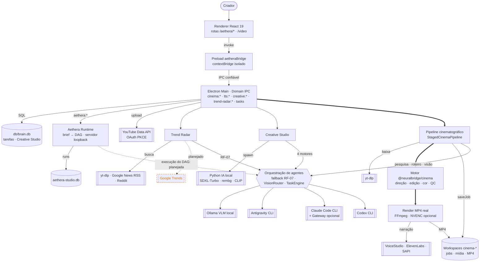

# Aethera Studio

> Estúdio audiovisual autônomo com IA para Windows: do prompt ao vídeo MP4 renderizado, com pesquisa factual, roteiro, aquisição de mídia, validação visual, narração e publicação no YouTube.

Aethera Studio é um app desktop Electron + React. A partir de um pedido em linguagem natural, ele pesquisa o tema, escreve o roteiro, decupa as cenas, busca e valida a mídia, monta a timeline, gera a narração e renderiza uma prévia MP4 real com FFmpeg. As etapas pesadas de IA rodam nos CLIs que você já autenticou (**Antigravity**, **Claude Code** e **Codex**) e em modelos locais (Ollama, SDXL-Turbo, rembg e CLIP). Os dados ficam na sua máquina, em SQLite e em arquivos de workspace.

Este repositório é um monorepo com npm workspaces. Além do Aethera, ele traz o **Singularity Orchestrator** (`apps/orchestrator-desktop`), o **Void** (`apps/void-desktop`) e o app NeuralBridge original (`apps/desktop`). A documentação anterior do NeuralBridge está em [`docs/NEURALBRIDGE-README.md`](docs/NEURALBRIDGE-README.md).

---

## Sumário

- [Arquitetura](#arquitetura)
- [Pipeline cinematográfico](#pipeline-cinematográfico)
- [Orquestração de IA](#orquestração-de-ia)
- [Módulos](#módulos)
- [Status: implementado × planejado](#status-implementado--planejado)
- [Requisitos](#requisitos)
- [Como rodar](#como-rodar)
- [Dados e segurança](#dados-e-segurança)
- [Documentação](#documentação)

---

## Arquitetura

O diagrama interativo completo, com links para o código-fonte de cada componente, está em [`docs/architecture/aethera-studio-architecture.html`](docs/architecture/aethera-studio-architecture.html). Baixe o arquivo e abra no navegador. Ele funciona offline.

Resumo (linhas tracejadas = planejado ou parcial):



| Camada | Onde fica |
|---|---|
| Renderer (React 19, react-router, TanStack Query) | `apps/aethera-desktop/src/renderer`, com páginas em `packages/desktop-shared/src/renderer` |
| Preload (`window.aetheraBridge`) | `apps/aethera-desktop/src/preload/index.ts` |
| Processo principal e IPC | `apps/aethera-desktop/src/main/index.ts`, `aethera-ipc.ts` |
| Runtime e contratos do ecossistema | `apps/aethera-desktop/src/main/runtime.ts`, `packages/integration-contracts` |
| Pipeline cinematográfico | `apps/aethera-desktop/src/main/cinema-pipeline.ts` |
| Motor de cinema | `packages/cinema` |
| Creative Studio | `packages/creative-studio`, `apps/aethera-desktop/src/main/creative-studio-service.ts` |
| Adaptadores de agentes | `packages/agents`, `apps/aethera-desktop/src/main/antigravity-cli.ts` |
| Provedores de visão | `packages/orchestrator/src/aethera/vision-providers.ts` |
| Persistência (SQLite + Drizzle) | `packages/database` |

---

## Pipeline cinematográfico

`StagedCinemaPipeline` conduz cada produção por etapas persistidas em disco. Uma produção pode ser cancelada e retomada de onde parou:

1. **Interpretação** do prompt (obra, entidades, critérios), com invalidação incremental quando o prompt muda.
2. **Pesquisa editorial** estruturada em um dossiê validado.
3. **Roteiro** gerado por agente a partir da pesquisa, com checkpoint.
4. **Decupagem** semântica: consultas específicas por cena.
5. **Aquisição** de mídia local ou via yt-dlp, seguida de **validação visual** dos frames.
6. **Planejamento** de cobertura e anti-repetição.
7. **Montagem**, depois **áudio, SFX e VFX**.
8. **Prévia**: render MP4 real com FFmpeg, cache incremental de segmentos e supervisor visual que pode rerenderizar cenas defeituosas uma vez.
9. **Editor**: timeline multifaixa para ajustes finais e exportação OTIO.

Quando falta pesquisa, roteiro ou mídia válida, a produção pausa (`paused_pending_research`, `paused_pending_script`, `paused_pending_media`) em vez de inventar fatos ou usar material irrelevante. O **Production Console** registra logs por etapa em `cinema-console-logs`.

O Evolution Core e a Academy guardam memórias de produção (regras dos diretores, feedback e materiais de estudo). Essas memórias entram nos próximos roteiros e pacotes.

---

## Orquestração de IA

Não existe um orquestrador único. Cada fluxo tem sua cadeia de fallback, e todas usam os CLIs instalados e autenticados localmente:

| Fluxo | Ordem de tentativa |
|---|---|
| Pesquisa e roteiro | Antigravity (`agy`) → `claude -p` → `codex exec` |
| Trend Radar (conselho RF-07) | Antigravity para síntese e refinamento do briefing |
| Validação visual (`VisionRouter`) | Ollama VLM local → Claude Gateway → Antigravity → Claude → Codex (via TaskEngine) → SigLIP local → heurística FFmpeg |
| Creative Studio | `claude-code`, `codex-cli`, `antigravity-cli`, `claude-gateway`, com fallback para um agente e para geração local |

O **Claude Gateway** é opcional. Quando habilitado, o Claude Code roda com `ANTHROPIC_BASE_URL`, token e modelo próprios, guardados com `safeStorage` e isolados em um perfil separado.

---

## Módulos

- **Produção com IA** (`/aethera/cinema`): pipeline completo, painel do diretor e console de produção.
- **Editor** (`/video`): timeline multifaixa, áudio, legendas, render com jobs e cancelamento.
- **Creative Studio**: thumbnails (Thumbnail Lab A/B/C), banners, avatares e marcas d'água, com editor em camadas, quality gate e geração local por SDXL-Turbo e rembg.
- **Trend Radar**: ideias de vídeo a partir de fontes verificadas (YouTube via yt-dlp, Google News RSS, Reddit), com deduplicação e briefing cinematográfico.
- **Narração**: registro de provedores TTS com VoiceStudio local (`localhost:3900`), ElevenLabs e Windows SAPI como fallback.
- **Biblioteca de mídia** gerenciada (SHA-256, caminhos portáveis), **Calendário editorial** e **Revisão e Qualidade** com release gates.
- **Publicação** no YouTube via OAuth PKCE loopback, com aprovação explícita antes do upload.
- **Backup geral** do sistema e da Academy.

---

## Status: implementado × planejado

| Item | Status |
|---|---|
| Pipeline cinematográfico, motor de cinema, render MP4, TTS, Creative Studio, Trend Radar (YouTube/News/Reddit) | Implementado |
| Pareamento com Singularity Orchestrator e Void (servidor loopback + discovery) | Implementado, opcional |
| Conector **Google Trends** do Trend Radar (`searchTrends`) | Planejado: interface declarada, sem conector |
| `Aethera Runtime.produceFromPrompt` | Parcial: cria run, DAG e metadados, mas ainda não executa os agentes |
| OAuth real do Google/YouTube | Código pronto; homologação com credenciais reais pendente |
| Instalador NSIS (`npm run dist:win:aethera`) | Configurado; execução pendente |

Detalhes e evidências em [`docs/aethera/STATUS.md`](docs/aethera/STATUS.md) e [`docs/PLAN.md`](docs/PLAN.md).

---

## Requisitos

- Windows 10/11 x64
- Node.js **22 ou superior** (`engines.node >=22`)
- FFmpeg e ffprobe no `PATH` (render e análise de frames)
- Pelo menos um agente autenticado: Antigravity CLI (`agy`), Claude Code (`claude`) ou Codex (`codex`)
- Opcionais:
  - yt-dlp (aquisição de mídia e busca no YouTube)
  - Ollama com um modelo de visão (`http://127.0.0.1:11434`, configurável por `NB_LOCAL_VLM_URL`)
  - Python com o worker do Creative Studio (`NB_PYTHON`). A GPU NVIDIA é opcional; sem ela o SDXL-Turbo roda na CPU.
  - VoiceStudio local ou uma chave ElevenLabs para narração
  - Cliente OAuth do Google para publicar no YouTube

`better-sqlite3`, `sharp` e `electron` baixam binários pré-compilados na instalação. Sem binário compatível, o `better-sqlite3` precisa das ferramentas de build do Visual Studio.

---

## Como rodar

```bash
npm ci
```

```bash
npm run dev -w @neuralbridge/aethera-desktop
```

| Comando | Faz |
|---|---|
| `npm run dev -w @neuralbridge/aethera-desktop` | Aethera em modo desenvolvimento (electron-vite) |
| `npm run build:aethera` | Build de produção do Aethera |
| `npm run typecheck -w @neuralbridge/aethera-desktop` | Typecheck do app (main + renderer) |
| `npm test` | Testes unitários (Vitest) |
| `npm run dist:win:aethera` | Instalador NSIS em `dist/aethera` |

---

## Dados e segurança

- Todos os dados ficam em `%APPDATA%/AetheraStudio`: `aethera-studio.db`, `db/brain.db`, workspaces `cinema-*`, `creative-studio/` e preferências.
- O renderer roda com `contextIsolation` e sem `nodeIntegration`. Cada handler IPC valida a origem (`ensureTrusted` / `isTrustedSender`).
- O protocolo `aethera-media://` serve apenas arquivos de mídia existentes, com extensões permitidas.
- Credenciais (ElevenLabs, Claude Gateway, OAuth, IGDB) são cifradas com `safeStorage`.
- Agentes chamados pelo runtime rodam em modo `read-only`. Publicação e upload exigem confirmação explícita.

---

## Documentação

- [Diagrama interativo de arquitetura](docs/architecture/aethera-studio-architecture.html)
- [Status do Aethera](docs/aethera/STATUS.md) · [Plano](docs/PLAN.md)
- [Motor de cinema](docs/aethera/cinema/) · [Creative Studio](docs/plans/aethera-creative-studio.md)
- [Separação do ecossistema Singularity](docs/architecture/SEP-2026-01-BASELINE.md) · [Contratos](docs/architecture/ADR-SEP-02-CONTRACTS.md)
- [README anterior do NeuralBridge](docs/NEURALBRIDGE-README.md)
