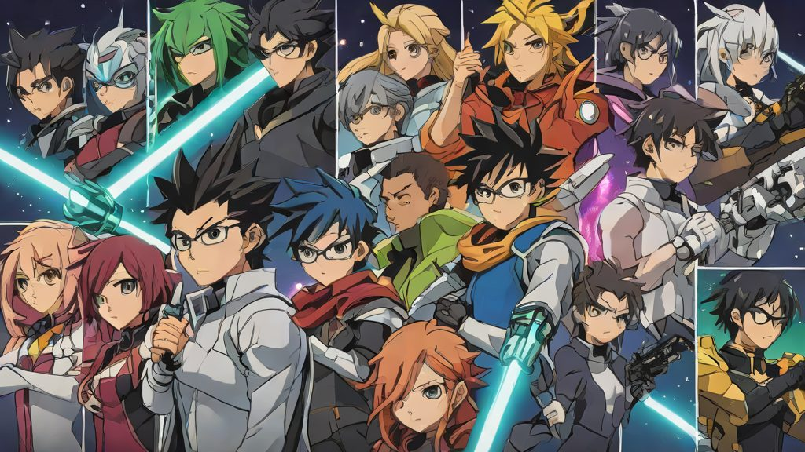
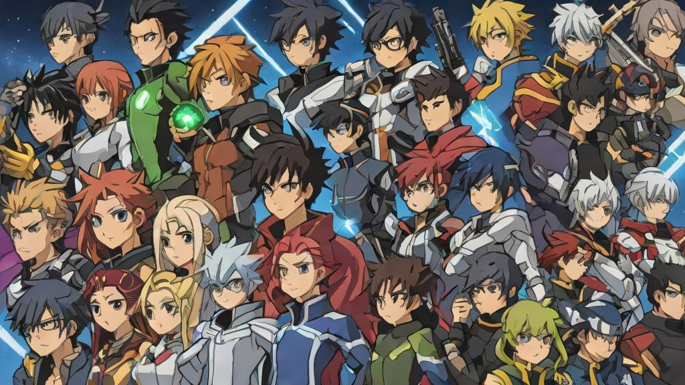
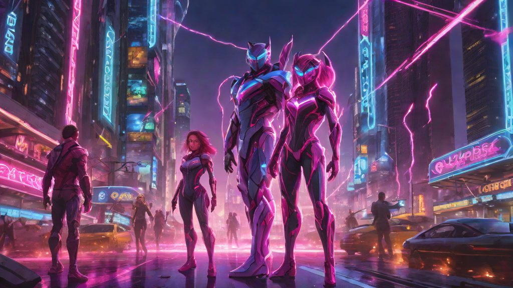
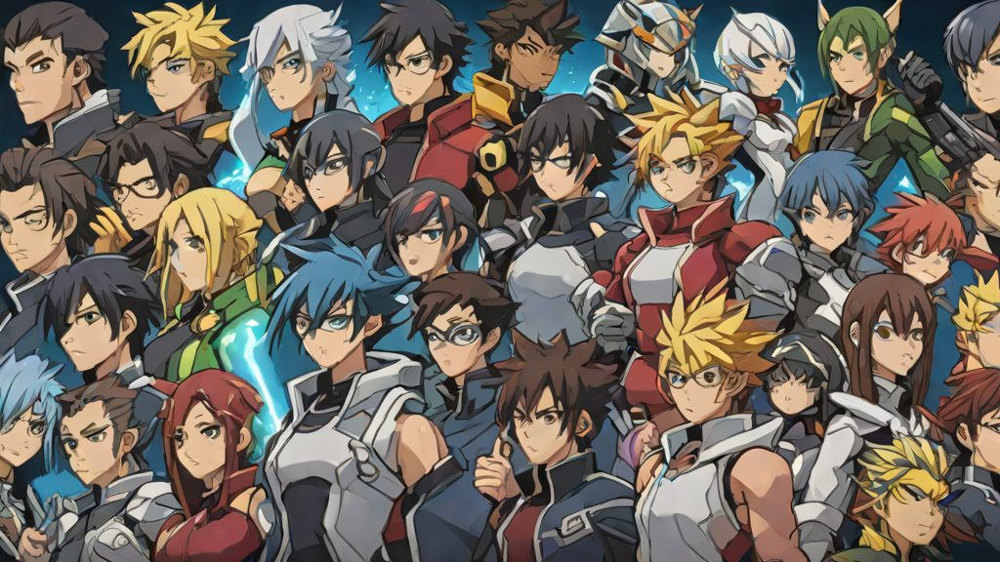
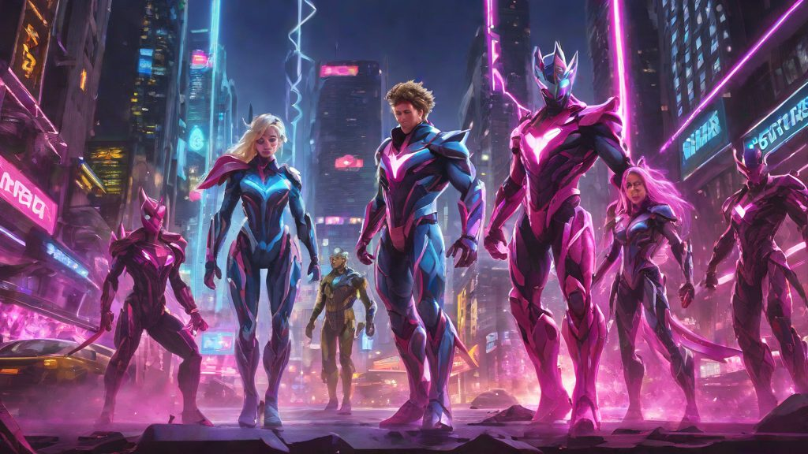
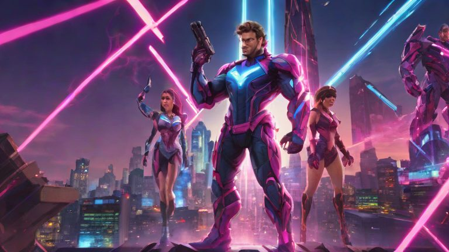

# Banner NextWorth — CF-0 baseline

Gerado em 2026-11-16T22:30:41.614Z. IA local disponível: sim.

`edge` = energia de bordas da arte sem texto (no banner final inclui as partículas da camada VFX, que inflam o valor; compare `edge` só entre imagens cruas). `luma σ` = dispersão de luminância (baixo = fundo liso/vazio).
CLIP: probabilidade do melhor conceito positivo × melhor distrator (fundo vazio/gradiente).

| id | descrição | tempo (s) | VRAM base→pico (MiB) | edge | luma σ | CLIP +/− | gate | prévia |
|---|---|---|---|---|---|---|---|---|
| no-ai-fallback | Sem IA (indisponível ou desmarcada): fallback atual | — | —→— | 126.55 | 3.19 | 0.537/0.695 (off) | 78 ✓ |  |
| current-raw-ai | Fluxo atual: imagem crua do SDXL-Turbo (prompt pt-BR, 1024×576, 3 passos, sem seed) | 44.1 | 5060→7607 | 56.27 | 68.62 | 0.717/0.516 | — |  |
| current-final | Fluxo atual: banner final (fundo esticado 2,5× + blur 5 + brilho 0,74 + vinheta 0,58) | — | —→— | 112 | 44.82 | 0.715/0.561 | 84 ✓ |  |
| probe-pt-1024-s11 | Sonda C2: prompt pt-BR, 1024×576, seed 11 | 35.7 | 2465→7429 | 60.09 | 66.25 | 0.667/0.622 | — |  |
| probe-en-1024-s11 | Sonda C2: prompt EN estruturado, 1024×576, seed 11 | 33.1 | 2087→7474 | 37.96 | 59.89 | 0.867/0.527 | — |  |
| probe-en-768-s11 | Sonda H1: prompt EN, 768×432, seed 11 | 28.9 | 2024→7418 | 27.29 | 59.58 | 0.802/0.541 | — |  |
| probe-pt-1024-s22 | Sonda C2: prompt pt-BR, 1024×576, seed 22 | 32.3 | 2013→7600 | 59.24 | 67.65 | 0.694/0.56 | — |  |
| probe-en-1024-s22 | Sonda C2: prompt EN estruturado, 1024×576, seed 22 | 35.1 | 2305→7487 | 39.71 | 59.91 | 0.757/0.521 | — |  |
| probe-en-768-s22 | Sonda H1: prompt EN, 768×432, seed 22 | 210.0 | 2143→7698 | 26.33 | 57.99 | 0.729/0.516 | — |  |
