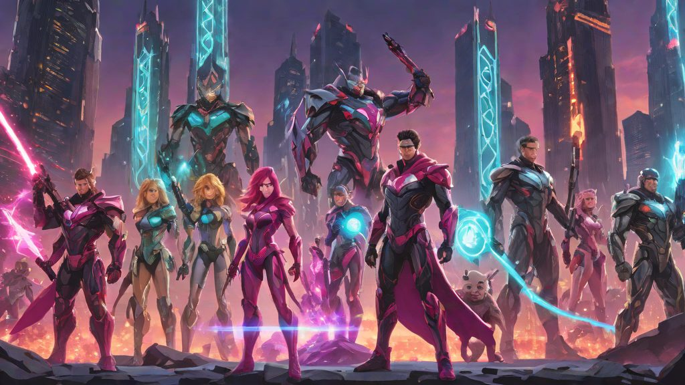
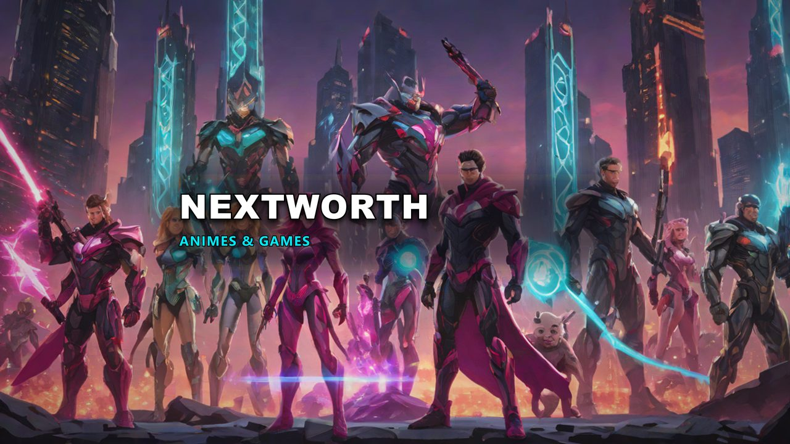
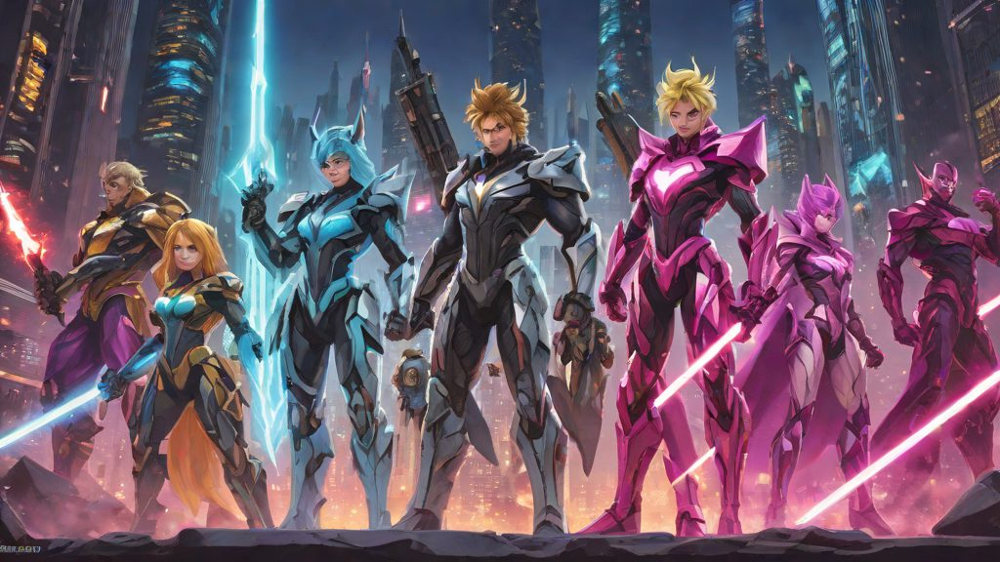
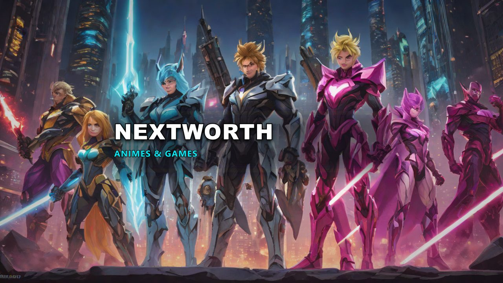

# Banner NextWorth — CF-1

Gerado em 2026-11-16T23:02:21.181Z. IA local disponível: sim.

`edge` = energia de bordas da arte sem texto (no banner final inclui as partículas da camada VFX, que inflam o valor;
compare `edge` só entre imagens cruas). `luma σ` = dispersão de luminância (baixo = fundo liso/vazio).
CLIP: probabilidade do melhor conceito positivo × melhor distrator (fundo vazio/gradiente).

| id | descrição | tempo (s) | VRAM base→pico (MiB) | edge | luma σ | CLIP +/− | gate | prévia |
|---|---|---|---|---|---|---|---|---|
| no-ai-fallback | Sem IA (indisponível ou desmarcada): fallback atual | — | —→— | 126.55 | 3.19 | 0.537/0.695 (off) | 78 ✓ |  |
| cf1-raw-s11 | CF-1: imagem crua (receita geek_banner, 1024×576, seed 11) | 18.6 | 954→6560 | 39.01 | 58.4 | 0.696/0.544 | — |  |
| cf1-final-s11 | CF-1: banner final (fundo composto sem degradação + scrim local), seed 11 | — | —→— | 107.37 | 52.07 | 0.653/0.582 | 86 ✓ |  |
| cf1-raw-s22 | CF-1: imagem crua (receita geek_banner, 1024×576, seed 22) | 16.5 | 958→6565 | 42.06 | 59.48 | 0.752/0.532 | — |  |
| cf1-final-s22 | CF-1: banner final (fundo composto sem degradação + scrim local), seed 22 | — | —→— | 106.26 | 52.85 | 0.717/0.573 | 87 ✓ |  |
