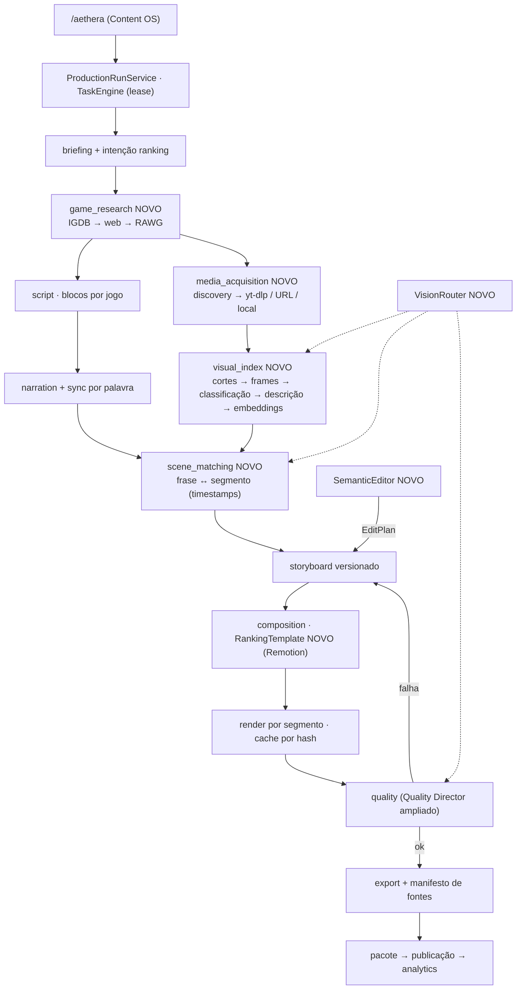

# Aethera Autonomous Studio — Plano consolidado

Versão 3 · 2026-11-11 · Status: **AS-01…AS-09 implementadas e commitadas; AS-10 em execução, com o gate real
bloqueado até existirem mídia, labels e demais artefatos externos verificáveis.** A continuidade foi autorizada pelo usuário
no checkout isolado `C:/dev/neuralbridge-studio`; o estado detalhado e as limitações estão em `docs/aethera/STATUS.md`.

Objetivo: o Aethera pesquisa, compreende, seleciona e edita vídeos reais com inteligência semântica — começando por
"Top N Jogos do mês" (~20 min, 1080p) — reaproveitando Content OS, `TaskEngine` e `ProductionRunService`, e sem
depender de um provedor de IA específico.

## 1. Resultado da auditoria (AS-01)

**A maior parte do pipeline já existe.** Não será recriado:

| Capacidade | Onde já existe | Uso no Studio |
|---|---|---|
| Execução persistida em 10 etapas com checkpoint, retry, retomada, aprovações, orçamento, artefatos com hash | `orchestrator/velix-production.ts` (`ProductionRunService`), `shared/velix-production.ts`, `velix_production_*` | Base de todas as fases; etapas novas são aditivas |
| Execução de agentes (Claude/Codex) com lease, saída estruturada read-only **e imagens** | `orchestrator/engine.ts` `runStructuredReadOnly({ images, outputSchema, model })`; `agents/codex-adapter.ts` (`--image=`), `codex-limits.ts` | Seam para o Codex como provedor visual e técnico (D-AS-3) |
| Canal, ideia, projeto, briefing, roteiro, pacote, publicação, analytics, autonomia | Content OS (`content-*`, migrações 0098–0107, **ainda não commitadas**) | Entrada e saída do Studio |
| Pesquisa com claims e evidência obrigatória | `velix-research-stage.ts`, `shared/velix-evidence.ts` | Base do Game Research |
| Roteiro longo por capítulos | `velix-script-stage.ts`, `shared/velix-long-script.ts` | Blocos por jogo |
| Descoberta YouTube Data API | `orchestrator/velix-discovery-adapters.ts`, `velix_discovery_searches`, `velix_media_references` | Base do Media Acquisition |
| yt-dlp do usuário, diagnóstico de 403/desatualizado | `workspace/velix.ts` | Extraído para adaptador isolado |
| Inventário de mídia com hash e direitos | `velix_local_assets`, `velix_media_rights` | Catálogo de ativos |
| Cortes de cena (FFmpeg `scene`), silêncios, energia | `workspace/velix-clip-hunter.ts`, `velix_media_analyses` | Primeiro estágio da Visual Intelligence |
| Embeddings locais de texto (multilingual-e5-small, transformers.js, CPU, carga/descarga sob demanda) | `brain/src/embeddings/local-provider.ts` | Embedding de descrições; padrão para modelos locais |
| Storyboard versionado, locks, substituição, ranking explicável de mídia | `shared/velix-storyboard.ts` (`rankMedia`), `velix_storyboards` | Revisão de timeline = versão de storyboard |
| TTS (VoiceStudio), transcrição e alinhamento por palavra, legendas por frase | `velix-narration-stage.ts`, `shared/velix-sync.ts` | Mantido (D-AS-4) |
| Timeline multipista derivada | `shared/velix-timeline.ts`, `ProductionTimeline.tsx` | Mantida (D-AS-5) |
| Render Remotion por segmento reaproveitando segmentos inalterados; FFmpeg empacotado | `velix-render-stage.ts`, `workspace/velix-production-render.ts`, `motion/render-worker.mjs` | Mantido (D-AS-5) |
| QA com bloqueio de exportação | `qualityChecks`, `velix_production_quality` | Ampliado pelo Quality Director |
| Derivados (Shorts) | `velix-derivative-service.ts` | Usado sem mudança até haver lacuna comprovada |

**Lacunas reais** (escopo do Studio): dados de jogo verificados; aquisição durável e retomável; compreensão visual
por trecho; escolha de trecho por timestamp ligada à frase; template de ranking; edição por linguagem natural;
verificações de QA específicas (jogo ↔ cena, loudness, frames pretos/congelados, sync). Hoje `rankMedia` escolhe o
**arquivo inteiro** por palavras do título/tags.

## 2. Decisões registradas

### D-AS-1 — Dados dos jogos
- **IGDB** é a fonte estruturada principal (título, aliases, data, plataformas, empresas, IDs). Exige app Twitch
  (client id/secret) guardado com `safeStorage`, como os demais segredos.
- **Pesquisa web** valida datas, plataformas, adiamentos e notícias (claims com evidência, pipeline existente).
- **RAWG** é fallback opcional, desligado sem chave.
- Jogo com dado não confirmado entra apenas **sinalizado** (`verification: 'unconfirmed'`), visível no roteiro e no QA.

### D-AS-2 — Trailers e gameplays de terceiros
- Política editorial **por canal** para comentário, crítica, análise, ranking e documentário com trechos reais.
- O Media Hunter pesquisa, adquire, cataloga e seleciona **automaticamente**; fontes: YouTube, sites oficiais/press
  kits, arquivos locais e outras plataformas suportadas pelos adaptadores.
- Novo estado de uso de mídia (aditivo ao Rights Manager): `editorial_use` — permitido no **render** quando a
  política do canal está ativa e a proveniência está completa. Mídia de terceiros **não é bloqueada genericamente**.
- **`editorial_use` é uma classificação editorial interna, não uma garantia de autorização legal.** Ele diz só "o
  canal decidiu usar este material neste contexto editorial, com esta proveniência". A situação jurídica fica num
  campo separado, `legalClearance: 'unknown' | 'own' | 'licensed' | 'public_domain' | 'creative_commons' |
  'press_kit_terms'`, com padrão `unknown`, e nunca é inferida por agente. A autorização de publicação (§2.1) mostra
  `legalClearance` de cada ativo e exige que a pessoa confirme ciente.
- Incerteza (licença desconhecida, canal não oficial, restrição conhecida, trecho longo, música reconhecível) gera
  `review_required`: entra em prévia, mas a exportação passa por revisão editorial e a publicação por autorização
  própria (§2.1).
- Registro obrigatório por ativo: URL, plataforma, canal/publisher, oficial ou não, data, licença declarada,
  restrições conhecidas, adaptador, versão do adaptador, hash, e contexto de uso (projeto, cena, duração usada).
- Manifesto de fontes no export e atribuição sugerida na descrição do pacote.

### D-AS-3 — Inteligência visual híbrida, independente de provedor
- Contratos próprios (§4.3) para **análise visual**, **classificação de cena**, **embeddings** e **seleção semântica**.
  Nenhum provedor é dependência central.
- **Codex** é o provedor preferencial para trabalho técnico e de automação (scripts de análise, metadados, auxílio à
  seleção, correções de produção) e é candidato a provedor visual. Integração **só pelo seam existente**
  (`TaskEngine.runStructuredReadOnly` com `images` e `outputSchema`, read-only, lease, limites do `codex-limits`);
  nunca chamada direta da CLI pelo Studio. Viabilidade verificada no benchmark B-1 antes de virar runtime.
- **Local**: FFmpeg (cortes, frames, `blackdetect`/`freezedetect`/`ebur128`), embeddings visuais (SigLIP/CLIP via
  transformers.js/ONNX, mesmo padrão do `LocalEmbeddingProvider`, sem Python se possível), VLM quantizado
  (Qwen3-VL candidato) como processo isolado, um modelo carregado por vez, dentro de 8 GB de VRAM.
- **Externos** configuráveis: GPT com visão, Gemini, outros — chaves via `safeStorage`, desligados por padrão.
- **Roteador** escolhe por tarefa → projeto → canal → padrão global; fallback por confiança, disponibilidade,
  desempenho e custo; orçamento e cache por `(frameHash, provider, model, promptVersion)`.
- Benchmark obrigatório com trailers reais comparando Codex, FFmpeg/heurísticas, locais e externos (§6).

### D-AS-4 — Narração e sincronização
- TTS atual (VoiceStudio) preservado; interface `TtsProvider` para múltiplos provedores.
- Sincronização por palavra existente reaproveitada; trechos de vídeo associados a **frases e conceitos**.
- Trocar a mídia de uma cena **não** regenera narração (narração tem hash próprio, independente do visual).

### D-AS-5 — Composição e edição
- Remotion + TypeScript é o compositor principal; FFmpeg para corte, análise e otimização.
- Hypit continua opcional (AET-04/05), sem dependência obrigatória.
- Editor e timeline existentes reaproveitados; edição semântica por linguagem natural gera **operações sobre o
  storyboard versionado**; render incremental e reuso de segmentos preservados.

### D-AS-6 — Planejamento e ativação
- Registrado no planejamento do Aethera (`docs/aethera/PLAN.md`) como programa AS.
- Content OS, `TaskEngine` e `ProductionRunService` preservados; nada duplicado.
- **Nenhuma mudança de runtime antes de o Content OS (migrações 0098–0107 e código associado) estar estabilizado e
  registrado em commit.**
- Cada fase AS depende de autorização específica.

### 2.1 Quatro aprovações formalmente separadas

Nenhuma substitui outra; cada uma tem registro próprio em `velix_production_approvals` (campo `gate`, aditivo), quem
decidiu, quando, sobre qual versão (hash do storyboard/render) e com qual nota. Mudar a versão invalida as
aprovações que dependiam dela.

| Gate | Pergunta que responde | Quem pode decidir | Automação permitida | Invalida quando |
|---|---|---|---|---|
| **G1 Aprovação técnica** | O arquivo está tecnicamente correto (resolução, áudio, loudness, sync, frames, integridade)? | Quality Director; humano pode sobrepor com nota | Sim, por checks determinísticos | Novo render |
| **G2 Verificação factual** | Cada afirmação e cada dado de jogo têm evidência; a identidade de cada cena está confirmada (§4.5)? | Research Agent + humano para `conflicting`/`unconfirmed` | Parcial: só itens `confirmed` com evidência ≥ 2 fontes | Mudança de roteiro, de jogo ou de mídia da cena |
| **G3 Revisão editorial** | O conteúdo, o tom, a escolha e a duração dos trechos de terceiros estão de acordo com a política do canal? | Humano; agente só sugere | Não para mídia `review_required`; sim para o resto conforme autonomia do canal | Mudança de storyboard |
| **G4 Autorização de publicação** | Esta versão pode ir a público, ciente de `legalClearance` de cada ativo? | **Somente humano** | Nunca (mantém a política de autonomia existente) | Qualquer mudança no render ou no pacote |

Exportar exige G1 + G2 + G3. Publicar exige G1–G4 na mesma versão. `editorial_use` alimenta G3, nunca G4.

## 3. Arquitetura consolidada



Princípios: etapas novas são aditivas em `productionStageKinds` (runs antigos mantêm 10 etapas); checkpoint **por
item** (jogo, ativo, segmento) dentro da etapa; operações idempotentes por hash; conteúdo externo (títulos,
descrições, frames, páginas) é dado não confiável e vai delimitado a agentes read-only com schema fechado; logs
estruturados sem segredos.

### 3.1 Cadeia de invalidação (o que refaz o quê)

| Mudança | Refaz | Não refaz |
|---|---|---|
| Troca de mídia/trecho de uma cena | composição + render dos segmentos da cena + QA | pesquisa, roteiro, narração, outras cenas |
| Edição de uma frase | TTS da frase/bloco, sync do bloco, matching e render das cenas do bloco | pesquisa, aquisição, índice visual |
| Novo ativo adquirido | índice visual desse ativo | tudo o mais até uma cena usá-lo |
| Mudança de template | composição/render dos segmentos que usam o template | pesquisa, narração, índice |

Chave de cache de segmento: `hash(sceneSpec + segmentId + sourceRange + narrationHash + templateVersion + formatId)`.

## 4. Contratos (definidos aqui; viram código em AS-02, com Zod em `packages/shared`, `schemaVersion` em todos)

### 4.1 Jogo e pesquisa
```ts
VerifiedSubject = { id; kind: 'game'; title; aliases: string[]; releaseDate: string | null;
  datePrecision: 'day'|'month'|'quarter'|'year'; platforms: string[]; companies: string[];
  externalIds: { igdb?: string; rawg?: string; steam?: string };
  verification: 'confirmed'|'unconfirmed'|'conflicting'; evidenceIds: string[]; checkedAt: string }
RankingIntent = { kind: 'ranking'; count: number; period?: { from; to }; subjectKind: 'game'; criteria: string }
```

### 4.2 Aquisição
```ts
MediaAcquisitionJob = { id; runId; subjectId; referenceId; adapter: 'yt-dlp'|'direct-url'|'local-import'|string;
  idempotencyKey; status: 'queued'|'running'|'paused'|'done'|'failed'|'skipped'; attempt; bytesDone; bytesTotal;
  partialPath?: string;                     // retomada de download interrompido
  result?: { assetId; contentHash; width; height; fps; durationMs; vcodec; acodec };
  error?: { code: 'unavailable'|'forbidden'|'format'|'network'|'tool_missing'|'tool_outdated'|'cancelled'; retryable } }
MediaProvenance = { url; platform; publisher; official: boolean; publishedAt; license: string|null;
  knownRestrictions: string[]; adapter; adapterVersion; acquiredAt; usage: 'editorial_use'|'review_required'|'blocked' }
AcquisitionAdapter = { id; detect(): Availability; acquire(job, sink, signal): Promise<AcquisitionResult> }
```

### 4.3 Inteligência visual (independente de provedor)
```ts
VisualAnalysisProvider = { id; capabilities: ('describe'|'classify'|'embed_image'|'embed_text'|'ocr')[];
  limits: { maxImagesPerCall; vramMb?; costPerImageUsd? }; detect(): Promise<Availability>;
  describe?(frames, schema, signal): Promise<FrameAnalysis[]>; classify?(frames, labels, signal);
  embedImage?(frames, signal): Promise<Vector[]>; embedText?(texts, signal): Promise<Vector[]> }
// Provedores: ffmpeg-heuristics · codex (TaskEngine) · claude (TaskEngine) · local-vlm · local-siglip · openai · gemini
VisionPolicy = { task: 'describe'|'classify'|'embed'|'match'|'qa'; chain: ProviderId[]; minConfidence;
  budgetUsd; maxLatencyMs; scope: 'global'|'channel'|'project' }
MediaSegment = { id; assetId; startMs; endMs; frameHashes: string[];
  kind: 'gameplay'|'combat'|'exploration'|'cinematic'|'presentation'|'logo'|'menu_ui'|'text_card'|'talking'|'unknown';
  description; tags: string[]; embeddingRefs: { provider; model; ref }[];
  quality: { blur; motion; overlayText; watermark; black; frozen }; analyzedBy: { provider; model; confidence } }
```

### 4.4 Matching, edição e QA
```ts
SceneMatch = { sceneId; sentenceIds: string[]; segmentId; sourceStartMs; sourceEndMs; score;
  breakdown: { semantic; subject; kind; quality; diversity; duration }; reason: string }
StoryboardScene.visual += { segmentId?; sourceStartMs?; sourceEndMs?; subjectId? }   // opcional: cenas antigas inalteradas
EditCommand = { text } → EditPlan = { ops: TimelineOp[]; affectedSceneIds; rerenderSegmentIds; regenerateNarration: boolean }
TimelineOp = replaceMedia | changeRange | trim | move | split | setTransition | rewriteSentence | lock | unlock
QualityCheck += 'loudness'|'clipping'|'black_frames'|'frozen_frames'|'caption_drift'|'subject_mismatch'
  |'repeated_segment'|'overlay_collision'|'watermark'|'unconfirmed_subject'|'identity_unverified'
```

### 4.5 Validação independente da identidade do jogo

Objetivo: nenhuma cena de outro título entra no vídeo, mesmo quando a busca, o título do vídeo ou o classificador
visual erram. A identidade é verificada **por sinais independentes**, em dois níveis (ativo e segmento), por um
módulo próprio (`SubjectIdentityVerifier`) que **não** é o mesmo componente que escolheu a mídia.

```ts
IdentitySignal = { source: 'provenance'|'metadata_text'|'ocr'|'audio_transcript'|'visual_reference'|'neighbour_consistency';
  verdict: 'match'|'mismatch'|'inconclusive'; score; evidence: string }   // evidence = trecho/frames/URL, auditável
SubjectIdentity = { assetId; segmentId?; subjectId; signals: IdentitySignal[];
  status: 'verified'|'review_required'|'rejected'; calibratedConfidence; verifiedBy: 'rules'|'human' }
```

| Sinal | Como | Independência |
|---|---|---|
| Proveniência | Canal oficial do publisher/desenvolvedor (IDs do IGDB `involved_companies`/`websites`), press kit oficial | Fonte, não conteúdo |
| Texto de metadados | Título/descrição/capítulos × título e aliases do IGDB, com detecção de **outros** títulos citados (compilações, "Top 10", comparativos) | Texto do publicador |
| OCR | Cartões de título/logo nos frames (FFmpeg + OCR local) × título/aliases | Conteúdo visual |
| Transcrição do áudio | Nome do jogo falado no trailer (transcrição já usada na narração) | Conteúdo sonoro |
| Referência visual | Embedding (SigLIP) dos frames × **screenshots/artworks oficiais do IGDB** do jogo e dos jogos vizinhos no ranking | Conteúdo visual vs. referência externa |
| Consistência de vizinhança | Segmento destoa visualmente do resto do mesmo ativo (compilações, cenas de outro jogo em trailer de evento) | Interno ao ativo |

Regras:
- **Ativo** `verified` exige ≥ 2 sinais `match` de origens diferentes (ex.: proveniência + referência visual) e
  nenhum `mismatch`. Ativo de compilação/evento/"top" (vários títulos) nunca é verificado em bloco: só por segmento.
- **Segmento** herda o ativo só se a consistência de vizinhança não acusar desvio; senão precisa do próprio sinal
  visual/OCR.
- Qualquer `mismatch` forte (ex.: OCR com o título de outro jogo da lista, referência visual mais próxima de outro
  jogo do ranking) → `rejected` para aquele jogo, sem fallback silencioso.
- O matching (AS-06) só considera segmentos `verified` para o jogo da frase; `review_required` aparece como candidato
  marcado. G2 (§2.1) exige 100% das cenas de jogo com identidade `verified` (regras ou humano).
- Teste adversarial obrigatório: trailers de jogos da mesma franquia/estética, vídeo de evento com vários jogos,
  reupload com título enganoso.

### 4.6 Confiança calibrada e encaminhamento

A meta de acurácia ≥ 80% (AS-05) continua como **métrica inicial de qualidade do classificador**. A decisão
automática usa outra coisa: **confiança calibrada** por provedor, modelo, versão do prompt e rótulo.

- **Conjunto de calibração**: segmentos rotulados à mão do B-1 (separados do conjunto de teste), ampliado com cada
  decisão humana de revisão (rótulo + identidade), versionado.
- **Calibração**: escore bruto → probabilidade calibrada (Platt/isotônica por rótulo); medir ECE e curva de
  confiabilidade; para LLM/VLM sem escore, usar concordância entre amostras/provedores como escore bruto.
- **Três faixas por decisão**, com limiares guardados em `VisionPolicy` (versionados) e definidos pelo conjunto de
  calibração, não fixados a mão:

| Faixa | Regra | Efeito |
|---|---|---|
| Automático | probabilidade calibrada ≥ τ_auto, onde τ_auto é o menor limiar com **precisão ≥ 95%** na calibração (identidade: **≥ 99%**) | Seleção automática, registrada com o escore |
| Revisão humana | entre τ_review e τ_auto | Candidato marcado na timeline; fila de revisão com frames e sinais |
| Rejeição | < τ_review | Fora da seleção; visível no índice |

- Fallback do roteador sobe para o próximo provedor da cadeia **antes** de mandar para revisão quando a faixa é
  de revisão e há orçamento.
- Mudou provedor, modelo, prompt ou distribuição dos dados (deriva medida no AS-10) → limiares voltam a "revisão
  para tudo" até nova calibração.
- Métricas acompanhadas: precisão na faixa automática, taxa de revisão, ECE, erros descobertos depois da seleção.

## 5. Roadmap priorizado

Ordem conforme a priorização aprovada. Estimativas = esforço técnico, não prazo; dependem do benchmark B-1 e das
credenciais externas.

| Fase | Nome | Depende de | Estimativa |
|---|---|---|---|
| AS-01 | Auditoria, decisões e contratos (documento) | — | **concluída** |
| AS-02 | Fundação do Studio: contratos em código, etapas aditivas, checkpoint por item, VisionRouter vazio, cenário de referência | Pré-requisitos §8 | **concluída; commit `99afedb4`** |
| AS-03 | Game Research | AS-02 | **concluída; commit `230d5114`; pesquisa real aguarda credenciais IGDB** |
| AS-04 | Media Acquisition | AS-02 (AS-03 para busca por jogo) | **concluída; commit `9799cf97`** |
| AS-05 | Visual Intelligence + benchmark B-1 | AS-04 | **fundação concluída; commits `f02a5e93` + correções; B-1 real permanece externo** |
| AS-06 | Semantic Scene Matching | AS-05, narração existente | **concluída; commit `2edec8ef`; calibração real permanece externa** |
| AS-07 | Ranking Templates (Remotion) | AS-03 (dados), pode correr em paralelo a AS-04–06 | **concluída; commit `925d6034`; validação real permanece externa** |
| AS-08 | Semantic Editing | AS-06 | **concluída; commit `72837b22`; agente/mídia reais permanecem externos** |
| AS-09 | Quality Director | AS-06 (subject), AS-07 (render) | **concluída; commit `45ca16e0`; homologação real permanece externa** |
| AS-10 | Validação de referência (3 jogos, métricas) — gate do Marco 3 | AS-03…09 | **em execução; commits `a349f303`, `07e0ff5e`, `6dc083b`, `d42b76a`, `0ca5252` e `e442060`; gate externo bloqueado por artefatos ausentes** |
| AS-11 | Pacote/Shorts, memória criativa, AutoPilot | AS-10 **e** lacuna comprovada | só sob demanda |

Total AS-02…AS-10: **~41–61 dias**. Marcos: **M1** = AS-02–03 (jogos verificados + roteiro); **M2** = AS-04–06
(mídia real compreendida e casada com a fala); **M3** (1º release) = AS-07–10.

### AS-02 — Fundação do Studio
- Contratos §4 em `packages/shared` + testes de schema; estado `editorial_use`/`review_required` aditivo.
- Etapas `game_research`, `media_acquisition`, `visual_index`, `scene_matching` aditivas; runs antigos intactos.
- Checkpoint por item dentro da etapa; `VisionRouter` com política e cache, sem provedor real (só `ffmpeg-heuristics`).
- Migração aditiva (número confirmado após o commit do Content OS) para segmentos, jobs de aquisição e proveniência.
- Fixture de referência: 3 jogos com clipes curtos sintéticos no repositório (não trailers reais) + manifesto do
  cenário real fora do repositório.
- **Aceite**: run com 3 itens falha no item 2, app reinicia, retoma no item 2 sem duplicar artefato; runs e projetos
  Velix antigos abrem e renderizam igual; suíte serial completa verde.

### AS-03 — Game Research
- Adaptador IGDB (OAuth client credentials Twitch, rate limit 4 req/s, cache por dia); validação web via claims;
  RAWG opcional; intenção de ranking extraída do prompt via `runStructuredReadOnly` e confirmada na tela.
- **Aceite**: para o período de referência, lista com data/plataformas confirmadas em ≥2 fontes por jogo; divergência
  vira `conflicting` visível; sem credencial IGDB a etapa falha com orientação, nunca com dado inventado; testes com
  respostas gravadas.

### AS-04 — Media Acquisition
- Consultas por jogo (trailer oficial, gameplay, reveal) na Data API com cache de busca; pontuação de canal oficial.
- Adaptadores isolados em `workspace/media-acquisition/`: yt-dlp (detecção de versão, formato ≤1080p, `--continue`
  para retomada, sem shell, argumentos fixos), URL direta (HTTP Range), import local.
- Jobs duráveis: idempotência por `hash(url+formato)`, backoff, pausa/retomada, `skipped` não derruba o run;
  dedupe por `contentHash`; proveniência completa (D-AS-2).
- **Aceite**: para os 3 jogos, ≥1 trailer e ≥1 gameplay por jogo importados com proveniência; download interrompido
  retoma do parcial; yt-dlp ausente/desatualizado → mensagem acionável e caminho de import local; testes com
  adaptador falso para 403, formato indisponível, rede e cancelamento.

### AS-05 — Visual Intelligence (+ benchmark B-1)
- Pipeline: cortes (existente) → 1–3 frames por segmento → classificação por rótulo → descrição → embeddings
  imagem/texto → flags de qualidade. Lotes, concorrência 1 em GPU, nunca simultâneo a render.
- Provedores: `ffmpeg-heuristics`, `codex` e `claude` via TaskEngine (imagens + schema), `local-siglip`,
  `local-vlm` (processo isolado), `openai`/`gemini` opcionais. Roteador com fallback, orçamento e cache.
- `SubjectIdentityVerifier` (§4.5) em módulo separado do seletor, com os sinais de proveniência, texto, OCR,
  transcrição, referência visual IGDB e vizinhança.
- Calibração de confiança (§4.6) a partir do conjunto de calibração do B-1.
- **Aceite**: B-1 executado e registrado por categoria (§6); política padrão escolhida pelos números; classificação
  `combat/exploration/cinematic/presentation/menu_ui` com acurácia ≥ 80% no conjunto de teste (métrica inicial);
  precisão ≥ 95% na faixa automática e ECE registrado; identidade: 0 segmentos de outro jogo na faixa automática nos
  casos adversariais; pico de VRAM ≤ 7,5 GB; reindexar ativo inalterado = 0 chamadas (cache).

### AS-06 — Semantic Scene Matching
- `rankMedia` passa a considerar `MediaSegment`: similaridade frase ↔ segmento, `subjectId`, tipo de cena pedido pela
  frase, qualidade, diversidade, ajuste de duração; grava `sourceStartMs/EndMs` e motivo explicável.
- Narração e sync reaproveitados; legenda segue a sync existente.
- Só segmentos com identidade `verified` para o jogo da frase entram automaticamente; `review_required` vira
  candidato marcado; seleção automática só na faixa calibrada (§4.6).
- **Aceite**: 100% das cenas de um jogo usam mídia com identidade `verified` desse jogo; frases rotuladas ("combate contra chefe",
  "exploração de mundo aberto") recebem segmento do tipo certo em ≥ 75%; nenhuma regeneração de TTS ao trocar mídia.

### AS-07 — Ranking Templates
- Composições Remotion: abertura, cartão de posição (#10…#1) com título/data/plataformas, terço inferior, transição
  entre posições, encerramento; safe areas 16:9 e 9:16; parâmetros vindos de `VerifiedSubject`.
- **Aceite**: render 1080p30 determinístico (mesmo hash de frames em duas execuções), snapshots visuais, movimento
  reduzido respeitado, versão do template no hash de cache.

### AS-08 — Semantic Editing
- Comando em linguagem natural → `EditPlan` via agente read-only com schema fechado → validação das operações →
  nova versão do storyboard → render só dos segmentos afetados; undo = versão anterior.
- **Aceite**: "troque a cena do jogo 2 por uma de combate" altera só as cenas do jogo 2, re-renderiza só os
  segmentos listados em `rerenderSegmentIds` (contados no log), não chama TTS nem pesquisa; undo restaura bit a bit
  o storyboard anterior; comando ambíguo pede confirmação em vez de agir.

### AS-09 — Quality Director
- Checks novos (§4.4) com FFmpeg (`ebur128`, `blackdetect`, `freezedetect`, `astats`), sync narração/legenda,
  `subject_mismatch` via `subjectId` + classificação visual, repetição, colisão de texto, marca d'água, jogo não
  confirmado. Falha volta ao storyboard com a cena marcada e sugestão.
- Gates G1–G4 (§2.1) com registro separado: o Quality Director decide só G1; G2 consome a verificação factual e a
  identidade; G3 e G4 continuam humanos conforme a tabela.
- **Aceite**: suíte de defeitos injetados (silêncio, preto, congelado, áudio estourado, legenda +400 ms, cena de
  outro jogo, segmento repetido) — 100% detectados; um render que passa em G1 com cena `identity_unverified` não é
  exportável; publicar sem G4 da mesma versão é recusado; falso positivo ≤ 1 por vídeo de referência limpo.

### AS-10 — Validação de referência (3 jogos reais)
Cenário completo, registrado em `docs/aethera/STATUS.md` com métricas (§6): pesquisa e verificação → aquisição →
frames → classificação (combate, exploração, apresentação…) → trechos por timestamp → matching frase ↔ cena →
narração e legendas sincronizadas → render 1080p → troca de uma cena sem reconstrução → Quality Director.
**Aceite**: todos os passos com evidência; troca de cena prova reuso (segmentos re-renderizados ≤ cenas afetadas);
MP4 1920×1080 validado por FFprobe; relatório de QA sem bloqueio.

### AS-11 — Somente sob demanda
Capítulos por posição, Short por jogo, memória criativa a partir de edições aceitas/rejeitadas e AutoPilot mensal
reaproveitam derivados, `velixEditorialDecisions`, política de autonomia e scheduler existentes. Só entram com lacuna
comprovada no AS-10 e autorização própria.

## 6. Testes e benchmarks

**Por fase**: unidade (schemas, idempotência, roteador, ranking, `TimelineOp`, hash de cache); integração (migrações
aditivas, repositórios, adaptadores falsos com respostas gravadas para IGDB/RAWG/YouTube/yt-dlp/visão, FFmpeg real em
clipes sintéticos); E2E Playwright/Electron sem credenciais reais; regressão serial completa
(`npx vitest run --no-file-parallelism`) e abertura/render de produções Velix antigas. Nenhum teste desabilitado.

**Benchmark B-1 (AS-05)** — 3 trailers + 3 gameplays reais dos jogos de referência (mais 2 vídeos adversariais:
mesma franquia e evento com vários jogos), ~150 segmentos rotulados à mão, divididos em **calibração** e **teste**.
Cada ferramenta é comparada **só no que ela realmente faz**; não há ranking único entre categorias diferentes.

**Categoria A — Processamento (FFmpeg, OCR local).** Não classifica semântica; é medida como pré-processamento e QA.

| Tarefa | Métrica |
|---|---|
| Detecção de cortes (`scene`) | precisão/recall de cortes contra marcação manual (tolerância ±2 frames); comparar com PySceneDetect só se recall < 85% |
| Preto/congelado/loudness/clipping (`blackdetect`, `freezedetect`, `ebur128`, `astats`) | detecção dos defeitos injetados; falsos positivos por minuto |
| Extração de frames | ms/frame, MB em disco |
| OCR de cartões de título | acerto do título do jogo nos cartões rotulados (sinal de identidade §4.5) |

**Categoria B — Embeddings (SigLIP e alternativas: CLIP/OpenCLIP via transformers.js/ONNX).** Não descreve; mede
proximidade.

| Tarefa | Métrica |
|---|---|
| Busca frase → segmento | recall@1/@3/@5, MRR |
| Classificação zero-shot por rótulos (combate, exploração, apresentação, menu…) | acurácia, F1 por rótulo, escore calibrável |
| Identidade visual vs. screenshots IGDB | AUC jogo certo × jogos vizinhos/mesma franquia |
| Custo | ms/frame CPU e GPU, pico de VRAM/RAM, tamanho do modelo |

**Categoria C — Multimodais (Codex e Claude via TaskEngine; Qwen3-VL quantizado local; GPT visão/Gemini opcionais com
consentimento).** Descrevem e raciocinam; não produzem embedding.

| Tarefa | Métrica |
|---|---|
| Classificação por segmento (frames + schema fechado) | acurácia, F1 por rótulo, concordância entre amostras (escore para calibração) |
| Descrição útil para matching | recall@3 quando a descrição gerada é embutida pelo provedor de texto local existente |
| Identidade (frames + lista de candidatos) | acerto, taxa de "inconclusivo", erros em casos adversariais |
| Robustez | % de saídas válidas no schema, recusas, variação entre execuções |
| Custo | latência por lote, cota consumida (Codex: `codex-limits`; Claude: uso do agente), pico de VRAM (local), US$ (externos) |
| Viabilidade do Codex em runtime | `--image` em modo read-only sem interação, lease, cancelamento, comportamento com cota esgotada |

**Combinações** (o que de fato vai para produção): A + B (só local, custo zero), A + B + C local (Qwen3-VL) e
A + B + C remoto em fallback. Mede-se precisão na faixa automática (§4.6), taxa de revisão, tempo total e custo por
vídeo de 20 min.

Saída: política padrão do `VisionRouter` por tarefa, justificada por números, com os limiares calibrados de §4.6.

**Métricas do AS-10**: tempo por etapa, total; VRAM/RAM/CPU (monitoramento real do Singularity); GB baixados e em
disco; chamadas e custo por provedor; precisão de matching; defeitos detectados; segmentos reaproveitados na troca.

## 7. Riscos técnicos e operacionais

| Risco | Prob. | Impacto | Mitigação |
|---|---|---|---|
| Reivindicação de direitos / Content ID na publicação | Alta | Alto | Política D-AS-2, `review_required` em incerteza, trechos curtos, sem áudio do trailer por padrão, manifesto e atribuição, aprovação humana antes de publicar |
| Termos das plataformas sobre download | Média | Alto | Decisão do usuário registrada (D-AS-2); adaptador isolado e desligável; import local e press kits oficiais como alternativas |
| yt-dlp quebra com mudanças do YouTube | Alta | Médio | Detecção de versão, mensagem acionável existente, `skipped` por item, outras fontes |
| Quota YouTube Data API (100 un. por busca, 10.000/dia) | Média | Médio | Cache de buscas por (jogo, consulta, dia); ~20 buscas por vídeo |
| Codex como provedor visual: latência de CLI, cota, saída instável | Média | Médio | Só via TaskEngine; validado em B-1; fallback no roteador; nunca único provedor |
| VRAM 8 GB (VLM + Remotion) | Média | Médio | Concorrência 1, um modelo por vez, indexação e render nunca simultâneos, descarga por ociosidade |
| Disco (3–8 GB/projeto de 10 jogos) | Alta | Baixo | ≤1080p, dedupe, TTL de mídia bruta após export |
| Dado de jogo errado/adiado | Média | Alto | IGDB + ≥2 fontes, `conflicting` visível, check `unconfirmed_subject` |
| Cena de jogo errado | Média | Alto | `subjectId` em toda mídia, canal oficial pontuado, `subject_mismatch` no QA |
| Prompt injection em títulos, descrições, frames (texto na imagem) | Média | Médio | Dados delimitados, agentes read-only, schema fechado, sem execução de saída |
| Custos de provedores externos | Média | Médio | Desligados por padrão, orçamento por run, estimativa antes de chamada paga, cache |
| Trabalho paralelo não commitado (Content OS, Fase 51) | Alta | Médio | Pré-requisito P1; checar `git status`/`git log` antes de cada lote |
| Dependência Python (PySceneDetect/TransNetV2, VLM) | Média | Baixo | FFmpeg primeiro; Python só se B-1 provar ganho, como processo isolado |

## 8. Pré-requisitos para iniciar AS-02 (todos obrigatórios)

Procedimento seguro detalhado (inventário por frente, ordem dos commits, validação, worktree, backup e reversão):
`docs/plans/aethera-studio-prerequisites-runbook.md`.

| # | Pré-requisito | Estado em 2026-11-10 | Responsável |
|---|---|---|---|
| P0 | Nenhuma sessão escrevendo na árvore principal | **Concluído** — Codex sem gravações desde 21:39 de 2026-11-10 | — |
| P1 | Content OS estabilizado e registrado em commit (migrações 0098–0107) | **Concluído** — `ab97ea30`, validado isolado: typecheck + 287 arquivos / 2.206 testes | — |
| P2 | Fase 51 registrada antes do Content OS, separada por trecho nos 13 arquivos compartilhados | **Concluído** — `994dd70d` (após `6ef65aa9`, infraestrutura de testes), validado isolado: typecheck + 281 arquivos / 2.172 testes | — |
| P3 | Suíte completa, typecheck e build verdes depois dos commits | Por commit: concluído; final na árvore principal: ver `docs/aethera/STATUS.md` | — |
| P4 | Próximo número de migração | **0108** (última: `0107_content_channel_concurrency`) | — |
| P5 | Branch/worktree próprio do Studio com dados isolados | **Concluído** — worktree `C:/dev/neuralbridge-studio`, branch `feat/aethera-studio` a partir de `d62a5616`; dados em `C:/dev/neuralbridge-studio-data` via `NB_DATA_DIR`; mídia real em `C:/dev/aethera-reference-media`; `npm ci` + Electron 44.9.3 + typecheck aprovados | — |
| P6 | Autorização explícita do AS-02 | **Concedida em 2026-11-10** | — |

Não bloqueiam o AS-02, mas bloqueiam fases seguintes: credenciais IGDB/Twitch (AS-03); yt-dlp instalado e
atualizado (AS-04); escolha dos 3 jogos de referência e pasta de mídia real fora do repositório (AS-04/AS-10); Codex
autenticado e cota disponível, VoiceStudio ativo, chaves opcionais de OpenAI/Gemini para B-1 (AS-05).
