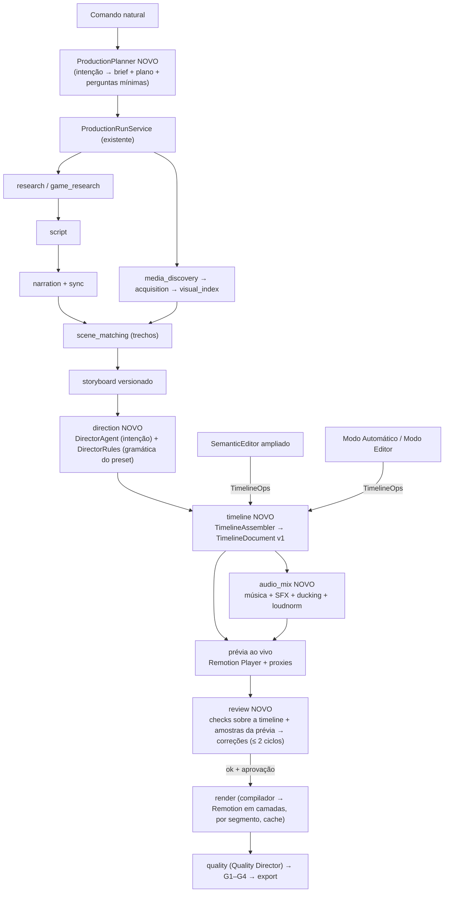

# Aethera Studio — Produtora audiovisual autônoma (programa AP)

Versão 2 · 2026-11-12 · Status: **direção arquitetural aprovada; decisões D-AP registradas (§0); AP-02 validado
tecnicamente, AP-03 concluído tecnicamente, AP-04…AP-10 com implementação inicial no worktree do Studio e AP-11 com aplicação persistida do plano até a prévia, sem commit.** Estende o programa AS
(`docs/plans/aethera-autonomous-studio.md`, AS-01…AS-10) e o redesign R0–R8 (`docs/aethera/REDESIGN-PLAN.md`); não os
substitui. Evidências da auditoria citadas por arquivo; medições reais de 2026-11-11 vêm do run `d4a808e4`
(`docs/aethera/STATUS.md`).

**Resumo em 6 linhas.** O Aethera já pesquisa, roteiriza, narra, sincroniza por palavra, adquire mídia, indexa por
cena, casa frase ↔ trecho, edita por linguagem natural e revisa com gates — mas **ainda não monta um vídeo editado**:
o render toca cada mídia **do segundo 0** (ignora o trecho escolhido), **não aceita a mídia que o próprio Media Hunter
adquire**, não tem trilha, SFX, ducking, legenda animada, camadas sobrepostas nem movimento de câmera, e a "timeline"
é uma vista derivada da lista de cenas. O plano cria **uma timeline como dado** entre o storyboard e o render, faz o
Remotion compor essa timeline em camadas, adiciona mixagem de áudio, direção criativa por regras + agente, presets
como gramáticas, prévia ao vivo e a interface Automático/Editor sobre o mesmo projeto.

**2026-11-12 — escopo universal.** O Aethera passa a ser produtora de **qualquer tema**; games viram uma categoria
(adaptador), não o núcleo. Auditoria, generalizações, lacunas e encaixe nas fases existentes em **§15** (decisões
D-AP-12…17 **aprovadas em 2026-11-12**).

---

## 0. Decisões do usuário (2026-11-11)

| ID | Decisão | Consequência no plano |
|---|---|---|
| D-AP-1 | Direção arquitetural aprovada (4 camadas, `TimelineDocument` como fonte da edição) | §3–§5 valem como base |
| D-AP-2 | Música: **biblioteca local com licença registrada por faixa**; contratos extensíveis para música gerada por IA, **sem integração agora** | `MusicSource` com variante `generated` reservada e sem provedor (§4.4, §7.3) |
| D-AP-3 | SFX: biblioteca sintetizada do kit MotionVelix | Importada com manifesto de origem (AP-05) |
| D-AP-4 | Primeira demonstração: **TOP 5, ~5 min**, com mídia real, narração, motion graphics, trilha, SFX, transições e legendas; depois **15 min** | AP-12 dividido em AP-12a (5 min) e AP-12b (15 min) |
| D-AP-5 | Fase 52: **planejar a integração antes do AP-11**, com verificação de compatibilidade e testes; **sem merge automático** | Novo AP-10b (análise + ensaio em worktree descartável; merge só com autorização) |
| D-AP-6 | Identidade: **verde-petróleo + verde-esmeralda**; o dourado deixa de ser o acento do Aethera; DS reutilizado com tokens **escopados ao Aethera**, sem afetar outros módulos | §6.1 com a paleta e as regras de contraste |
| D-AP-7 | Motores: **Remotion, FFmpeg e MotionVelix**; nenhum outro compositor sem justificativa técnica | §3.3 mantido |
| D-AP-8 | Interface: modos Automático e Editor sobre o **mesmo `TimelineDocument`**; editor no layout da referência (player em destaque, timeline multicamadas, propriedades contextuais, edição por linguagem natural) | §6 |

Requisitos transversais (valem para todas as fases):

- **Mídia adquirida ≠ mídia licenciada.** O Rights Manager (`velix_media_rights`, `verified_allowed`) e a proveniência
  Aethera (`usage`, `legalClearance`) continuam separados; nenhuma fase grava `verified_allowed` ou altera
  `legalClearance` por inferência. Uso editorial é uma **base de uso** própria, visível e auditável (§14.3).
- Timeline persistente, versionada e editável; toda alteração por IA vira **diff rastreável** com desfazer.
- **Prévia e render final usam a mesma representação de composição** (no AP-02: o mesmo `compositionPlan`; a partir
  do AP-04: a mesma composição Remotion `aethera-timeline` sobre o mesmo `TimelineDocument`).
- Retomada, checkpoints e render incremental onde for tecnicamente viável.
- **Fase não fecha só com mocks ou testes unitários**: os marcos marcados "AV real" em §9 exigem validação audiovisual
  com arquivos reais, medida e assistida.
- Preservar código e contratos existentes: mudanças em schemas são aditivas (campos opcionais, membros novos de união).

---

## 1. Inventário — o que já existe

Legenda: ✅ pronto e usado · 🟡 parcial · ⛔ bloqueado por externo · ❌ ausente.

### 1.1 Orquestração e confiabilidade

| Capacidade | Onde | Estado |
|---|---|---|
| Run persistido com etapas, checkpoint, retry, retomada, aprovações, orçamento, artefatos com hash | `orchestrator/velix-production.ts` (`ProductionRunService`), `velix_production_*` | ✅ |
| Etapas: briefing, research, script, storyboard, narration, sync, composition, render, quality, export + game_research, media_discovery, media_acquisition, visual_index, scene_matching | `shared/velix-production.ts` | ✅ (aditivas) |
| Checkpoint por item dentro da etapa | `orchestrator/aethera/item-checkpoint.ts` | ✅ |
| Agentes só via `TaskEngine` (lease, read-only estruturado, imagens) | `orchestrator/engine.ts` `runStructuredReadOnly` | ✅ |
| Gates G1 técnico, G2 factual, G3 editorial, G4 publicação, por versão | AS-09, `velix_production_approvals` | ✅ |
| Scheduler que impede indexação visual e render simultâneos | `aethera-visual-scheduler.ts`, `runExclusiveRender` | ✅ |
| Content OS: canal, ideia, briefing, roteiro, pacote, publicação, analytics, autonomia, fila, calendário | migrações 0098–0107, `features/aethera/*` | ✅ (OAuth real ⛔) |
| Risk Engine / Model Router / Policy Gate (Fase 52) | branch `feat/neura-assistant`, **não está em `feat/aethera-studio`** | 🟡 52.1 + núcleo 52.2 (NIM), sem commit |

### 1.2 Pesquisa, roteiro, narração

| Capacidade | Onde | Estado |
|---|---|---|
| Pesquisa com claims e evidência obrigatória | `velix-research-stage.ts`, `shared/velix-evidence.ts` | ✅ |
| Jogos verificados: IGDB + web + RAWG, `confirmed/unconfirmed/conflicting` | AS-03, `aethera/game-research-stage.ts` | ✅ (rodado real) |
| Roteiro longo por capítulos e beats | `velix-script-stage.ts`, `shared/velix-long-script.ts` | ✅ |
| TTS VoiceStudio, transcrição e alinhamento por palavra | `velix-narration-stage.ts`, `workspace/velix-narration.ts`, `shared/velix-sync.ts` | ✅ |
| Intenção de ranking a partir do pedido | `RankingIntent` (AS-02/03) | 🟡 só ranking de jogos |

### 1.3 Mídia e inteligência visual

| Capacidade | Onde | Estado |
|---|---|---|
| Descoberta (IGDB vídeos + busca yt-dlp), pontuação, identidade, recomendação | AS-04 `media-hunter.ts` | ✅ |
| Aquisição retomável, dedupe por hash, proveniência, `editorial_use`/`review_required` | AS-04 + correções de 2026-11-11 | ✅ (5 fontes reais, 3,3 GB em 2 min) |
| Limite editorial por tipo (trailer 10 min, gameplay 60 min) | `shared/aethera-media.ts` (2026-11-11) | ✅ |
| Cortes de cena, 1–3 frames por segmento, qualidade (preto/congelado/movimento) | AS-05 `visual-index.ts`, `aethera-segment-quality.ts` | ✅ (163 segmentos reais) |
| VisionRouter com cache, orçamento, fallback; Codex/Claude via TaskEngine | AS-05 `vision-router.ts` | 🟡 provedores locais/externos indisponíveis por padrão |
| Identidade independente do jogo (≥ 2 sinais) | `subject-identity-verifier.ts` | 🟡 OCR, transcrição e referência visual ainda não ligados |
| Calibração de confiança e benchmark B-1 | AS-05 contratos | ⛔ sem rótulos reais |
| Matching frase ↔ trecho com timestamps e motivo | AS-06 `scene-matching-stage.ts`, `rankMediaSegments` | ✅ (sem calibração: tudo em revisão) |

### 1.4 Composição, render, edição, revisão

| Capacidade | Onde | Estado |
|---|---|---|
| Storyboard versionado (cenas, locks, restore, edições tipadas) | `shared/velix-storyboard.ts`, `velix_storyboards` | ✅ |
| Timeline multipista | `shared/velix-timeline.ts`, `ProductionTimeline.tsx` | 🟡 **vista derivada** das cenas; música e SFX são faixas vazias "planejadas" |
| Composição: cenas sem mídia → Remotion (`title`, `card`, `stat`, `lower-third`, `bars`…); cenas com mídia → FFmpeg | `shared/velix-composition.ts` `compositionPlan` | 🟡 **corte seco entre mídias, sem camadas** |
| Render por segmento com cache por hash; draft a 1/3 do tamanho | `velix-render-stage.ts`, `workspace/velix-production-render.ts` | ✅ |
| Segmento de mídia usa o trecho casado | `renderAssetSegment`: `-stream_loop -1 -t <dur> -i <arquivo>` | ❌ **sempre do segundo 0** |
| Render aceita mídia adquirida pelo Media Hunter | `localMediaOf` exige referência `local.neuralbridge/asset/*` e `verified_allowed` | ❌ **mídia `conditional`/YouTube fica de fora** |
| Movimento de câmera | `scene.camera` (`static/push-in/pan`) gravado | ❌ não renderizado em mídia |
| Transições | `cut/fade/slide` no schema; motion: `cut/fade`; entre mídias: corte | 🟡 |
| Legendas | SRT queimado por libass (`captionStyle`), uma frase por cue | 🟡 **não animadas** |
| Template de ranking (abertura, #N, transição, terço inferior, encerramento) | AS-07 `aethera-ranking`, Remotion | ✅ (render determinístico provado) |
| Estilos: dossie, explicativo, texto-gigante, tipografia-cinetica, legenda-premium, showreel, logo-reveal, one-take, drawn… | `shared/video-styles.ts` (18), `velix-style-mix.ts` | 🟡 caminho paralelo ("Estúdio/Render direto"), fora do run |
| Kit MotionVelix (usuário): 31 SFX sintetizados (whoosh, riser, impacto, glitch, boom…), `MV.sfx` mixado, zoom de ênfase, reframe por rosto, trilha `--audio` | `~/.claude/skills/motionvelix` (`assets/sfx`, `engine/render.mjs`, `scripts/mv_edit.py`, `mv_visao.py`) | ✅ fora do run; reframe depende de Python/OpenCV |
| Música de fundo, ducking, loudness alvo | — | ❌ (o QA **mede** EBU R128/clipping; nada **corrige**) |
| Edição semântica (linguagem natural → `EditPlan` → nova versão → rerender seletivo, undo) | AS-08 `semantic-editing.ts` | 🟡 3 operações: trocar visual do jogo, atualizar cena, mover |
| Quality Director (silêncio, preto, congelado, loudness, clipping, legenda, sujeito, repetição, marca d'água…) | AS-09 `shared/aethera-quality.ts` | ✅ (mede o MP4 final) |

### 1.5 Interface

| Superfície | Onde | Estado |
|---|---|---|
| `/aethera` Content OS: Home, projeto, pacote, variantes, analytics, fila, calendário, biblioteca, canal | `features/aethera/*` | ✅ |
| `/video` Aethera Studio: Descobrir, Ideias, Produzir, Estúdio, Motion, Canal, Render direto, Importar | `features/video/VelixPage.tsx` (546 linhas) + 30 componentes | ✅ mas **duas casas para a mesma produção** |
| Produção: runs, pesquisa de jogos, Media Hunter, índice visual, storyboard, timeline, narração, render, evidência AS-10 | `features/video/Production*.tsx` | ✅ empilhados numa página longa |
| Design System do Singularity (petróleo, dourado, vidro, Inter, `GlassPanel`, `StatusDot`, `FeedbackState`…) | `components/ui`, `styles.css` | ✅ — **regra: sem segundo design system** |

---

## 2. Lacunas em relação à produtora autônoma

Ordenadas pelo que impede o critério de sucesso ("um comando → vídeo completo editado com prévia revisável").

| # | Lacuna | Por que bloqueia | Gravidade |
|---|---|---|---|
| L1 | Render ignora o trecho casado e recusa a mídia adquirida | Nenhum vídeo do Studio pode usar o gameplay certo hoje | **Bloqueante** |
| L2 | Não há timeline como dado (clipes, camadas, keyframes, áudio) | Sem ela não há edição multicamada, nem edição pontual por comando, nem modo Editor | **Bloqueante** |
| L3 | Compositor de uma camada (mídia **ou** motion) | Títulos sobre gameplay, PiP, terço inferior sobre vídeo, HUD são impossíveis | **Bloqueante** |
| L4 | Sem trilha, SFX, ducking, normalização | Sound design é requisito explícito; QA já reprovaria loudness | Alta |
| L5 | Sem direção criativa | Edição sem ritmo; transições/efeitos sem propósito | Alta |
| L6 | Legenda não animada; transições e câmera não renderizadas | Requisitos de motion explícitos | Alta |
| L7 | Prévia = render draft lento (FFmpeg + Remotion), não um player ao vivo | Ciclo de ajuste em minutos, não em segundos | Alta |
| L8 | Comando natural → produção só existe para ranking de jogos; etapas acionadas uma a uma | "Um comando" exige um planejador de produção | Alta |
| L9 | Edição semântica cobre 3 operações | "troque o gameplay do #3, aumente o impacto do título, abaixe a música" precisa de operações de timeline | Média |
| L10 | Revisão automática só sobre o MP4 final, sem ciclo de correção | Requisito de revisão com correções rastreáveis e limite de tentativas | Média |
| L11 | Presets = estilos de render (caminho paralelo) | Precisa de gramática de edição aplicada ao run | Média |
| L12 | UI dividida em `/aethera` + `/video` com abas sobrepostas | Requisito de interface única e organizada | Média |
| L13 | Indexação visual lenta (3 de 5 mídias em 33 min; 5 chamadas de visão por segmento) | 10 jogos × 2 fontes ≈ horas | Média (custo/tempo) |
| L14 | Calibração, B-1, OCR/transcrição/referência visual da identidade | Seleção automática nunca sai de "revisão" | ⛔ externo (rótulos reais) |

---

## 3. Arquitetura proposta

### 3.1 Princípio: quatro camadas separadas

```
 (1) Planejamento editorial   brief · pesquisa · roteiro · storyboard (cenas ↔ narração)        ← existe
 (2) Decisões criativas       DirectorPlan: ritmo, ênfases, gramática do preset, intenção de cada corte  ← NOVO
 (3) Timeline estruturada     TimelineDocument versionado: faixas, clipes, keyframes, transições, mix   ← NOVO
 (4) Execução determinística  compilador → Remotion (camadas) + FFmpeg (proxies, trims, mix, loudness)   ← estende
```

Regras: (1)→(2)→(3) são **gerados** e depois **editáveis**; (4) só lê (3). O mesmo `TimelineDocument` serve à prévia
ao vivo, ao render final e aos dois modos de interface. Agentes nunca escrevem arquivos de mídia nem chamam motores:
propõem dados com schema fechado, regras validam, o compilador executa.

### 3.2 Fluxo



Etapas novas (`direction`, `timeline`, `audio_mix`, `preview`, `review`) entram como `studioStageKinds` aditivas; runs
antigos continuam com o caminho atual.

### 3.3 Reutilizado, estendido, criado

| Item | Decisão | Justificativa |
|---|---|---|
| `ProductionRunService`, `TaskEngine`, checkpoints, gates, orçamento | **Reutilizar** | Já é o orquestrador; nada paralelo |
| Pesquisa, roteiro, narração, sync por palavra, Media Hunter, índice visual, matching | **Reutilizar** | Prontos e testados |
| Storyboard versionado | **Reutilizar** como camada editorial | Continua a fonte de "o que é dito e o que se mostra" |
| `velix-timeline.ts` (vista) | **Substituir a origem**: passa a ler o `TimelineDocument` quando existir; storyboard antigo continua com a vista derivada | Compatibilidade |
| Remotion (`render-worker.mjs`, composições) | **Estender**: nova composição `aethera-timeline` multicamadas | Já é o compositor principal (D-AS-5); evita segundo motor |
| FFmpeg (`velix-production-render.ts`) | **Estender**: proxies, trims, mix, loudnorm; deixa de compor cenas | Faz o que faz melhor; composição vai ao Remotion |
| `compositionPlan` / `renderAssetSegment` | **Manter** para runs antigos; **corrigir** L1 já (trecho + mídia adquirida) | Fecha o AS-10 sem esperar a timeline |
| Motion templates (`velix-base`, `velix-editorial`, `aethera-ranking`) e cenas (`title`, `stat`, `lower-third`, `card`, `bars`…) | **Reutilizar** como componentes de camada gráfica | Já determinísticos e testados |
| SFX do kit MotionVelix | **Reutilizar** a biblioteca sintetizada (importada para `assets/aethera/sfx` com manifesto de origem) | Original, sem direitos de terceiros |
| `video-styles` / style-mix | **Convergir**: estilos viram presets aplicados à timeline; caminho "Render direto" fica como legado | Elimina o caminho paralelo |
| `EditPlan` (AS-08) | **Estender** com `TimelineOp` | Mesmo seam read-only, mesmo undo |
| Quality Director (AS-09) | **Estender** com checks sobre a timeline (antes do render) | Pega erro antes de gastar render |
| VisionRouter (AS-05) | **Reutilizar** para revisão visual de amostras da prévia | Mesmo cache e orçamento |
| Fase 52 Model Router / Policy Gate | **Integração planejada no AP-10b** (D-AP-5): compatibilidade verificada e testada em worktree descartável; merge só com autorização | Evita dois roteadores de modelo; VisionRouter continua só para visão |
| MotionVelix (kit do usuário) | **Reutilizar** (D-AP-7): SFX sintetizados, estilos do Estúdio, render do kit para estilos que só existem nele | Já é um dos três motores aprovados |
| Hypit (AET-04/05) | **Fora deste programa** | Opcional, não necessário para o critério de sucesso |

---

## 4. Modelo de dados

### 4.1 `TimelineDocument` v1 (novo, `packages/shared/src/aethera-timeline.ts`, Zod, `schemaVersion: 1`)

```ts
TimelineDocument = {
  schemaVersion: 1; id; runId; version; basedOn: { storyboardVersion; directorPlanVersion; presetId; presetVersion };
  format: VideoFormat; fps; durationMs;
  tracks: Track[];                       // ordem = empilhamento (0 = fundo)
  markers: Marker[];                     // capítulos, posições do ranking, batidas, revisões
  audio: AudioMix;
}
Track = { id; kind: 'video'|'graphics'|'text'|'captions'|'narration'|'music'|'sfx'; label; locked; muted; hidden; items: Clip[] }
Clip  = { id;                            // estável entre versões: base do diff e da edição pontual
  startMs; durationMs; sceneIds: string[]; subjectId?; label;
  source: MediaSource | GraphicSource | TextSource | AudioSource;
  transform: { x; y; scale; rotation; crop?: Rect; fit: 'cover'|'contain' };
  keyframes: Keyframe[];                 // propriedade, tempo relativo, valor, easing
  enter?: TransitionRef; exit?: TransitionRef;  // transição entre clipes da mesma faixa
  effects: EffectRef[];                  // zoom de ênfase, speed ramp, blur, color, glitch… (lista fechada)
  intent?: { reason; directorRuleId? };  // por que existe (rastreável)
  provenance?: { assetId; legalClearance; usage } }
MediaSource   = { kind: 'media'; assetId; proxyPath?; inMs; outMs; speed: number; volume: number }   // inMs/outMs = trecho real
GraphicSource = { kind: 'graphic'; component: GraphicComponentId; version; props: Record<string, unknown> }  // allow-list
TextSource    = { kind: 'text'; text; styleId }
AudioSource   = { kind: 'audio'; assetId|sfxId|narrationKey; inMs; outMs; gainDb }
Keyframe      = { property: 'scale'|'x'|'y'|'opacity'|'rotation'|'volume'|'blur'; atMs; value; easing: 'linear'|'ease-in'|'ease-out'|'ease-in-out'|'spring' }
AudioMix      = { targetLufs: -14; truePeakDb: -1; musicDuckDb: -12; duck: { attackMs; releaseMs }; stems: { narration; music; sfx } }
Marker        = { id; atMs; kind: 'chapter'|'ranking_position'|'beat'|'review'; label; ref? }
```

Princípios: toda posição em ms com conversão para frames feita **uma vez** no compilador (como `frameBounds` hoje);
componentes gráficos e efeitos são **listas fechadas** versionadas (sem markup, sem código vindo de agente); cada clipe
diz de onde veio (`sceneIds`, `intent`, `provenance`).

### 4.2 `DirectorPlan` v1 (novo)

```ts
DirectorPlan = { schemaVersion: 1; presetId; presetVersion;
  pacing: { averageShotMs; minShotMs; maxShotMs };            // derivado do preset e do ritmo da narração
  beats: { atMs; kind: 'hook'|'reveal'|'emphasis'|'breath'|'transition'|'climax'; strength: 1|2|3; reason }[];
  sceneDirections: { sceneId; shotPlan: ShotIntent[]; graphics: GraphicIntent[]; sound: SoundIntent[]; transitionOut?: TransitionIntent }[];
  budgets: { transitionsPerMinute; effectsPerMinute; sfxPerMinute };   // limites do preset
  rationale: string }
```

### 4.3 `ProductionPreset` v1 (novo; gramática, não template)

```ts
ProductionPreset = { id; version; label;
  pacing: { averageShotMs: [min, max]; cutOnBeat: boolean };
  transitions: { allowed: TransitionId[]; default: TransitionId; maxPerMinute; neverRepeatConsecutive: boolean };
  typography: { titleFont; bodyFont; captionStyleId; scale };
  graphics: { components: GraphicComponentId[]; lowerThird?: GraphicComponentId; counter?: GraphicComponentId };
  camera: { punchInOnEmphasis: boolean; maxZoom; kenBurnsOnStills: boolean };
  sound: { musicMood: string[]; sfxPalette: SfxId[]; sfxOnTransitions: boolean; musicDuckDb };
  captions: { style: 'word-highlight'|'phrase'|'none'; position };
  colorGrade?: LutId; formats: VideoFormat['id'][] }
```

Presets iniciais: TOP 10 dinâmico, Documentário cinematográfico, Notícias, Games e análises, Tecnologia futurista,
Storytelling, Shorts verticais, Anime. Cada um reaproveita componentes existentes (`aethera-ranking`, `velix-editorial`,
`tipografia-cinetica`, `legenda-premium`…) e só define **regras**.

### 4.4 Outros contratos

- `ProductionCommand` → `ProductionPlan` (intenção, brief, etapas, estimativa de duração/custo/tempo, perguntas
  pendentes ≤ 3, padrões aplicados e por quê).
- `TimelineOp` (estende `EditPlan`): `replaceSource`, `setRange`, `trim`, `move`, `split`, `delete`, `insertGraphic`,
  `setTransition`, `setKeyframes`, `setEffect`, `setGain`, `setDuck`, `lock`, `unlock`. Alvo por **seletor**
  (`{ chapter | rankingPosition | subjectId | timeRange | clipIds | selection }`), resolvido de forma determinística;
  ambíguo → confirmação.
- `ReviewFinding` = `{ id; checkId; severity; clipIds; atMs; evidence; proposedOps?: TimelineOp[]; status }` —
  correção rastreável.
- `MusicSource` (D-AP-2) = `{ kind: 'library'; trackId; license: { name; source; evidence; scope; expiresAt|null } }`
  **|** `{ kind: 'generated'; providerId; model; promptHash; seed; license }` — a variante `generated` existe no schema
  e nos testes de contrato, mas **nenhum provedor é registrado**: escolher `generated` falha com "provedor de música
  gerada não configurado". `MusicLibraryTrack` = `{ id; relativePath; sha256; durationMs; bpm|null; mood[]; license;
  importedAt }`; faixa sem licença registrada não é elegível.
- `TimelineChange` (diff rastreável) = `{ fromVersion; toVersion; author: 'user'|'agent'|'review'|'assembler';
  command?; ops: TimelineOp[]; affectedClipIds; summary }`; desfazer = restaurar `fromVersion` como nova versão.

### 4.5 Persistência (migrações aditivas, número confirmado no momento)

| Tabela | Conteúdo |
|---|---|
| `aethera_timelines` | `(run_id, version)` único, documento JSON, hash, origem (`assembled`/`edit`/`review`/`restore`), autor, criado em |
| `aethera_director_plans` | versões do plano de direção |
| `aethera_presets` | presets do usuário (os padrões ficam em código, versionados) |
| `aethera_review_findings` | achados, ops propostas, decisão, versão em que foram resolvidos |
| `aethera_media_proxies` | proxy por asset (resolução, hash do original, caminho) |

Undo/redo = versões; mudar a timeline invalida gates dependentes (regra AS-09 mantida).

---

## 5. Agentes e responsabilidades

Todos via `TaskEngine.runStructuredReadOnly`, schema fechado, conteúdo externo delimitado como dado. Nenhum agente tem
ferramenta de escrita; o que muda o projeto é sempre um validador determinístico.

| Agente / módulo | Entrada | Saída | Determinístico? |
|---|---|---|---|
| **ProductionPlanner** (novo) | comando, canal, presets | `ProductionPlan` + perguntas mínimas | agente + validação |
| Research / GameResearch (existente) | brief | claims, `VerifiedSubject` | agente + fontes |
| Scriptwriter (existente) | pesquisa, preset | roteiro por capítulos | agente |
| Narration/Sync (existente) | roteiro | áudio + palavras | motor |
| Media Hunter + Visual Index + Matching (existente) | sujeitos, frases | trechos com identidade e motivo | regras + visão |
| **DirectorAgent** (novo) | storyboard, beats da narração, preset | intenções (`DirectorPlan` bruto) | agente |
| **DirectorRules** (novo) | intenções + preset | `DirectorPlan` válido (orçamentos, sem repetição, limites) | **sim** |
| **TimelineAssembler** (novo) | storyboard + `DirectorPlan` + preset | `TimelineDocument` | **sim** |
| **AudioDesigner** (novo, regras) | timeline, narração, música | `AudioMix`, clipes de SFX, curva de ducking | **sim** (+ análise de batida) |
| SemanticEditor (AS-08, ampliado) | comando + timeline resumida | `TimelineOp[]` | agente + validação |
| **Reviewer** (novo) | timeline + amostras da prévia | `ReviewFinding[]` + ops propostas | regras + visão |
| Quality Director (AS-09) | MP4 final | G1/G2 | **sim** |

Roteamento de modelo: hoje "agente da produção" (Claude/Codex) por preferência; com a Fase 52 mesclada, o Model Router
escolhe por tarefa e o Policy Gate aplica a política de dados (NIM só para leitura estruturada de dado público).

---

## 6. UX/UI

### 6.1 Decisões de interface

1. **Uma casa só.** A produção vive em `/aethera/productions/:id`. `/video` permanece como compatibilidade e atalho
   para ferramentas avulsas (Captura, Importar, Render direto) até a migração terminar; nada some sem alternativa.
2. **Dois modos, um projeto.** *Automático* (acompanhar e aprovar) e *Editor* (ajuste fino) leem e escrevem o mesmo
   `TimelineDocument`; trocar de modo não muda dados.
3. **Cores (D-AP-6): verde-petróleo + esmeralda, só no Aethera.** Mesmos componentes do DS do Singularity; os
   tokens são **sobrescritos num escopo** (`[data-module="aethera"]` na raiz das rotas `/aethera` e `/video`), então
   nenhum outro módulo muda. O dourado deixa de ser acento no Aethera.

   | Token Aethera | Valor | Uso | Contraste medido (WCAG) |
   |---|---|---|---|
   | `--ae-bg` | `#061D1B` | fundo | — |
   | `--ae-surface` | `#0A2925` | superfícies, barra superior | — |
   | `--ae-panel` | `#0F4037` | painéis, cards, inspetor | texto branco 11,6:1 |
   | `--ae-accent` | `#18B88C` | ação principal, foco, seleção, progresso | sobre `--ae-bg` 6,9:1 · sobre painel 4,6:1 |
   | `--ae-highlight` | `#3DE0AD` | destaque, estado ativo, marcador do playhead | sobre `--ae-bg` 10,4:1 |

   Regras: texto **sobre** o acento usa `--ae-bg` (6,9:1), nunca branco (2,5:1, reprovado); texto pequeno em
   esmeralda só sobre `--ae-bg`/`--ae-surface`; foco visível em `--ae-highlight`. As faixas da timeline ganham tokens
   semânticos próprios (`--ae-track-video`, `-motion`, `-narration`, `-music`, `-sfx`), distinguíveis também por ícone
   e rótulo (não só por cor). O símbolo do Aethera (R1, lâminas douradas) é recolorido para a paleta no AP-07, com os
   mesmos testes de renderização em 3 tamanhos. Tudo validado pela varredura de acessibilidade existente.
4. Progressive disclosure: inspetor só aparece com seleção; ferramentas avançadas por contexto; uma ação principal
   por tela; nenhum modal para fluxo normal; estados vazio/carregando/erro/sucesso com `FeedbackState`.

### 6.2 Arquitetura de informação

```
Aethera
├─ Início (dashboard)               produções em andamento · recentes · aprovações pendentes · "Nova produção"
├─ Produções                         lista com status real por etapa
│   └─ Produção  (workspace)
│       ├─ Visão geral   (modo Automático)  monitor de etapas · bloqueios · custos · próxima decisão
│       ├─ Pesquisa      fontes, fatos, jogos verificados/conflitantes
│       ├─ Roteiro       capítulos, beats, frases ↔ fatos
│       ├─ Mídias        candidatas, adquiridas, índice, identidade, direitos
│       ├─ Edição        (modo Editor)  biblioteca · player · timeline · inspetor · assistente
│       ├─ Revisão       achados, correções propostas, gates G1–G3
│       └─ Exportação    render final, formatos, manifesto de fontes, G4/publicação (Content OS)
├─ Biblioteca de mídia               (existente, ampliada com proxies e uso)
├─ Presets & estilos                 presets como gramáticas, prévia de cada um
├─ Canais · Fila · Calendário        (Content OS existente)
└─ Agentes                           status Claude/Codex, uso, modelo por tarefa (Fase 52)
```

As abas da produção são **estados do mesmo projeto**, não telas de configuração: cada uma mostra o resultado da etapa e
permite revisá-lo. O menu lateral mostra a produção atual com o progresso real das etapas (dados de `productionRunState`).

### 6.3 Wireframes

**A. Início**
```
┌ Aethera ─────────────────────────────────────────────────────────────────────────────┐
│ ┌──────────────────────────────────────────────────────────────────────────────────┐ │
│ │  ✦  Descreva o vídeo que você quer produzir…                          [Produzir] │ │  ← ação principal
│ │     16:9 · 15 min · Games · PT-BR  (alterar)                                      │ │
│ └──────────────────────────────────────────────────────────────────────────────────┘ │
│ Em andamento                                         Aguardando você (2)              │
│ ┌ TOP 10 Jogos de 2027 ─────────────┐ ┌ …         ┐  • Aprovar fontes (TOP 10)        │
│ │ ███████████░░░ Mídias · 60%        │ │           │  • Revisar roteiro (Doc. IA)      │
│ │ ⏱ ~1 h 20 restante · US$ 0         │ │           │                                   │
│ └────────────────────────────────────┘ └───────────┘                                   │
│ Recentes  ▸ thumbnails com status (concluído, publicado, falhou)                       │
└──────────────────────────────────────────────────────────────────────────────────────┘
```

**B. Nova produção (depois do "Produzir")** — proposta antes de executar
```
┌ Nova produção ───────────────────────────────────────────────────────────────────────┐
│ "TOP 10 jogos mais aguardados de 2027, 15 min…"                                       │
│ Entendi assim                                     Preciso confirmar (1)                │
│  Tema   Ranking de jogos · 2027 · 10 posições      ◯ Incluir jogos sem data confirmada?│
│  Formato 16:9 · 1080p · 15 min (±1)                  ( ) só confirmados  (•) com aviso  │
│  Preset TOP 10 dinâmico   Voz  Narrador PT-BR                                          │
│  Etapas pesquisa → roteiro → narração → mídias → edição → prévia                       │
│  Estimativa ~2–3 h de máquina · US$ 0 (agentes de assinatura) · ~12 GB em disco        │
│                                             [Ajustar detalhes]   [Começar produção]    │
└──────────────────────────────────────────────────────────────────────────────────────┘
```

**C. Workspace — modo Automático (Visão geral)**
```
┌ ◧ TOP 10 Jogos de 2027   16:9 · 15:00 · 1080p        [Automático | Editor]   [Prévia ▶]┐
│ Visão geral  Pesquisa  Roteiro  Mídias  Edição  Revisão  Exportação                    │
├───────────────────────────────────────────────┬───────────────────────────────────────┤
│ ✔ Pesquisa   10 jogos · 2 conflitantes        │  Próxima decisão                        │
│ ✔ Roteiro    6 capítulos · 2.140 palavras     │  ┌───────────────────────────────────┐ │
│ ✔ Narração   14:52 medidos                    │  │ 2 jogos sem gameplay ≤ 60 min      │ │
│ ◐ Mídias     18/20 fontes · índice 60%        │  │ [Usar trailers] [Procurar mais]    │ │
│ ○ Edição     aguarda mídias                   │  └───────────────────────────────────┘ │
│ ○ Revisão    —                                │  Custos  US$ 0,00 / 0,00 · cota Codex 34%│
│ ○ Exportação —                                │  Recursos GPU 0% · disco 9,8 GB          │
└───────────────────────────────────────────────┴───────────────────────────────────────┘
```

**D. Workspace — modo Editor (Edição)** — segue a referência enviada, com o DS do Singularity
```
┌ ◧ TOP 10 Jogos de 2027                                [Automático | Editor]  [Renderizar]┐
├────────┬───────────────────────────────────────────────────────┬────────────────────────┤
│Mídias  │                                                       │ (vazio sem seleção)     │
│ ▸ #10  │                  PLAYER (prévia ao vivo)              │ Clipe de vídeo          │
│ ▸ #9   │                                                       │ gameplay-elden… 12:30–  │
│ ▸ …    │                                                       │ ▸ Trecho  ▸ Enquadram.  │
│Gráficos│  ▶ 03:24 / 15:00 ━━━━━━━●──────────────  🔊  ⛶       │ ▸ Câmera  ▸ Cor  ▸ Áudio │
│SFX     ├───────────────────────────────────────────────────────┤ ▸ Transição: Dissolver  │
│Música  │ ✂ ⤢ ⊞    02:00   ▼03:24   06:00   10:00   14:00        │   0,8 s                 │
│        │ Vídeo    ███▌██████▌█████▌████                         │ Por que está aqui:      │
│        │ Motion     ▓TOP 10▓   ▓#10▓   ▓»»▓                     │ "combate contra chefe"  │
│        │ Legendas ░░░░░░░░░░░░░░░░░░░░░░░░                      │ casou com a frase 14    │
│        │ Narração ∿∿∿∿∿∿∿∿∿∿∿∿∿∿∿∿∿∿∿∿∿∿∿∿                      │                         │
│        │ Música   ≈≈≈≈≈≈≈≈≈≈≈≈≈≈≈≈≈≈≈≈≈≈≈≈ (duck)                │                         │
│        │ SFX       ◆   ◆    ◆   ◆                                │                         │
├────────┴───────────────────────────────────────────────────────┴────────────────────────┤
│ ✦ Peça alterações ao Aethera…                                              [Enviar]     │
└─────────────────────────────────────────────────────────────────────────────────────────┘
```
Biblioteca e inspetor recolhíveis; o player domina; a resposta do assistente aparece como **diff de operações**
("3 alterações em #3: trocar gameplay, título com impacto +, música −6 dB durante a fala") com [Aplicar] [Desfazer].

**E. Revisão**
```
┌ Revisão  versão 7 · 4 achados (1 bloqueante) ─────────────────────────────────────────┐
│ ⛔ 06:12  Legenda fora da área segura (#6)          [Ver] [Aplicar correção]           │
│ ⚠ 08:40  Mesmo trecho usado 3× (Elden Ring)        [Ver] [Trocar por alternativa]      │
│ ⚠ 11:05  Música −9 LU acima da fala por 4 s         [Ver] [Aplicar correção]           │
│ ℹ 14:58  Duração 14:58 (planejado 15:00 ±60 s)      ok                                  │
│ Ciclo automático 1/2 concluído · G1 pendente do render · G3 [Aprovar revisão editorial]  │
└────────────────────────────────────────────────────────────────────────────────────────┘
```

**F. Monitor** = a coluna esquerda de C, também disponível como gaveta compacta em qualquer aba (sem logs técnicos;
"ver detalhes" abre o histórico de eventos da etapa).

---

## 7. Edição, motion graphics, transições e sound design

### 7.1 Compositor

Nova composição Remotion `aethera-timeline` que recebe um **trecho** do `TimelineDocument` (janela de tempo) e desenha
as faixas em ordem: vídeo (`<OffthreadVideo>` com `startFrom`/`endAt` = `inMs/outMs`, `playbackRate` para speed
ramp), gráficos (componentes da allow-list), texto, legendas, com keyframes interpolados (`interpolate`/`spring`,
determinísticos). Áudio **não** é misturado no Remotion: vai para o `audio_mix` (FFmpeg), juntado no final.

Render por segmento continua: segmento = janela entre marcadores (capítulo/posição) com chave
`hash(janela do documento + versões de componentes + hashes dos proxies/originais + formato)`; segmento inalterado não
renderiza de novo (mesma regra de hoje).

### 7.2 Repertório (lista fechada, versionada)

| Família | Itens | Base existente |
|---|---|---|
| Cortes | corte seco, jump cut (remoção de trecho), match cut (assistido: segmentos com `kind` e movimento parecidos) | índice visual (movimento, tipo) |
| Câmera | push-in, pull-out, pan, punch-in de ênfase em beats, Ken Burns em imagens, reenquadramento 16:9→9:16 por centro de atenção | `camera` do storyboard; reframe do kit (Python) só se B-1 provar ganho |
| Tempo | speed ramp (keyframe de `playbackRate`), freeze frame | — |
| Composição | PiP, máscara retangular/arredondada, sobreposição com blend, split screen | — |
| Transições | dissolve, dip to black, whip pan (blur + slide), zoom through, glitch, wipe, luma fade | `fade/slide` atuais |
| Gráficos | título animado, tipografia cinética, contador/ranking #N, lower third, barra/indicador, infográfico (`bars`, `stat`), HUD futurista, cartão de jogo (data, plataformas) | `title`, `stat`, `lower-third`, `bars`, `card`, `aethera-ranking` |
| Legendas | por palavra com destaque (karaokê), por frase, posição segura; estilo do preset | palavras do sync já existem |
| Cor | LUT por preset, normalização de exposição entre fontes | — |

Direção criativa (anti-excesso): `DirectorRules` aplica orçamentos por minuto do preset, proíbe a mesma transição em
sequência, exige motivo (`intent.reason`) em todo efeito, alinha cortes a fronteiras de frase/batida e reserva
transições "fortes" para mudança de capítulo/posição. O agente só **propõe** intenção (ex.: "revelação no #1");
regras decidem a forma.

### 7.3 Sound design

| Item | Como |
|---|---|
| Música de fundo | `MusicSource.kind = 'library'` para faixa importada **com licença registrada**, ou `generated` somente com manifesto `ace-step-local`: Turbo + LM 0.6B/`pt` na máquina local, prompt instrumental derivado da intenção das cenas, cache por hash, origem/licença registradas e escopo não comercial. Escolha por humor do preset + duração |
| Batidas | detecção de onset/BPM na faixa (FFmpeg + análise em TS) → marcadores `beat` para alinhar cortes |
| Ducking | curva de volume da música a partir das **palavras** da narração (já temos início/fim de cada palavra): −12 dB com ataque 80 ms / release 400 ms; mais preciso que `sidechaincompress` e determinístico |
| SFX | biblioteca sintetizada do kit (whoosh, riser, impacto, glitch, boom, swish…) importada com manifesto; posicionados nas transições/gráficos pela regra do preset (`sfxPerMinute`) |
| Mix final | FFmpeg: stems → `amix` → `loudnorm` em 2 passes para −14 LUFS integrado, true peak −1 dBTP; `astats` para picos |
| Verificação | Quality Director (existente) mede EBU R128, clipping, silêncio; novo check "música acima da fala" sobre a timeline |
| Áudio original do trailer | desligado por padrão (risco de Content ID, D-AS-2); permitido por clipe com `review_required` |

---

## 8. Prévia, revisão e renderização

1. **Proxies** (`aethera_media_proxies`): ao adquirir, FFmpeg gera proxy 540p H.264 com GOP curto (busca rápida). O
   original fica para o render final.
2. **Prévia ao vivo**: Remotion **Player** (já é dependência e já é usado em `features/video/motion/MotionPreview.tsx`,
   `@remotion/player` 4.0.539 — nenhuma dependência nova) no renderer tocando o `TimelineDocument` com proxies + mix de áudio de
   prévia (gerado em segundos, só re-mixado quando o áudio muda). Edição → nova versão → o player recarrega só o trecho.
   Prévia nunca bloqueia indexação nem render (mesmo scheduler).
3. **Revisão automática** (`review`), antes de qualquer render:
   - sobre a timeline (determinística): trechos sem mídia, buracos, sobreposição de texto, texto fora da área segura,
     legenda × palavras (drift), mídia repetida além do limite do preset, transições acima do orçamento, duração ×
     planejado, música acima da fala, identidade não verificada, jogo não confirmado;
   - sobre amostras da prévia (visão, orçamento do VisionRouter): texto ilegível/cortado, enquadramento (corte de
     rosto/HUD), cena incompatível com a frase (descrição do frame × frase);
   - cada achado propõe `TimelineOp[]`; correções de baixo risco aplicadas automaticamente em **no máximo 2 ciclos**;
     o resto vai para a aba Revisão. Critério de aprovação objetivo: zero bloqueantes e avisos ≤ limite do preset.
4. **Render final** só com aprovação explícita da versão (G3 editorial já existente) → render por segmento →
   `audio_mix` final → montagem → Quality Director (G1/G2) → exportação com manifesto de fontes → G4/publicação pelo
   Content OS.

---

## 9. Fases incrementais

Estimativa = esforço técnico, não prazo. Cada fase exige autorização própria (regra do projeto) e termina com testes
verdes e registro em `docs/aethera/STATUS.md`.

"AV real" = o marco só fecha com arquivos reais (mídia adquirida, narração real, MP4 renderizado), métricas medidas
por FFprobe/FFmpeg/Quality Director e o vídeo assistido e aprovado por você. Testes unitários e fixtures sintéticos são
necessários, mas não suficientes.

| Fase | Nome | Depende de | Estimativa | AV real |
|---|---|---|---|---|
| AP-01 | Auditoria e plano | — | concluída | — |
| AP-02 | **Caminho real de mídia no render atual**: trecho casado, base de uso editorial sem confundir com licença, cena ↔ jogo, aceitação humana do trecho (detalhe em §14) | — | 4–6 d | **Sim (M1)** |
| AP-03 | `TimelineDocument` v1 + Assembler a partir do storyboard + versões + `TimelineChange` + `TimelineOp` básicos | AP-02 | 6–9 d | — |
| AP-04 | Compositor Remotion `aethera-timeline` multicamadas (trechos, câmera push-in/pan, speed ramp, PiP, transições, legenda por palavra) + proxies + render por segmento; **prévia e render pela mesma composição**; + `text_over_footage` e selo ilustrativa/reconstituição (D-AP-17, §15.5) | AP-03 | 11–15 d | **Sim** |
| AP-05 | Áudio: biblioteca de música licenciada, SFX do MotionVelix, ducking por palavras, loudnorm, batidas; `MusicSource.generated` com **ACE-Step 1.5 local** (modelo, versão, seed, prompt e licença por faixa; §15.3.7) | AP-03; ACE-Step instalado e homologado no hardware (RTX 4060 Ti 8 GB, Turbo + LM 0.6B, VoiceStudio descarregado durante a geração) | 6–9 d | **Sim** (medição LUFS/picos + escuta) |
| AP-06 | Presets como gramáticas + DirectorAgent + DirectorRules; tipo de mídia por cena com motivo, orçamentos de variedade/repetição, recurso visual original quando não houver mídia autorizada (D-AP-17) | AP-04, AP-05 | 7–10 d | — |
| AP-07 | Workspace único (`/aethera/productions/:id`), tokens verde-petróleo/esmeralda escopados, símbolo recolorido, modo Automático, monitor | AP-03 (dados) | 6–8 d | — |
| AP-08 | Modo Editor no layout da referência: player ao vivo, timeline interativa, inspetor contextual, biblioteca | AP-04, AP-07 | 10–14 d | **Sim** (edição real assistida) |
| AP-09 | Assistente na timeline: `TimelineOp` completos, seletores, diff/aplicar/desfazer | AP-08 | 5–7 d | — |
| AP-10 | Revisão automática com correções rastreáveis e limite de ciclos; achados de repetição, assunto errado, fundo chapado evitável, ilustrativa sem selo e anacronismo (ativo só quando a fonte tem data/período) | AP-06, AP-08 | 6–8 d | — |
| AP-10b | **Integração planejada da Fase 52** (D-AP-5): diff de contratos, conflitos, ensaio de merge em worktree descartável, suíte serial completa; risco das ações de aquisição/publicação e roteamento de modelo da pesquisa universal; relatório e pedido de autorização — **sem merge automático** | AP-10; lote 52.2 concluído na branch da Fase 52 | 3–4 d | — |
| AP-11 | Lotes **11.1** contratos universais → **11.2** `CategoryAdapter` (games migrado + história/documentário + filmes/séries/anime) → **11.3** pesquisa contextual e aquisição multifonte → ProductionPlanner: comando natural → plano → execução encadeada (§15.5) | AP-06, AP-10, AP-10b | 12–17 d | **Sim** (11.3: uma pesquisa real fora de games) |
| AP-12a | **Demonstração TOP 5 (~5 min)**: mídia real, narração, motion, trilha, SFX, transições, legendas, prévia, ajuste por comando, render final | AP-02…AP-11 | 3–4 d | **Sim (M4a)** |
| AP-12b | **Produção de 15 min** (TOP 10) com as métricas do AP-12a como linha de base | AP-12a | 2–3 d | **Sim (M4b)** |

Total AP-02…AP-12b: **~78–110 dias de esforço** (revisto em 2026-11-12 com §15). Marcos: **M1** (AP-02) primeiro vídeo real com os trechos certos e
base de uso explícita; **M2** (AP-03…05) timeline como dado, composição multicamadas e áudio profissional; **M3**
(AP-06…10b) produtora editável; **M4a/M4b** (AP-11…12b) um comando → vídeo de 5 e de 15 min.

Critérios de aceite:

- **AP-02**: ver §14.6.
- **AP-03**: storyboard → timeline determinística (mesma entrada, mesmo hash); runs antigos sem timeline continuam
  iguais; `TimelineOp` com seletor resolve só os clipes certos; undo bit a bit; IDs de clipe estáveis entre versões.
- **AP-04**: render da timeline com 3 camadas (vídeo + gráfico + legenda) determinístico (hash de quadros em duas
  execuções); trecho, speed ramp, PiP, 6 transições, câmera push-in/pan e legenda por palavra com snapshot visual;
  segmento inalterado não renderiza; paridade visual com o caminho antigo para um storyboard sem mídia; **o quadro N da
  prévia (Player) e o quadro N do render final vêm da mesma composição e das mesmas props** (teste comparando props
  serializadas e hash de quadros em resolução de proxy); AV real: 1 min de gameplay real com título sobreposto,
  transição e legenda animada, assistido e aprovado.
- **AP-05**: −14 ±1 LUFS, true peak ≤ −1 dBTP medidos pelo Quality Director; música ≥ 10 dB abaixo da fala nas janelas
  de palavra; SFX alinhados ±1 quadro; nenhuma faixa sem licença registrada entra.
- **AP-06**: orçamentos do preset nunca excedidos (teste de propriedade); todo efeito com `intent.reason`; mesma
  entrada + mesmo preset = mesmo plano; 8 presets com snapshot.
- **AP-07**: uma só rota para a produção; nenhuma funcionalidade de `/video` perdida (E2E de todas as abas); estados
  vazio/carregando/erro/sucesso; acessibilidade (teclado, contraste, reduced motion) e 3 larguras.
- **AP-08**: player inicia em < 2 s com proxies; editar clipe reflete na prévia em < 1 s (sem render); arrastar,
  cortar, mover, travar por mouse e teclado; inspetor contextual por tipo; desempenho com 600 clipes.
- **AP-09**: "no terceiro jogo, troque o gameplay, aumente o impacto do título e diminua a música durante a narração"
  altera só clipes do #3 e o envelope de ducking, mostra diff, aplica, desfaz.
- **AP-10**: suíte de defeitos injetados na timeline 100% detectada; ≤ 2 ciclos; falso positivo ≤ 1 por vídeo limpo;
  cada correção ligada ao achado e à versão.
- **AP-11**: comando → plano com ≤ 3 perguntas; execução encadeada até a prévia sem intervenção além das decisões
  obrigatórias (fontes `review_required`, G3); retomada após fechar o app.
- **AP-10b**: relatório de compatibilidade (contratos alterados, conflitos, migrações, testes) e ensaio de merge em
  worktree descartável com suíte serial completa verde; nenhum merge na branch real sem a sua autorização.
- **AP-12a**: §12 executado para um TOP 5 de ~5 min com evidência real (sem fixture): mídia real, narração, motion
  graphics, trilha licenciada, SFX, transições, legendas animadas, prévia, ao menos um ajuste por comando antes da
  exportação, métricas registradas (tempo por etapa, disco, cota, LUFS, picos, segmentos reaproveitados) e MP4 final
  aprovado por você.
- **AP-12b**: mesma cadeia para 15 min (TOP 10), comparando tempo e recursos com o AP-12a.

---

## 10. Riscos, custos e limitações

| Risco | Prob. | Impacto | Mitigação |
|---|---|---|---|
| Direitos/Content ID de trailers e gameplays | Alta | Alto | D-AS-2 mantida, áudio original desligado, trechos curtos, manifesto, G3/G4 humanos |
| Música sem licença clara | Alta | Alto | Só biblioteca com licença registrada por faixa (D-AP-2); sem música gerada sem decisão |
| Tempo de indexação (medido: 3 mídias em 33 min; ~25 min por gameplay de 55 min) | Alta | Médio | Limite de 60 min por gameplay (feito); indexar só trechos candidatos; provedor local de embeddings; cache |
| Tempo de render Remotion multicamadas, 15 min 1080p | Alta | Médio | Render por segmento com cache, proxies na prévia, render final só após aprovação, concorrência medida |
| VRAM 8 GB (visão local + render) | Média | Médio | Scheduler existente: nunca simultâneos |
| Disco (medido: 5 fontes = 3,3 GB; 12 h = 20 GB) | Alta | Baixo | Limites por tipo, proxies pequenos, TTL de originais após export |
| Arquivos apagados fora do app (ocorreu em 2026-11-11) | Média | Médio | Reaproveitamento verifica arquivo (feito); proxies e originais verificados antes de prévia/render |
| Jogos de 2027 sem gameplay real | Alta | Médio | Preset usa trailers oficiais e gráficos; fato não confirmado sinalizado (G2) |
| Agente propõe edição excessiva/aleatória | Média | Médio | DirectorRules e orçamentos determinísticos; agente só propõe intenção |
| Cotas de Claude/Codex | Média | Médio | Cache, tarefas estruturadas curtas, Model Router da Fase 52 quando mesclado |
| Duas branches divergentes (Fase 52 em `feat/neura-assistant`, Studio em `feat/aethera-studio`) | Alta | Médio | Integração planejada e testada no AP-10b, sem merge automático (D-AP-5) |
| Escopo de UI grande | Média | Alto | AP-07 e AP-08 separados; `/video` preservado até a migração |

Custos: com Claude/Codex por assinatura, NIM gratuito e modelos locais, o custo direto por vídeo pode ser **US$ 0**; o
custo real é **tempo de máquina e cota**. Estimativa para o vídeo de referência (a medir no AP-12a e no AP-12b): pesquisa e roteiro
~15–30 min; narração ~5 min; aquisição ~5–10 min; indexação ~1–2 h (com os limites); prévia imediata; render final
~1–2 h na máquina atual.

Limitações assumidas: sem edição de vídeo gerado por IA (só fontes reais, gráficos e motion); reframe por rosto e
modelos visuais locais só se o B-1 provar ganho; calibração automática depende de rótulos reais (AS-05).

---

## 11. Plano de testes

| Nível | O quê |
|---|---|
| Unidade | schemas (timeline, director, preset, ops), Assembler determinístico, DirectorRules (testes de propriedade de orçamento), resolução de seletores, curva de ducking, cálculo de chave de segmento, conversão ms→quadro sem drift |
| Integração | migrações aditivas e repositórios; FFmpeg real em fontes sintéticas (trecho correto, proxies, loudnorm, SFX alinhados); render Remotion da composição `aethera-timeline` com hash de quadros; agentes falsos com respostas gravadas para Planner/Director/Editor/Reviewer; retomada após falha em cada etapa nova |
| Visual | snapshots de cada gráfico, transição e preset em 16:9 e 9:16; reduced motion |
| E2E (Playwright/Electron, sem credenciais reais) | Início → Nova produção → plano → execução com agentes falsos → prévia → comando de edição → revisão → render; modos Automático/Editor no mesmo projeto; todas as abas de `/video` preservadas |
| Defeitos injetados | timeline e MP4: buraco, texto fora da área, legenda +400 ms, música alta, clipping, mídia repetida, jogo errado, duração errada |
| Regressão | suíte serial completa (`npx vitest run --no-file-parallelism`), abertura e render de produções Velix antigas, typecheck, build |
| Homologação real (AP-02, AP-04, AP-05, AP-08, AP-12a, AP-12b) | o fluxo da §12 com dados reais; nenhum resultado simulado conta como evidência |

---

## 12. Demonstração do fluxo completo

Comando de referência: *"Aethera, crie um vídeo de 15 minutos com o TOP 10 jogos mais aguardados de 2027…"*. Por
D-AP-4 a primeira execução (AP-12a) é a mesma cadeia para um **TOP 5 de ~5 min**; a de 15 min (AP-12b) vem depois.

| # | O que acontece | Quem executa | Artefato / evidência | Você intervém? |
|---|---|---|---|---|
| 1 | Interpreta: ranking, 10 posições, 2027, 16:9, 15 min, preset TOP 10 dinâmico, narrador PT-BR | ProductionPlanner (agente) | `ProductionPlan` com padrões e estimativa | Confirma 1 pergunta (jogos sem data) |
| 2 | Pesquisa jogos e fatos | GameResearch (IGDB + web) | 10 `VerifiedSubject`, claims com fontes | Só se houver `conflicting` |
| 3 | Roteiro por capítulos (abertura, #10…#1, encerramento) | Scriptwriter | roteiro, beats | Opcional (aba Roteiro) |
| 4 | Narração e sincronização por palavra | VoiceStudio + sync | WAV, palavras com tempo | — |
| 5 | Descobre, filtra (≤ 10 min trailer, ≤ 60 min gameplay), adquire | Media Hunter | fontes com proveniência | Aprova fontes `review_required` |
| 6 | Indexa trechos e casa frase ↔ trecho | Visual Index + Matching | segmentos, matches com motivo | — |
| 7 | Direção: ritmo, beats ("revelação no #1"), transições e gráficos por regra | DirectorAgent + DirectorRules | `DirectorPlan` | — |
| 8 | Monta a timeline (vídeo, cartões #N, lower thirds, legendas por palavra, música, SFX) | TimelineAssembler + AudioDesigner | `TimelineDocument` v1, mix de prévia | — |
| 9 | Revisão automática (≤ 2 ciclos) | Reviewer | achados + correções aplicadas | Vê o que sobrou |
| 10 | **Prévia ao vivo** | Remotion Player + proxies | — | Assiste |
| 11 | "No #3 troque o gameplay, aumente o impacto do título e diminua a música durante a narração" | SemanticEditor | diff de 3 operações, versão 8 | Aplica ou desfaz |
| 12 | Aprova a versão (G3) e renderiza | Compilador → Remotion → audio_mix → FFmpeg | MP4 1080p, só segmentos novos renderizados | Clica "Renderizar" |
| 13 | Quality Director, exportação, pacote | AS-09 + Content OS | G1/G2, manifesto de fontes, pacote | G4 para publicar |

Critério final: o MP4 contém roteiro narrado, cenas coerentes com a fala (trechos certos), edição com ritmo, motion
graphics, trilha licenciada, SFX, legendas animadas, e passou por prévia revisável com pelo menos um ajuste por
comando antes da exportação. Concatenar mídias ou renderizar uma composição simples **não** atende.

---


## 13. Decisões

Resolvidas em 2026-11-11: D-AP-1 a D-AP-8 (§0). Abertas, necessárias antes de iniciar o AP-02 (§14.9):

| ID | Decisão | Recomendação |
|---|---|---|
| D-AP-9 | Política de uso editorial de mídia de terceiros **desligada por padrão**, ligada por você por projeto de vídeo, com nota registrada | Aprovar |
| D-AP-10 | Fonte `review_required` entra **só na prévia** até uma decisão sua por ativo (aprovar uso editorial ou rejeitar) | Aprovar |
| D-AP-11 | Validação real do AP-02 com uma **produção nova e curta** ("AP-02 · 3 jogos", ~2 min) reaproveitando as 5 fontes já adquiridas, em vez do run `d4a808e4` (roteiro sobre outro tema) | Produção nova |

---

## 14. AP-02 — escopo detalhado (aguardando autorização)

### 14.1 Objetivo e limites

**Objetivo:** um storyboard Aethera com trechos casados renderiza **o trecho certo** da mídia adquirida, com uma
**base de uso explícita** (licença ou uso editorial autorizado), sem confundir mídia adquirida com mídia licenciada, e
isso é provado com um vídeo real de três jogos.

**Fora do AP-02** (para não fazer trabalho que será substituído): `TimelineDocument`, camadas sobrepostas, câmera,
transições novas, música, SFX, legenda animada, tokens e redesign (AP-03…AP-08); calibração e B-1 (AS-05); Fase 52.

### 14.2 Diagnóstico com evidência

| # | Problema | Evidência |
|---|---|---|
| P1 | O segmento de mídia é renderizado do segundo 0, com laço, ignorando o trecho | `workspace/src/velix-production-render.ts:61` (`-stream_loop -1 -t <dur> -i <arquivo>`) |
| P2 | O render só enxerga assets com referência `local.neuralbridge/asset/*` e direitos do Rights Manager | `apps/desktop/src/main/index.ts:1402-1411` (`localMediaOf`) e `:1417` (`rights`) |
| P3 | `compositionPlan` e o check `rights` exigem `verified_allowed`; `rights` não é dispensável | `shared/src/velix-composition.ts:75,174-175`; `velix-render-stage.ts:95` |
| P4 | Nenhuma etapa atribui `subjectId` às cenas; o fallback só funciona com um jogo | `index.ts:1489`; `scene-matching-stage.ts:28` |
| P5 | Sem calibração (`thresholds: null`) nada é selecionado; os candidatos ficam só no checkpoint, sem tela nem operação para aceitar | `scene-matching-stage.ts:29-31,48` |
| P6 | A chave de cache do segmento não inclui o trecho: mudar só o trecho reaproveitaria o vídeo errado | `velix-composition.ts:91` |
| P7 | O match não carrega `assetId` (só `segmentId` e `referenceId`) | `shared/src/aethera-studio.ts:148-151` |

### 14.3 Base de uso — mídia adquirida ≠ mídia licenciada

`RenderUseBasis = 'licensed' | 'editorial_use' | 'preview_only' | 'not_allowed'`, calculada por função pura em
`packages/shared` a partir de fontes que **já existem** e que continuam separadas:

| Situação do ativo | Base | Prévia | Render final | Exportar | Publicar |
|---|---|---|---|---|---|
| Rights Manager `verified_allowed` | `licensed` | sim | sim | G1–G3 | G1–G4 (igual a hoje) |
| Proveniência Aethera `usage = editorial_use` + proveniência completa + política do projeto ligada (D-AP-9) | `editorial_use` | sim | sim | G1–G3, com o check de uso editorial visível | G4 mostra `legalClearance` de cada ativo |
| `usage = review_required` sem decisão sua | `preview_only` | sim | **não** | não | não |
| `review_required` com decisão "aprovar uso editorial" (D-AP-10) | `editorial_use` | sim | sim | como acima | como acima |
| `blocked`, sem proveniência, decisão "rejeitar", ou política desligada | `not_allowed` | não | não | não | não |

Invariantes testados: nenhuma escrita em `velix_media_rights`; nenhum ativo vira `verified_allowed`; `legalClearance`
nunca é alterado (continua `unknown`); o manifesto do render registra a base de cada ativo; o check `rights` continua
**não dispensável** e passa a exigir `licensed` **ou** `editorial_use` válido (em runs Velix antigos, sem dados
Aethera, o comportamento é idêntico ao atual); um novo check `editorial-use` (aviso, alimenta G3) lista cada ativo de
terceiros com publicador, URL e `legalClearance`.

### 14.4 Mudanças por arquivo

| Arquivo | Mudança | Natureza |
|---|---|---|
| `packages/shared/src/aethera-studio.ts` | `sceneMatchSchema` + `assetId` opcional; schemas `RenderUseBasis`, `EditorialUsePolicy`, `MediaEditorialDecision`; função `renderUseBasis()` | aditiva |
| `packages/shared/src/velix-storyboard.ts` | `storyboardEditSchema` + `accept_match` `{ sceneId, candidateKey }` e `assign_subject` `{ sceneIds, subjectId \| null }`; `applyStoryboardEdit` aceita só candidatos registrados pelo matching (nunca trecho arbitrário); `validateStoryboard` recebe mapa de base de uso opcional | aditiva |
| `packages/shared/src/velix-composition.ts` | `LocalMedia.basis?`; segmento `asset` + `source?: { startMs; endMs }` vindo do match; elegibilidade por base e modo (prévia/final); `segmentKey` inclui `source` **só quando existe** (chaves antigas inalteradas); check `rights` por base; check `editorial-use`; `renderManifestSchema` + `source`/`basis` opcionais por segmento | aditiva; comportamento antigo preservado |
| `packages/workspace/src/velix-production-render.ts` | `renderAssetSegment` + `startMs`/`endMs` opcionais: busca precisa `-ss … -t …` sem laço; trecho mais curto que a cena → congela o último quadro (`tpad=stop_mode=clone`) e reporta; fontes VFR (59,94) normalizadas por `-r`; áudio da fonte continua descartado (`-an`) | aditiva |
| `packages/orchestrator/src/velix-render-stage.ts` | repassa trecho e base; prévia (`draft`) aceita `preview_only`, final não; manifesto e checks com base | aditiva |
| `packages/orchestrator/src/aethera/scene-subjects.ts` (novo) | `inferSceneSubjects`: capítulo → jogo pelo título; senão menções na narração (reusa `resolveTitleMentions` de `visual-index.ts`); ambíguo ou ausente → sem jogo, com motivo, para decisão humana | novo, puro |
| `packages/orchestrator/src/aethera/scene-matching-stage.ts` | aplica a inferência antes do ranking; candidatos em revisão ganham `candidateKey` estável e `assetId` | aditiva |
| `packages/database/migrations/0112_aethera_editorial_use.sql` (número confirmado na hora; último atual: 0111) | `aethera_editorial_policies` (projeto, ligada, nota, quem, quando) e `aethera_media_editorial_decisions` (ativo, projeto, aprovar/rejeitar, nota, quem, quando) | migração aditiva |
| `packages/database/src/schema.ts`, `aethera-studio-repository.ts` | tabelas e métodos; inventário de tabelas do teste de banco | aditiva |
| `apps/desktop/src/main/index.ts` | `localMediaOf` passa a incluir ativos adquiridos (proveniência → referência pela URL) com a base calculada; `rights` recebe as bases; handlers IPC novos | estende |
| `packages/shared/src/ipc.ts`, `channels.ts`, `apps/desktop/src/preload/index.ts` | canais: ler/alterar política editorial do projeto; decidir uso editorial de um ativo; listar candidatos em revisão de um run (as edições usam o `storyboardEdit` existente com as operações novas) | aditiva |
| `apps/desktop/src/renderer/src/features/video/ProductionMediaHunter.tsx` | chave da política editorial com nota; decisão por ativo `review_required` mostrando publicador, URL e `legalClearance` | estende |
| `apps/desktop/src/renderer/src/features/video/ProductionMatchReview.tsx` (novo, montado no `ProductionStoryboard`) | por cena: jogo (atribuir/trocar), candidatos com início–fim, motivo, nota, identidade, base de uso e miniatura (data URL buscada pelo processo principal, padrão do Media Hunter); "Usar este trecho" → nova versão do storyboard | novo, nos componentes atuais do DS |

Nada muda em: `TaskEngine`, `ProductionRunService`, pesquisa, roteiro, narração, sync, Media Hunter, índice visual,
Quality Director (além do check novo), Content OS, rotas.

### 14.5 Testes

| Nível | Casos |
|---|---|
| Unidade | matriz completa de `renderUseBasis` (incluindo "ativo adquirido nunca vira `licensed`"); `compositionPlan` com trecho; **chave de segmento antiga idêntica** à atual para storyboards sem match (valor fixado a partir do código de hoje); trecho na chave quando existe; `accept_match` só com `candidateKey` registrado, recusa trecho arbitrário e cena bloqueada; `assign_subject`; `inferSceneSubjects` (capítulos, menções, ambiguidade, franquias como "Elden Ring" × "Elden Ring Nightreign", nenhum jogo); checks `rights` e `editorial-use`; storyboards e manifestos antigos continuam válidos no parse |
| Integração (FFmpeg real) | fonte sintética com uma cor por segundo (concatenação `lavfi color`): renderizar `startMs = 7.000` gera o primeiro quadro na cor do segundo 7 e o último na do segundo final esperado; trecho curto congela o último quadro e reporta; fonte 59,94 fps sai a 30 fps com a duração exata em quadros |
| Integração (render stage, repositórios reais, motor falso só para o Remotion) | política desligada → mídia adquirida recusada com motivo; ligada → renderizada; `review_required` → só prévia; decisão aprovar → final; tabela `velix_media_rights` idêntica antes e depois; manifesto com base por ativo; mudar só o trecho re-renderiza só aquele segmento; retomada após abortar no meio reaproveita os segmentos prontos |
| Migração | 0112 aditiva sobre um banco com dados atuais (só tabelas novas) |
| E2E (Playwright/Electron, sem credenciais) | ligar a política com nota; decidir um ativo; aceitar um candidato → versão nova do storyboard; disparar prévia |
| Regressão | suíte serial completa (`npx vitest run --no-file-parallelism`), E2E de produção Velix antiga (render com reaproveitamento total), typecheck, build, ESLint dos arquivos tocados |

### 14.6 Critérios de aceite

1. **Trecho certo** — automatizado (fonte sintética) e real: para cada cena com mídia do vídeo de validação, o quadro
   no meio da cena coincide com o quadro da fonte em `sourceStartMs + deslocamento` (distância de hash perceptual
   abaixo do limiar), medido por script e registrado.
2. **Direitos preservados** — mídia adquirida só renderiza com base `editorial_use` válida; `review_required` só na
   prévia até a sua decisão; exportar sem G3 é recusado; G4 mostra `legalClearance: unknown`; zero linhas alteradas em
   `velix_media_rights`; manifesto com base por ativo.
3. **Vários jogos** — toda cena com mídia tem `subjectId` (inferido ou atribuído por você); nenhuma cena usa trecho
   de outro jogo (regra de identidade do AS-06 mantida).
4. **Render incremental** — produção Velix antiga reaproveita 100% dos segmentos (mesmas chaves); trocar só o trecho
   de uma cena re-renderiza só aquele segmento (contado no manifesto).
5. **Retomada** — interromper o render real no meio e retomar reaproveita os segmentos concluídos.
6. **AV real (M1)** — produção "AP-02 · 3 jogos" (~2 min, narração real citando Cyberpunk 2077, Elden Ring e Hollow
   Knight: Silksong), reaproveitando as 5 fontes já adquiridas, com o índice visual concluído, matching, sua aceitação
   de ao menos um trecho por jogo, prévia e MP4 final 1920×1080 validado pelo FFprobe, relatório do Quality Director
   registrado, e o vídeo **assistido e aprovado por você**.
7. Suíte serial completa, typecheck, build e lint dos arquivos tocados verdes.

O gate do AS-10 continua dependente dos rótulos manuais (`labels/segments.json`) e do B-1; o AP-02 entrega as peças
de render, QA e troca incremental que ele exige, mas **não** declara o AS-10 aprovado.

### 14.7 Riscos do AP-02

| Risco | Mitigação |
|---|---|
| Confundir uso editorial com licença | Base de uso separada, política desligada por padrão, invariantes testados (§14.3) |
| Mudar a chave de cache e invalidar renders antigos | Trecho entra na chave só quando existe; teste de chave fixa |
| Busca imprecisa em H.264 de GOP longo | `-ss` antes de `-i` com transcodificação é preciso por quadro no FFmpeg atual; teste por cor |
| Trecho do match mais curto que a cena | Congelar o último quadro e reportar; o matching já pondera a duração |
| Inferência de jogo errada | Só determinística (título/menção); ambíguo fica sem jogo para você decidir; nada automático com dúvida |
| Indexação das 2 mídias restantes (~1 h com o app aberto) | Retomar antes da validação; os 163 segmentos prontos ficam |
| Arquivos apagados fora do app (como em 2026-11-11) | O reaproveitamento já verifica o disco; o render recusa arquivo ausente com mensagem |
| Silksong sem gameplay ≤ 60 min | A validação usa o trailer oficial do Silksong; a lacuna fica registrada |
| Cota de agente e VoiceStudio para roteiro e narração da validação | Roteiro curto (~2 min); uma narração |

### 14.8 Preparação e estimativa

Preparação (antes do código): confirmar o número da migração; concluir a indexação das 2 mídias restantes; você liga a
política editorial no projeto "Videos" (D-AP-9). Estimativa: **4–6 dias** de esforço, mais o tempo de máquina da
validação real.

### 14.9 Pendências para autorizar

D-AP-9, D-AP-10 e D-AP-11 (§13). Com elas aprovadas e a sua autorização específica, o AP-02 começa pela suíte de
testes de §14.5 (vermelha) e segue a ordem: base de uso → trecho no render → chave de cache → jogo por cena →
aceitação de candidato → UI → validação real.

---

## 15. Aethera como produtora universal (auditoria 2026-11-12, somente planejamento)

**Decisão do usuário (2026-11-12):** o Aethera é uma produtora audiovisual autônoma para **qualquer tema**: política,
história, ciência, tecnologia, games, filmes, séries, anime, documentários, notícias e curiosidades. Games são **uma
categoria**, não o núcleo. Esta seção não cria fases: distribui o trabalho pelas fases AP existentes (§15.5) e
registra as decisões abertas (§15.6). Nada foi implementado.

### 15.1 O que já é universal (reaproveitar sem mudança)

| Capacidade | Onde | Por que já atende |
|---|---|---|
| Pesquisa por afirmação com evidência | `orchestrator/src/velix-research-stage.ts`, `shared/src/velix-evidence.ts` | Tema livre; afirmações `fact/opinion/estimate/forecast`; fato só se apoia em referência **aprovada**; gate de afirmações sem suporte; candidatos de mídia `video/image/audio` viram referência pendente, nunca entrada de render |
| Descoberta de fontes | `orchestrator/src/velix-discovery-adapters.ts`, `video-research.ts` | YouTube Data API e RSS de notícias com filtros de período, duração e `creative_commons`; nada específico de games |
| Proveniência e uso separados de licença | `shared/src/aethera-studio.ts` (`mediaProvenanceSchema`, `mediaUsages`, `legalClearances`), `aethera-render-use.ts` | URL, plataforma, publicador, oficial, data, licença, restrições, adaptador; `usage` ≠ `legalClearance`; base de uso `licensed/editorial_use/preview_only/not_allowed` (AP-02) |
| Rights Manager | `velix_media_rights` | Continua a única fonte de `verified_allowed`; nenhuma inferência grava nele |
| Aquisição e fila | `media-hunter.ts`, `workspace/aethera-acquisition.ts` | yt-dlp, retomada, SHA-256, limite de duração, checkpoint por item; o mecanismo é genérico, a **busca** não (§15.2) |
| Indexação visual e corte por janela | `visual-index.ts`, `aethera-segment-quality.ts`, `vision-router.ts` | Cortes, qualidade, janelas de 20 s e provedores de visão sem regra de domínio |
| Casamento frase ↔ trecho | `scene-matching-stage.ts`, `velix-storyboard.ts` | Ranking por cena com base de uso e aceitação humana (`accept_match`) |
| Timeline, versões, diffs | `shared/src/aethera-timeline.ts` | 7 trilhas (vídeo, gráficos, texto, legenda, narração, música, SFX), `TimelineOp`, `TimelineChange` com autor, `subjectId` por clipe, `intent.reason` |
| Direção por regras e presets | `shared/src/aethera-director.ts` | Ritmo, transições, câmera, som e legendas por preset; nenhum vocabulário de games |
| Narração, sync, voz do canal | `aethera-voice.ts`, `velix-sync.ts` | PT-BR genérico (números e siglas por extenso) |
| Áudio: SFX, ducking, música local | `aethera-audio.ts`, `aethera-sfx.ts`, `aether/ace-step-client.ts` | 31 SFX, ducking, cliente ACE-Step 1.5 local (instalação em teste) |
| Quality Director | `aethera-quality.ts`, `aethera-quality-ffmpeg.ts` | Loudness, picos, silêncio, preto, congelamento, legendas; sem domínio |
| Fase 52 (outro checkout, não integrada) | `docs/plans/phase-52-risk-engine-model-router.md` | Risk Engine e Policy Gate classificam ações (download, publicação) e o roteador escolhe local/NIM/premium por tarefa; serve à pesquisa universal, a etapa que mais consome modelo. Integração continua no AP-10b |

### 15.2 O que é específico de games no núcleo (generalizar)

| Ponto | Onde | Generalização |
|---|---|---|
| `verifiedSubjectSchema.kind: z.literal('game')` e `rankingIntentSchema.subjectKind: z.literal('game')` | `shared/src/aethera-studio.ts:21,29` | `subjectKinds` = `game`, `work` (filme/série/anime/livro), `person`, `organization`, `event`, `place`, `period`, `concept`, `product`, `other`; aditivo: `game` continua válido e runs antigos abrem iguais |
| `segmentKinds` (gameplay, combat, menu_ui…) | `aethera-studio.ts:68` | Núcleo neutro (`footage`, `interview`, `speech`, `archival`, `document`, `chart`, `map`, `logo`, `text_card`, `talking`, `unknown`) + vocabulário extra declarado pelo adaptador (`gameplay`, `combat`, `menu_ui` passam ao adaptador de games) |
| `candidateKinds = ['trailer','gameplay','other']` e limites de duração | `shared/src/aethera-media.ts:11` | Tipos neutros (`official_promo`, `footage`, `interview`, `report`, `speech`, `archival`, `document`, `image`, `other`); `MAX_ACQUIRABLE_SECONDS` por tipo neutro (trailer → `official_promo`, 10 min) |
| Etapa `game_research` (IGDB/RAWG/web) e `resolveGameVerification` | `game-research-stage.ts`, `game-sources.ts`, `aethera-game-research.ts`, `web-confirmation.ts` | Etapa `subject_research` com **porta de adaptador**; o código de games vira o primeiro adaptador sem mudar comportamento; a regra `confirmed/unconfirmed/conflicting` já é genérica e sobe para o núcleo |
| Busca fixa "official trailer" + "gameplay"; vídeos do IGDB | `media-hunter.ts` | O adaptador fornece as **intenções de busca** e os canais oficiais; o Hunter só executa |
| `isOfficialChannel` por empresas de games; identidade por título/aliases do jogo | `media-hunter.ts`, `subject-identity-verifier.ts` | "Oficial" vem das entidades do adaptador (estúdio, emissora, governo, instituição); identidade compara com aliases de entidade de qualquer tipo |
| `inferSceneSubjects` (menção de título, capítulo de um jogo) | `scene-subjects.ts`, `velix-storyboard.ts:404` | Menção de qualquer entidade verificada; mensagens "o jogo da cena mudou" ficam neutras ("o assunto da cena") |
| Planner com voz fixa e `mediaPolicy: 'reuse-downloaded-only'` | `aethera-production-planner.ts` | Detecta categoria e entidades (pergunta quando ambíguo) e escolhe adaptadores; continua sem criar fatos |
| AS-10 (validação de referência com 3 jogos) | `aethera-reference-validation.ts` | Mantida como cenário de games; o cenário universal entra no AP-12a (D-AP-16) |

Regra de arquitetura: **o núcleo não conhece nenhuma categoria**. Cada categoria é um `CategoryAdapter` versionado em
`orchestrator/src/aethera/categories/<id>/` que declara: tipos de entidade, fontes estruturadas (com termos de uso
registrados), intenções de busca de mídia, critério de "oficial", vocabulário extra de segmentos, cuidados editoriais
e checagens extras. A proveniência registra `adapter` e `adapterVersion` (campos já existentes).

### 15.3 O que falta (novo, sem duplicar o existente)

1. **Pesquisa contextual universal.** Extração de entidades do tema e do roteiro; classificação de fonte em
   `primary` (documento oficial, dado público, publicação original), `secondary` (imprensa, enciclopédia) e
   `tertiary`; fato que exige fonte primária quando a categoria pede (política, ciência, história); confirmação
   cruzada com ≥ 2 fontes independentes para fato `conflicting`. Estende `velix-evidence.ts` (campo `tier` opcional)
   e o gate de afirmações; não cria um segundo pipeline de pesquisa.
2. **Aquisição multifonte e multimídia.** Além de YouTube/RSS: imagens e documentos (acervos institucionais,
   arquivos públicos, kits de imprensa, repositórios com licença explícita), entrevistas e reportagens. A proveniência
   ganha `author`, `termsUrl` e `termsCheckedAt` (opcionais). Regra: **público ≠ autorizado**; licença só é registrada
   quando lida na origem, nunca deduzida.
3. **Correspondência roteiro ↔ mídia generalizada.** Trecho exato em vídeos longos (já existe, por janela);
   validação de assunto por entidade; **anti-repetição** (o mesmo trecho/ativo não reaparece além do orçamento do
   preset); **anacronismo** (data da mídia ou do evento retratado incompatível com o período da frase vira alerta);
   natureza da imagem `real_record` × `illustrative` × `reconstruction`, exibida no editor e, quando o preset pede, em
   selo na tela ("imagem ilustrativa").
4. **Cuidados por categoria** (no adaptador, não no núcleo): games (trailers/gameplay oficiais; webcam de streamer
   detectada e evitada); filmes/séries/anime (material de imprensa e trailers oficiais; spoilers marcados); política
   (fonte primária obrigatória, equilíbrio de fontes, nenhuma montagem que altere o sentido de uma fala, falas sempre
   com data e contexto); história/documentários (acervos, datas, registro × reconstituição); ciência (artigo original,
   nível de evidência); notícias (data de publicação visível, atualização).
5. **Direitos.** Rights Manager e base de uso preservados. **Crítica/comentário** vira uma avaliação **por ativo e
   por uso** (trecho, duração, finalidade, transformação), registrada como decisão humana; nunca autoriza sozinha e
   nunca grava `verified_allowed`. **Invariante: o sistema nunca tenta contornar sistemas de identificação de
   conteúdo** — espelhar, alterar tom ou velocidade, recortar ou mascarar para evitar detecção são proibidos;
   transformações só por motivo editorial, registradas em `intent.reason`. Sem base de uso, o Director usa alternativa
   autorizada (licenciada, domínio público, CC compatível, material próprio) ou motion graphics. Bloqueios de
   publicação (G3/G4) mantidos.
6. **Direção audiovisual por tipo de mídia.** O DirectorPlan decide, por cena e com motivo, entre `footage`, `image`
   (Ken Burns), `animation`, `chart`/`map`/`document`, `text_over_footage` e `motion_graphic`. **Texto nunca sobre
   fundo chapado quando houver mídia relacionada**: vai sobre B-roll do mesmo assunto com escurecimento/desfoque; fundo
   chapado só sem nenhuma mídia autorizada, e o QD sinaliza. Hoje o assembler da timeline põe a cena `fallback` só na
   trilha de gráficos (`aethera-timeline.ts:109`), que é a origem dos fundos pretos. Variedade e ritmo viram
   orçamentos do preset (repetição de tipo, duração máxima de imagem parada).
7. **Música original gratuita.** ACE-Step 1.5 local como `MusicSource.generated` (antes só contrato, D-AP-2), com
   modelo, versão, seed, prompt e licença do modelo registrados por faixa; a biblioteca licenciada continua.

### 15.4 Riscos desta generalização

| Risco | Mitigação |
|---|---|
| Fontes estruturadas novas (filmes, acervos, dados públicos) têm termos e chaves próprios | Cada adaptador só entra com termos lidos e registrados; sem chave, a categoria funciona com web + YouTube/RSS e avisa |
| Desinformação em política/notícias | Fonte primária obrigatória, gate de afirmações bloqueante, data visível, revisão humana G1 |
| Imagem de pessoas reais | Pessoa real nunca gerada por IA como se fosse registro; marcação `reconstruction`/`illustrative` |
| Regressão em games (único caminho validado em real) | Games vira o primeiro adaptador com os testes atuais inalterados; AS-10 continua verde |
| Escopo sem fim | Só 2 adaptadores além de games antes do AP-12a (D-AP-13) |

### 15.5 Onde entra cada parte (sem fases novas)

| Fase existente | Acréscimo |
|---|---|
| AP-04 (compositor) | `text_over_footage` (texto sobre B-roll com escurecimento/desfoque); selo "ilustrativa/reconstituição" |
| AP-05 (áudio) | ACE-Step como `MusicSource.generated` local com registro de modelo/licença/seed; trilha por cena (gênero, emoção, intensidade) |
| AP-06 (presets + Director) | Tipo de mídia por cena com motivo; orçamentos de variedade e repetição; regra "sem fundo chapado com mídia disponível" |
| AP-10 (revisão automática) | Achados novos: repetição de trecho, anacronismo, assunto errado por entidade, ilustrativa sem selo, fundo chapado evitável |
| AP-10b (Fase 52) | Risco das ações de aquisição/publicação e roteamento de modelo da pesquisa universal entram no relatório de compatibilidade |
| AP-11 (planner) | Pré-requisito ampliado em 3 lotes: **11.1** contratos universais (sujeito, tipos de mídia/segmento, `tier`, proveniência ampliada; tudo aditivo); **11.2** porta `CategoryAdapter` + games migrado sem mudar comportamento + 2 adaptadores (D-AP-13); **11.3** pesquisa contextual com entidades e aquisição multifonte. Depois o planner detecta a categoria e encadeia. Estimativa do AP-11 sobe de 4–6 d para **12–17 d** |
| AP-12a/b | Demonstração também em tema não-game (D-AP-16) |

Total AP-02…AP-12b passa de ~67–96 d para **~78–110 d de esforço**.

### 15.6 Decisões aprovadas (2026-11-12)

| ID | Decisão aprovada |
|---|---|
| D-AP-12 | Núcleo genérico com `CategoryAdapter`; games é o primeiro módulo |
| D-AP-13 | Primeiros módulos adicionais: **história/documentário** e **filmes/séries/anime**; política, ciência e tecnologia entram depois como módulos |
| D-AP-14 | Crítica/comentário analisado por ativo e por uso, com decisão humana registrada; nunca autoriza sozinho nem grava `verified_allowed` |
| D-AP-15 | Proibição permanente de contornar sistemas de identificação de conteúdo |
| D-AP-16 | Validação com duas demonstrações no AP-12a: games e outro assunto (tema a escolher) |
| D-AP-17 | Texto sempre acompanhado de conteúdo visual contextualizado; fundo chapado só sem nenhuma mídia autorizada e sinalizado pelo QD |

Diretrizes complementares do usuário (2026-11-12), válidas para todas as fases:

1. O núcleo não depende de categorias específicas; novas categorias (política, ciência, tecnologia…) entram por módulo.
2. Assuntos podem envolver **várias categorias**: o sujeito tem uma categoria principal e categorias secundárias, e a
   pesquisa consulta os adaptadores de todas; conflito entre adaptadores vira `conflicting`, nunca escolha silenciosa.
3. Sem mídia autorizada, usar **recursos visuais originais** relacionados ao assunto (motion graphics, mapas,
   gráficos, tipografia, ilustração marcada como tal), **sem fabricar registros de acontecimentos reais**.
4. Separação mantida entre **origem** (proveniência), **licença** (`legalClearance`/Rights Manager), **análise
   editorial** (`usage`, base de uso, crítica/comentário) e **autorização de publicação** (G3/G4).
5. Compatibilidade com produções existentes, histórico da timeline e contratos atuais (mudanças aditivas, versões
   antigas abrem iguais).
6. Reutilizar a infraestrutura existente; nada duplicado (§15.1).
7. ACE-Step integrado conforme o AP-05, respeitando hardware (8 GB: Turbo + LM 0.6B, lote 1, VoiceStudio descarregado
   durante a geração) e licença (software e pesos MIT; a declaração de uso comercial do model card não é garantia de
   titularidade e fica registrada por faixa).

Sequência inalterada: o AP-11 **não começa antes** de AP-06, AP-10 e AP-10b. Nada desta seção é implementado sem autorização específica por lote.

---

## 16. AP-04 · etapa 2 — correção editorial (plano, 2026-11-12; aguarda autorização)

**Por quê.** A prova `ap04-prova.mp4` passou no QA técnico e foi reprovada editorialmente (`docs/aethera/STATUS.md`). As causas
medidas: voz a 215 ppm sem respiro, legenda palavra a palavra que nas pausas exibe o parágrafo, intenção visual como saco
de palavras, trechos sem semântica (escolha por disponibilidade), fundo desfocado como preenchimento. A etapa 1 provou
que o VisionRouter com Claude distingue interface, cinemática, ação e exploração, detecta webcam e texto queimado e que o
juiz não aceita trechos errados (0 aceitações indevidas em 16 negativos).

**Critério de sucesso (do usuário).** Narrativa audiovisual coerente: cada elemento visual tem relação comprovável com
o que a narração diz, a narração soa natural e a legenda é confortável. Passar no QA técnico não basta. A métrica
principal é a **qualidade da correspondência fala ↔ imagem**, não a taxa de classificação.

**Decisões já tomadas (2026-11-12).** Claude principal via TaskEngine; Codex fallback configurável, não validado até
teste real; contrato universal sem regras de games; cache reaproveitado, sem cache de resultado inválido; revisão humana
para parcial/incerto/sem evidência; confiança declarada nunca é critério único; reaproveitar as 50 análises do piloto.

### 16.1 Lotes, em ordem

| Lote | Entrega | Onde (reuso) | Depende de | Esforço |
|---|---|---|---|---|
| **E1 · Gate editorial + relatório por cena** | `EditorialShotReport` por tomada: narração, intenção, mídia (ativo, trecho, análise), evidência, decisão `accept/review/reject`, motivo, aprovação humana. Checagens editoriais **separadas do QA técnico**: ritmo da fala, leitura da legenda, relevância de cada tomada, preenchimento vazio, webcam, fonte divergente, colisão com texto queimado. Status da produção: "pronto tecnicamente, aguardando aprovação editorial" até a decisão humana (G3 só aprova com o pré-check editorial verde ou cada exceção aprovada). Relatório como artefato (JSON + Markdown); painel no Editor fica para o AP-08 | `aethera-review.ts` (AP-10), `aethera-quality.ts`, gates G3 | — | 1–1,5 d |
| **E2 · Narração natural** | Meta 145–170 ppm por cena, bloqueio acima de 185; velocidade da Voz C de 1,12 → 1,0 (D-E2); pausas automáticas: ~300 ms após frase, ~700 ms entre cenas e entre eixos/capítulos, via `planDirectedSegments` e o gerador de silêncio já existentes; tempo das cenas recalculado pelo áudio medido | `aethera-voice.ts`, `velix-narration-stage.ts`, VoiceStudio local | — | 0,5–1 d |
| **E3 · Legendas confortáveis** | Frases montadas a partir dos tempos de palavra: até 2 linhas × 42 caracteres, 1,2–6 s na tela, ≤ 17 caracteres/s, quebra em pontuação e pausa; texto claro com sombra suave, sem caixa; **nunca** cai para o parágrafo; sobe quando a análise da tomada indica texto queimado embaixo | `AetheraTimelineComposition.tsx`, `aethera-timeline.ts` (faixa `captions`) | E2 (tempos novos) | 1 d |
| **E4 · Intenção visual por tomada** | Contrato universal `ShotIntent`: tomada = intervalo de palavras dentro da cena, com `kind` (`subject_footage`, `comparison`, `concept`, `source_card`, `opening`, `closing`, `title`), assuntos, naturezas desejadas e descrição do que precisa aparecer. Cenas divididas nas fronteiras de frase (ex.: "Em Cyberpunk… Em Elden Ring… Em Silksong…" vira 3 tomadas). Proposta por chamada de texto (sem imagem) pelo TaskEngine, editável por pessoa; substitui o "Mostrar: aqui, cada, compare" de `velix-storyboard.ts:169` (aditivo; storyboards antigos seguem abrindo) | `velix-storyboard.ts`, `aethera-timeline.ts` | E1 | 1–1,5 d |
| **E5 · Seleção semântica** | Persistência aditiva (migração 0120) das análises e dos julgamentos de relevância, alimentando o cache do VisionRouter. Por tomada: candidatos do assunto → filtros duros (webcam; fonte divergente, como "trailer" que é demo da NVIDIA; trecho já usado) → natureza compatível → juiz contra a **intenção** → gate `relevanceDecision`. Aceito entra; parcial/incerto vai para revisão com as alternativas; sem candidato aceito vira composição (E6). Análise nova **só** para candidatos pré-selecionados ainda não analisados, com teto por tomada (4) e total exibido antes de rodar | `scene-matching-stage.ts`, `rankWholeMedia`, `vision-router.ts`, `visual-relevance.ts` | E4; D-E1 | 1,5–2 d |
| **E6 · Composições originais** | Abertura (gancho + cortes nítidos já aceitos + título), cartão de eixo, comparação lado a lado (quadros aceitos de cada assunto), cartão de fonte (citação, fonte, data), encerramento. Identidade **pelo tema da produção** (`visualTheme`: paleta, tipografia, grafismo), não pelas cores da interface Aethera. Fim do fundo desfocado automático: só existe quando a intenção pede texto sobre imagem **e** a imagem foi aceita; tomada só com gradiente é bloqueada | `AetheraTimelineComposition.tsx`, `aethera-director.ts` (presets) | E4, E5 | 2–3 d |
| **E7 · Conteúdo e fontes** | A afirmação da FTC vai à revisão G1 (D-E3); fonte divergente marcada e fora da seleção | `velix-evidence.ts`, revisão | — | 0,5 d |
| **E8 · Validação em amostra** | (1) Relatório de seleção semântica de uma amostra de tomadas **antes de qualquer render**, para sua aprovação; (2) render de **20–30 s** (abertura + uma tomada de comparação + uma de combate, com narração, legendas e imagens contextualizadas); (3) só depois, os 88 s | relatório E1, render por segmentos do AP-04 | E1–E7 | 0,5–1 d |

Total: **~8–11 d**. E2, E3 e E7 podem seguir em paralelo depois do E1; E4 → E5 → E6 é sequencial.

### 16.2 Critérios de aceite

- **Correspondência (principal):** toda tomada tem intenção e mídia com decisão `accept` do gate **ou** aprovação humana registrada; zero tomada aceita só pelo nome do assunto; zero trecho com webcam; zero fonte divergente; nenhum trecho repetido entre tomadas; o relatório por cena mostra a evidência observada de cada aceite.
- **Narração:** média de 145–170 ppm por cena, nenhuma acima de 185; pausa ≥ 250 ms entre frases e ≥ 600 ms entre cenas, medidas no áudio.
- **Legendas:** ≤ 17 caracteres/s, ≥ 1,2 s na tela, ≤ 2 linhas de 42; nenhuma caixa; nenhum parágrafo exibido em pausa (teste de regressão); nenhuma sobreposição com texto queimado indicado pela análise.
- **Sem preenchimento:** nenhuma tomada só com gradiente ou fundo desfocado sem intenção; o gate editorial bloqueia.
- **Gate editorial separado:** passar no QA técnico não muda o status para aprovado; aprovação editorial é humana.
- **Universal:** nenhum vocabulário de games nos contratos novos (teste); games continua como adaptador.
- **Custo de visão:** as 50 análises reaproveitadas; chamadas novas só para candidatos pré-selecionados, com o total mostrado antes.
- **Amostra:** relatório de seleção aprovado por você, depois o trecho de 20–30 s aprovado, antes de renderizar os 88 s.

### 16.3 Decisões abertas da etapa 2

| ID | Decisão | Recomendação |
|---|---|---|
| D-E1 | Cyberpunk: sem os gameplays com webcam e sem a demo da NVIDIA, não resta imagem válida do jogo. Adquirir um trailer oficial (CD Projekt RED) ou usar só composições originais nas tomadas de Cyberpunk | Adquirir 1 trailer oficial (fila existente, limite de 10 min, uso editorial pela política) |
| D-E2 | Velocidade 1,0 no preset da Voz C (vale para as próximas produções) ou só nesta produção | No preset |
| D-E3 | Afirmação da FTC sobre dark patterns: manter com cartão de fonte ou cortar do roteiro | Cortar desta produção: não sustenta a narrativa dos três jogos |
| D-E4 | Tema visual desta demonstração (`visualTheme`) | Grafite escuro neutro com acento por jogo extraído das próprias imagens aceitas |

### 16.4 Pendência fora deste checkout

O defeito do TaskEngine que descartava as imagens de `runStructuredReadOnly` (corrigido no Studio) também existe no
checkout principal `C:\dev\neuralbridge` (`packages/orchestrator/src/engine.ts:425`, `images: []`). Correção necessária;
**não alterada** sem autorização específica. Entra no relatório do AP-10b (integração da Fase 52).
