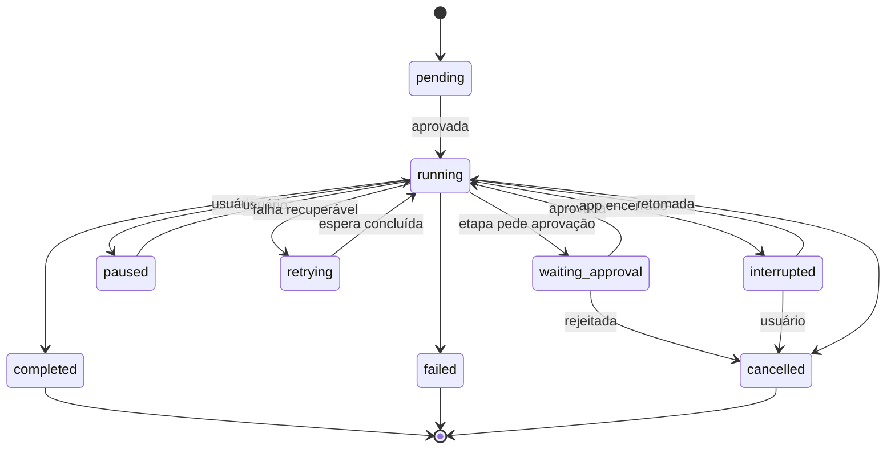
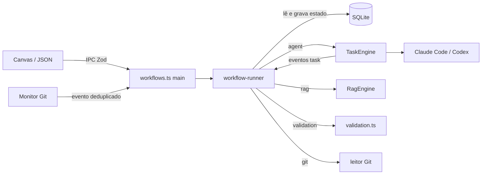

# Fase 31 — Advanced Workflow Orchestration: arquitetura e contratos

> Status: 31.1 parcial. O contrato v2, o acesso explícito do TaskEngine e a migração 0020 foram iniciados; runner integrado, editor visual e portões permanecem pendentes.

Visual Builder, Templates, Autonomous Execution & Git Automation.

**Status:** PENDENTE — NÃO INICIADA. Escopo, tarefas e critérios de aceite de cada subfase estão em [docs/PLAN.md](../PLAN.md#fase-31--advanced-workflow-orchestration). Este documento guarda o que serve às quatro subfases: estado real do código, decisões, contratos e máquinas de estado.

Os nomes abaixo são contratos propostos. A forma final pode mudar na implementação, desde que a decisão correspondente seja respeitada e a mudança fique registrada aqui.

## 1. Estado real do código (auditoria de 2026-10-30)

A Fase 27 consta como concluída no `PLAN.md`, mas o código entrega menos do que o texto sugere. O `docs/STATUS.md` já registrava parte disso como pendente.

| # | Achado | Evidência | Efeito na Fase 31 |
|---|---|---|---|
| A1 | `requiresApproval` é validado e salvo, mas nunca lido na execução. | Único uso em `packages/shared/src/workflows.ts`. | Aprovação por etapa não existe. Pré-requisito da 31.1. |
| A2 | A retomada após reinício não continua nada. `recover()` marca `paused`, `resume()` só troca o status, e o laço que executava morreu com o processo. A execução fica `running` para sempre. | `apps/desktop/src/main/workflows.ts`, `recover`, `resume` e o laço assíncrono de `run`. | Núcleo da 31.3. Contradiz o trecho "recuperação após reinício" da Fase 27 no `PLAN.md`. |
| A3 | Cancelar ou pausar a execução só atualiza `workflow_runs`. As tarefas em andamento continuam. | `pause` e `cancel` em `workflows.ts` não chamam o TaskEngine. | Pré-requisito da 31.1. |
| A4 | Nenhuma saída passa de uma etapa para a seguinte. Cada tarefa recebe só o próprio prompt. | `startTask({ prompt: step.prompt, ... })`. | Sem isso, os templates não funcionam. Pré-requisito da 31.1. |
| A5 | O modo de edição é decidido por palavras-chave do prompt. Em Acesso total, desde 2026-10-30, tudo é promovido a edição. Não há como pedir "somente leitura". | `route()` em `router.ts`; `askedToRead` em `engine.ts`; `StartInput` sem campo de acesso. | **Crítico.** Uma etapa de revisão ou uma automação Git poderia editar, sem checagem de permissões, em projeto com Acesso total. Pré-requisito da 31.1. |
| A6 | Etapas em `awaiting_approval` estouram o prazo fixo de 30 min por camada e derrubam a execução. | `deadline` em `workflows.ts`. | Corrigir na 31.1 junto com a aprovação. |
| A7 | `maxParallel` promete mais do que entrega: o TaskEngine roda uma tarefa por projeto. Etapas paralelas no mesmo projeto ficam em fila. | `inProjectQueue` em `engine.ts`. | Definir a semântica real de paralelismo na 31.1. |
| A8 | A execução não guarda a definição nem a versão usadas. | Colunas de `0014_workflow_runs.sql`. | Sem isso, retomar pode rodar outra definição. Pré-requisito da 31.3, resolvido na 31.1. |
| A9 | Não há retry nem backoff. A troca de agente existe só em tarefa de agente único que nasceu como leitura. O fluxo colaborativo não tem nenhuma. | `failover.ts`; bloco de `runRouted` em `engine.ts`. | Generalizar na 31.3. |
| A10 | No reinício, tarefas ativas viram `failed`. As sessões ficam em `task_steps.session_id` e podem ser reaproveitadas. | `TaskEngine.recover`, `TaskEngine.resume`. | Base da retomada de contexto. |
| A11 | Não há observador de Git nem de arquivos. O padrão de trabalho periódico existente é `setInterval` no processo principal com execução assíncrona. | Sem `fs.watch`; `history-sync-runtime.ts`. | Tudo novo na 31.4. |
| A12 | O executor Git é somente leitura e seguro (sem hooks, fsmonitor, diff externo ou textconv), mas só lê branches locais e não compara refs. Nomes de branch são recusados nos IPCs de commit. | `git.ts`, `git-history.ts`. | Estender na 31.4, com validação própria de refs. |
| A13 | A validação por comando existe, com lista fechada que já aceita `npm run test:integration` e `npm run test:e2e`. | `packages/workspace/src/validation.ts`. | Reaproveitar como nó; não é necessário ampliar a lista nem abrir ponto de aprovação. |
| A14 | Orçamento de tokens é por tarefa, não por execução. | `limits.tokenBudget`. | Criar limite por execução na 31.3. |
| A15 | `@xyflow/react` e bibliotecas de layout não estão instaladas. A CSP tem `style-src 'unsafe-inline'`, e o canvas não precisa de frame. | `apps/desktop/package.json`, `security/csp.ts`. | Dependência nova, instalada só na 31.1. |

## 2. Inventário

| Situação | Itens |
|---|---|
| **Existe e será reaproveitado** | TaskEngine (fila por projeto, aprovação, cancelamento, retomada, eventos, Guardian), router, adaptadores Claude e Codex, `compileWorkflow`, tabelas `workflows` e `workflow_runs`, permissões por projeto, skills, RagEngine, `validation.ts`, `snapshot.ts`, leitor Git, Mission Control, Token Intelligence, redator de segredos. |
| **Precisa ser estendido** | Schema de workflow (versão 2), `StartInput` (acesso, skills, política), `failover.ts`, `WorkflowsPage`, IPC `workflows:*`, leitor Git (refs e intervalo), lista de `validation.ts`. |
| **Inteiramente novo** | Canvas, compilador grafo ↔ definição, coordenador de execução, `workflow_run_steps`, biblioteca de templates, checkpoints, política de recuperação, gatilhos e automações Git. |

## 3. Decisões

1. **Sem segundo motor.** Toda etapa de agente é uma tarefa do TaskEngine. O coordenador só decide a ordem, nunca fala com uma CLI.
2. **Coordenador no pacote `orchestrator`.** O laço sai de `apps/desktop/src/main/workflows.ts` para `packages/orchestrator/src/workflow-runner.ts`, testável sem Electron, e o serviço do main vira uma camada fina de persistência e IPC. Reescreve-se só o laço, porque ele não sobrevive a reinício e não tem como ser estendido.
3. **O estado de execução vive no banco, não na memória.** Um passo do coordenador é uma função de `(definição, estado salvo) → próximas ações`. Retomar é chamar a mesma função. Assim, a recuperação não é um caminho de código à parte.
4. **`definition` continua sendo a fonte de verdade.** O grafo visual é derivado dela.
5. **Layout fora da definição.** Fica em `workflows.layout`. Arrastar um nó não cria versão nova do workflow.
6. **Acesso explícito por etapa.** `access: 'read-only' | 'edit'` é obrigatório nas etapas e tem precedência sobre o roteador e sobre a promoção do Acesso total.
7. **Segurança por padrão em automações.** Nenhuma automação Git edita, faz commit ou push sem aprovação humana da execução.
8. **Fila por projeto mantida para edição.** Etapas `read-only` explícitas podem rodar em paralelo. Etapas de edição do mesmo projeto ficam em fila, e a interface mostra isso. Um worktree por etapa fica fora desta fase.
9. **Nenhum `eval`.** Condições e interpolação usam gramática fechada.
10. **Saída de etapa é dado não confiável.** Vai para a etapa seguinte entre delimitadores, com aviso e limite de tamanho, como já acontece com o contexto do RAG.
11. **Sem provedor Git remoto.** Eventos de PR dependem de uma decisão sobre GitHub (31.4, seção de limites). "Pull Request Review" trabalha sobre diff local.
12. **Só com o app aberto.** Não há serviço em segundo plano no Windows. Ao abrir, o app compara os refs com o último cursor.

## 4. Contrato de workflow v2

```ts
type WorkflowStepKind = 'agent' | 'approval' | 'rag' | 'validation' | 'git' | 'condition';

interface WorkflowDefinitionV2 {
  schemaVersion: 2;
  name: string;
  projectId: string | null;
  maxParallel: number;            // 1..WORKFLOW_MAX_PARALLEL
  inputs: { id: string; label: string; required: boolean }[];
  steps: WorkflowStepV2[];        // até WORKFLOW_MAX_STEPS
  recovery?: RecoveryPolicy;      // 31.3: padrão da execução
  limits?: { tokenBudget?: number; maxDurationMs?: number }; // 31.3
}

interface WorkflowStepBase {
  id: string;                     // preservado entre editor e JSON
  title: string;
  dependsOn: string[];
  requiresApproval: boolean;      // pedido antes de iniciar a etapa
  timeoutMs?: number;             // limite: stepTimeoutMs do motor
  recovery?: RecoveryPolicy;      // 31.3: sobrepõe o padrão
}

type WorkflowStepV2 =
  | (WorkflowStepBase & { kind: 'agent'; prompt: string; agent: 'claude' | 'codex' | 'auto'; mode: RunMode; access: 'read-only' | 'edit'; skillIds?: string[] })
  | (WorkflowStepBase & { kind: 'approval'; message: string })
  | (WorkflowStepBase & { kind: 'rag'; query: string; topK: number })
  | (WorkflowStepBase & { kind: 'validation'; command: string })          // lista fechada de validation.ts
  | (WorkflowStepBase & { kind: 'git'; action: 'status' | 'diff' | 'log' | 'diff-range' }) // somente leitura
  | (WorkflowStepBase & { kind: 'condition'; when: ConditionExpr });      // 31.3
```

**Compatibilidade.** `normalizeWorkflow(input)` converte a v1 para a v2 ao ler: `kind: 'agent'`, `schemaVersion: 2`, `inputs: []`. Etapa v1 recebe `access: 'edit'` e `requiresApproval` como estava salvo, para não restringir silenciosamente um workflow existente. A exceção é o projeto em Acesso total, em que o editor pede revisão antes da primeira execução. O registro só é regravado quando o usuário salva. `compileWorkflow` continua aceitando a v1.

**Interpolação.** Só `{{inputs.<id>}}` e `{{steps.<id>.output}}`. O compilador rejeita referência a etapa que não seja dependência direta ou transitiva. Limite de 8 KB por saída, com corte marcado.

**Saída de etapa.** Vem de `tasks.summary` no caso de agentes, ou do resultado do executor nativo. Fica em `workflow_run_steps.output`, redigida.

## 5. Catálogo de nós

Regra: `support` diferente de `executable` aparece na paleta como "Planejado", não pode ser adicionado por arraste, e o compilador recusa o nó vindo de JSON ou importação.

| Nó | Classe | Compila para | Disponível em |
|---|---|---|---|
| Start | Visual | Nada; define as etapas sem dependência | 31.1 |
| End | Visual | Nada; define a saída final | 31.1 |
| Claude Code Agent | Executável | `agent`, `agent: 'claude'` | 31.1 |
| Codex Agent | Executável | `agent`, `agent: 'codex'` | 31.1 |
| Generic Agent | Executável | `agent`, `agent: 'auto'` (roteador) | 31.1 |
| Human Approval | Executável | `approval` | 31.1 |
| Parallel Execution | Visual estrutural | `dependsOn` compartilhado | 31.1 |
| Merge | Visual estrutural | `dependsOn` múltiplo | 31.1 |
| Skill Execution | Executável | `agent` com `skillIds` | 31.1 |
| RAG Search | Executável, requer extensão | `rag` | 31.2 |
| Validation (acréscimo necessário) | Executável, requer extensão | `validation` | 31.2 |
| Git Action, leitura | Executável, requer extensão | `git` | 31.2 (`diff-range` na 31.4) |
| Retry | Configuração | `recovery.retry` da etapa ligada | 31.3 |
| Fallback | Configuração | `recovery.fallback` da etapa ligada | 31.3 |
| Condition | Executável, requer extensão | `condition`, etapas puladas | 31.3 |
| Git Action, escrita | Fora da fase | Exige decisão própria de produto e segurança | Não planejado |

O nó **Validation** não constava do pedido original. Sem ele, "Executar testes" dos templates seria um pedido a um agente, sem prova real. Ele reaproveita `validation.ts`.

## 6. Modelo de dados

Números previstos, a confirmar pela sequência real de `packages/database/migrations` ao implementar. Hoje a última é `0019_task_pause`. Todas são aditivas.

| Migração | Subfase | Conteúdo |
|---|---|---|
| `0020_workflow_v2` | 31.1 | `workflows.layout`; em `workflow_runs`: `definition_snapshot`, `definition_version`, `inputs`, `trigger`. Nova `workflow_run_steps`. |
| `0021_workflow_templates` | 31.2 | `workflow_templates` (usuário e importados), `workflow_template_favorites`, `workflows.template_id` e `template_version`. |
| `0022_workflow_recovery` | 31.3 | `workflow_checkpoints`, `workflow_step_attempts`, `workflow_runs.recovery_state`. |
| `0023_git_automations` | 31.4 | `git_automations`, `git_automation_events` (com `dedupe_key` único), `git_ref_cursors`. |

```sql
-- workflow_run_steps (0020)
run_id, step_id, status, attempt, task_id, output, error, started_at, finished_at
PRIMARY KEY (run_id, step_id)

-- workflow_checkpoints (0022): uma linha por transição; nunca guarda credenciais
id, run_id, workflow_id, definition_version, sequence, completed, pending,
artifacts, provider, approval_state, recovery_meta, created_at

-- workflow_step_attempts (0022)
id, run_id, step_id, attempt, provider, task_id, failure_kind, delay_ms,
decision, reason, started_at, finished_at

-- git_automation_events (0023)
id, automation_id, project_id, kind, ref, commit_hash, dedupe_key UNIQUE,
run_id, status, reason, created_at
```

## 7. Máquina de estados da execução



`waiting_approval`, `retrying` e `interrupted` são estados novos da 31.1 e da 31.3. `paused` deixa de significar "interrompida no reinício".

## 8. Fluxo de execução



O coordenador reage aos eventos `task` do TaskEngine. O polling de 250 ms do código atual é removido.

## 9. Política de recuperação

```ts
interface RecoveryPolicy {
  retry?: { maxAttempts: number; baseDelayMs: number; maxDelayMs: number; maxTotalMs: number; jitter: 'full'; on: FailureKind[] };
  fallback?: { to: 'claude' | 'codex'; on: FailureKind[]; allowEdit: boolean };
  autoResume?: boolean;
}
```

`FailureKind` estende `AgentFailureKind`, separando `rate_limit` (429), `provider_overloaded` (529 e 5xx), `network`, `timeout` e `usage_limit` (cota do plano).

| Falha | Retry | Fallback | Observação |
|---|---|---|---|
| `rate_limit` | Sim, respeita `Retry-After` quando informado | Sim | |
| `provider_overloaded` | Sim | Sim | |
| `network` | Sim | Não ajuda se a rede caiu | Verificar disponibilidade antes |
| `timeout` | Uma vez | Sim | Etapa de edição: só se nada mudou |
| `usage_limit` | Não, a cota não volta em segundos | Sim | |
| `context_limit` | Não | Sim | |
| `authentication` | Não | Sim, em leitura | Avisar o usuário |
| `permission`, `execution` | Não | Não | Reportar |

**Regra de efeito colateral.** Antes de repetir ou trocar de agente numa etapa, o `workflow-runner` compara a árvore de trabalho com o snapshot do início (`snapshot.ts`, `changedSince`).

| Etapa | Nada mudou | Algo mudou |
|---|---|---|
| `read-only` | Repete ou troca | Não se aplica |
| `edit` | Repete ou troca, se `allowEdit` | **Para e pede decisão humana** |
| `validation`, `rag`, `git` leitura | Repete | Não se aplica |

**Fallback seguro.** Exige agente alternativo disponível, `capabilities` compatíveis (saída estruturada, skill, imagem, MCP), e registra o motivo. A transferência de contexto usa saídas das etapas, resumo da tentativa falha e referências de artefatos. Não reaproveita sessão entre agentes. Fallback nunca escala permissão.

## 10. Matriz de retomada

| Situação | Etapa concluída | Etapa `read-only` em andamento | Etapa `edit` em andamento | Aguardando aprovação |
|---|---|---|---|---|
| Fechamento inesperado do Electron | Não repete | Repete se `autoResume`; senão pede | **Pede confirmação**, mostrando o diff | Mantém o pedido |
| Reinício normal do app | Não repete | Idem | **Pede confirmação** | Mantém o pedido |
| Rede ou provedor temporário | Não repete | Retry automático | Retry só sem mudanças | Mantém o pedido |
| Cancelamento pelo usuário | Não repete | Não retoma | Não retoma | Não retoma |
| Versão do workflow alterada | Usa `definition_snapshot` | Idem | Idem | Idem |

Toda retomada de etapa cria uma tentativa nova, com `claim` transacional em `workflow_run_steps`. Assim, duas retomadas simultâneas não iniciam a mesma etapa.

## 11. Gatilhos Git

| Gatilho | Detecção | Dedupe |
|---|---|---|
| Novo commit, atualização de branch | Comparação de `for-each-ref` com `git_ref_cursors` | `automação + ref + hash` |
| Arquivos específicos | Filtro glob sobre os arquivos do intervalo | Idem |
| Diff entre branches | Sob demanda, `diff-range` | `automação + base + head` |
| Execução manual por commit ou branch | Ação na página Git Intelligence | Sem dedupe; pede confirmação |
| Novas alterações locais | Comparação do hash de `git status --porcelain` | `automação + hash do status` |

Prevenção de laço: alterações feitas por tarefas de workflow (`filesChanged`, janela de execução e branch) não disparam automações. Há também limite por hora e por projeto, além de um disjuntor que desliga a automação depois de N falhas seguidas.

Eventos remotos de PR ficam fora: exigiriam credencial, API do provedor e fluxo de autorização próprios.

## 12. Dependências novas previstas

Instalar somente na subfase indicada, com licença registrada em `docs/THIRD-PARTY.md`.

| Pacote | Subfase | Motivo |
|---|---|---|
| `@xyflow/react` (MIT) | 31.1 | Canvas. Medir o impacto no pacote do renderer e carregar a rota sob demanda. |
| `@dagrejs/dagre` (MIT) ou `elkjs` (EPL-2.0) | 31.1 | Layout automático. Preferir dagre pela licença e pelo tamanho. |

Gatilhos não precisam de dependência. Glob de arquivos deve reaproveitar o que o repositório já tiver antes de considerar um pacote novo.

## 13. Fora do escopo

Marketplace e compartilhamento remoto de templates, operações Git de escrita, eventos remotos de PR, execução com o app fechado, worktree por etapa, DSL arbitrária e agentes além de Claude Code e Codex.

## Homologação do Template 3 — Automated QA Pipeline (2026-11-01)

O Template 3 foi auditado contra o executor existente e não exigiu alteração no allowlist de `validation.ts`: `npm test`, `npm run test:integration` e `npm run test:e2e` já pertencem à gramática permitida. `apps/desktop/test/workflows.test.ts` agora executa o template com Git real, os três comandos em um projeto npm temporário e o relatório final persistido pelo Workflow Coordinator. A execução espera os passos nativos de forma assíncrona e confirma que todos os passos terminam como `completed`.

O Template 3 pode ser considerado homologado localmente; a Fase 31 só será encerrada quando seus demais critérios históricos e gates globais estiverem reconciliados. Nenhum executor paralelo, commit, push ou merge foi criado.
