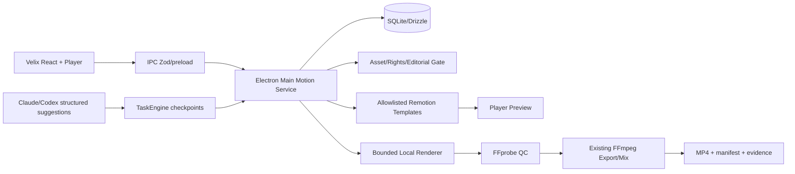

# Fase 39 — Velix Motion Engine

**Status:** PLANEJADA (2026-11-01). Planejamento somente; sem instalação, implementação ou commit.

## 1. Objetivo e limites

Evoluir o Velix para um estúdio híbrido com cenas React declarativas, motion graphics, captions cinematográficas, templates versionados, preview com `@remotion/player` e render local Remotion integrado ao Electron, preservando FFmpeg/FFprobe. Não substitui FFmpeg, não publica automaticamente, não usa mídia sem direitos, não altera aprovação editorial, não executa código gerado por agentes e não depende de Claude/Codex/ElevenLabs/YouTube reais na PoC.

## 2. Auditoria técnica

| Área | Evidência atual | Decisão para 39 |
|---|---|---|
| Electron | `apps/desktop/src/main/index.ts`, `window.ts`, `security/*` | Motion service no main, com processo filho controlado |
| IPC/preload | `apps/desktop/src/preload/index.ts`, `packages/shared/src/ipc.ts`, `channels.ts` | schemas Zod e allowlist aditivos |
| Renderer | `features/video/VelixPage.tsx`, `VelixStudio.tsx`, React Query | painel Player/timeline incremental |
| Timeline/Dossiê | `packages/workspace/src/velix-studio.ts`, `velix-production-scenes.ts`, `velix-dossie.ts`, `motion/roteiro.json` | adapter declarativo, sem reescrita do Dossiê |
| FFmpeg/FFprobe | `velix.ts`, `velix-clip-render.ts`, `videoRenderJobs`, `tests/e2e/video.spec.ts`, `velix-journey.spec.ts` | continua export/QC/mixagem; Remotion é adapter novo |
| Clip Hunter | `velix-clip-hunter.ts`, discovery UI e jobs locais | clips aprovados entram por referência/timecode |
| Editorial/direitos | `velix_editorial_*`, `velix_media_rights`, `velixLocalAssets` | gate obrigatório antes de preview/render |
| Persistência | SQLite/Drizzle, migrações aditivas, `video_render_jobs` | adicionar templates/cenas/attempts sem reescrever histórico |
| IA/skills | `packages/agents`, `packages/orchestrator/src/velix-contract.ts`, TaskEngine, Skills Manager | sugestões estruturadas; nenhum TS/JS executável |
| Recovery | `workflow-runner.ts` com cancel/retry/recover/checkpoints | adapter de job idempotente e reconciliado no startup |
| Testes | Vitest em packages/apps e Playwright Electron, fixtures MP4 sintéticas | unit + integration + E2E + empacotado |

### Regras preservadas

Renderer só fala por IPC validado; caminhos são relativos e resolvidos no main. Banco é autoridade para projeto, aprovação, direitos e proveniência. Conteúdo de roteiro, template importado, diff, saída de agente e URLs são dados não confiáveis. Read-only nunca edita. Fases 36/37 e o pipeline legado permanecem compatíveis.

## 3. Arquitetura



Motion Engine é um serviço/adaptador, não um segundo orquestrador. Preview é read-only. Templates são código empacotado e allowlisted; dados nunca viram import, expressão, URL ou código. Remotion renderiza composição/intermediário; FFmpeg segue responsável pelo pipeline existente. FFprobe só libera `completed` após codec, duração, resolução, áudio, integridade e hash/manifest válidos.

## 4. Contratos propostos

```ts
type MotionProject = { schemaVersion: 1; projectId: string; templateId: string; templateVersion: number; width: number; height: number; fps: number; durationInFrames: number; scenes: MotionScene[]; assets: AuthorizedAssetRef[]; captions?: Caption[] };
type MotionScene = { id: string; from: number; durationInFrames: number; kind: string; props: Record<string, unknown>; transition?: Transition };
type Caption = { text: string; startMs: number; endMs: number; timestampMs: number | null; confidence: number | null; pageBreakAfter?: boolean };
```

`motion:template:list/get`, `motion:preview`, `motion:render:start/status/cancel/retry/list`, `motion:timeline:load/save`, `motion:captions:import/sync`, `motion:asset:authorize` e `motion:compose:suggest` serão canais versionados e validados. `compose:suggest` retorna patch declarativo revisável; nunca código. Jobs: `pending → running → validating → completed`, com `waiting_approval`, `retrying`, `interrupted`, `cancelled`, `failed`. Retry usa input imutável e nova tentativa; cancelamento mata somente o processo filho do job.

Captions seguem JSON e o tipo Remotion `Caption`, com tempos em ms, confiança/proveniência e validação de sobreposição. ElevenLabs entra somente por importação manual de MP3/WAV ou fixture autorizada; nenhuma API é requisito da PoC.

## 5. Roadmap por lotes

### 39.1 — Auditoria, arquitetura e contratos

- **Objetivo/escopo:** congelar schemas, fronteiras, segurança, limites e matriz de migração. Prever `packages/shared/src/motion.ts`, `ipc.ts`, `channels.ts`, schemas database, `packages/workspace/src/motion-*`, handlers main/preload e fixtures.
- **Dependências/contratos:** baseline 34–38, TaskEngine, Zod, capability manifest, state machine e rights gate. Confirmar o próximo número de migration antes de criar migration.
- **Riscos/testes:** divergência IPC, colisão de migration e escopo; testar schemas, traversal, rights/editorial, idempotência e estados cancel/retry/recovery.
- **Aceite/rollback/evidência:** contratos e matriz aprovados sem runtime Remotion; rollback apenas de contratos sem consumidores; fixtures, matriz de canais e `git diff --check`.

### 39.2 — Integração mínima Remotion e render isolado

- **Objetivo:** PoC local com título animado, legenda, transição e MP4.
- **Escopo:** bundle/template PoC, renderer main, job persistido e bridge de QC, sem remover FFmpeg.
- **Dependências/contratos:** 39.1 e runtime aprovado; composição allowlisted, output temporário controlado, manifest FFprobe.
- **Riscos/testes:** Chromium/Windows, codec, CPU/RAM e licença; testar render sintético, FFprobe, cancel/retry/restart e regressão FFmpeg.
- **Aceite/rollback/evidência:** MP4 curto autorizado e validado; feature flag volta ao Dossiê/FFmpeg; MP4, JSON FFprobe e logs.

### 39.3 — Preview integrado ao Velix

- **Objetivo:** Player interativo e timeline.
- **Escopo:** `VelixMotionPreview.tsx`, queries/mutations, frame seek, fallback legacy, snapshots/E2E.
- **Dependências/contratos:** 39.2, `MASTER.md`, preview read-only, reduced motion e versão otimista.
- **Riscos/testes:** renderer pesado/CSP/estado divergente; testar IPC, acessibilidade, 375/768/1024/1440, reduced motion e restart.
- **Aceite/rollback/evidência:** preview sem perda de projeto legado; ocultar aba por flag; screenshots, trace e medição.

### 39.4 — Biblioteca de templates e identidade visual

- **Objetivo:** catálogo React versionado.
- **Escopo:** manifest/capabilities, title/lower-third/card/transitions, tokens do `MASTER.md`, licença e compatibilidade.
- **Dependências/contratos:** 39.2–39.3; `templateId` + versão e imports fixos.
- **Riscos/testes:** drift, fontes e template quebrado; snapshots, smoke render, contraste/foco e reduced motion.
- **Aceite/rollback/evidência:** preto e laranja oficiais (`#F97316`), Inter, sem emojis como ícones, foco acessível; fixar versão anterior; manifest/snapshots/licenças.

### 39.5 — Legendas cinematográficas

- **Objetivo:** sincronizar narração e captions.
- **Escopo:** SRT/JSON, `Caption[]`, quebra de linhas, safe-area e áudio importado.
- **Dependências/contratos:** templates e fixture áudio; caption editável e sem alteração silenciosa do editorial.
- **Riscos/testes:** transcrição/tempo/legibilidade; SRT inválido, áudio curto/longo, sobreposição, E2E offline.
- **Aceite/rollback/evidência:** preview e MP4 sincronizados; fallback simples; JSON, áudio, screenshot e FFprobe.

### 39.6 — Motion graphics e infográficos

- **Objetivo:** primitives declarativas para cards, barras e dados.
- **Escopo:** easing, safe-area, textos acessíveis e chart specs com fonte obrigatória.
- **Dependências/contratos:** templates/captions; dados e proveniência explícitos.
- **Riscos/testes:** escala enganosa/overflow/performance; casos zero/negativo/ausente, snapshots e benchmark.
- **Aceite/rollback/evidência:** infográfico reproduzível e auditável; primitives básicas/legacy como fallback; fixtures e relatório.

### 39.7 — Composição assistida por Claude/Codex

- **Objetivo:** sugestões declarativas com revisão humana.
- **Escopo:** adapter TaskEngine, prompt delimitado, schema strict, diff/aprovação e capability no Skills Manager.
- **Dependências/contratos:** 39.1–39.6, permissões; read-only por padrão, sem código/shell/URL.
- **Riscos/testes:** injection, fatos inventados e alteração silenciosa; fixtures maliciosas, provider indisponível, cancelamento e decisão.
- **Aceite/rollback/evidência:** só patch aprovado renderiza; desabilitar provider e editar JSON; prompt/schema/decisão/auditoria.

### 39.8 — Exportação híbrida e homologação

- **Objetivo:** consolidar MP4, QC, recovery, Windows e licença.
- **Escopo:** export adapter, manifest, health/recovery, electron-builder e relatório.
- **Dependências/contratos:** lotes anteriores; artefato só `completed` após FFprobe.
- **Riscos/testes:** Chromium, SmartScreen, codec, licença e recursos; empacotado, offline, crash/restart, carga e regressão FFmpeg.
- **Aceite/rollback/evidência:** PoC/casos autorizados homologados, sem publicação; flag/export legacy; pacote, MP4, FFprobe, logs, performance e notices.

## 6. Matriz de riscos, limites e segurança

| Risco | Mitigação/gate |
|---|---|
| RAM/CPU | 1 render por projeto, 2 global inicialmente, worker bounded, fila persistida e abortar acima do limite |
| Processo órfão | PID ownership, heartbeat, kill tree e reconciliação no startup |
| traversal/SSRF | `realpath` dentro da raiz, MIME/hash/extensão; URL remota só metadado |
| direitos | somente `verified_allowed` ou `conditional` satisfeita; `unverified/blocked` rejeitado |
| editorial | `editorialVersionId` + hash aprovado; mudança exige nova revisão |
| template malicioso | templates revisados/empacotados; agente só produz dados |
| crash/retry | SQLite, attempts/checkpoints, retry idempotente e decisão para escrita interrompida |
| licença/codec | manifest de versões/licenças e FFprobe obrigatório; gate legal em 39.8 |

Automações não fazem commit/push/checkout/merge. Nenhuma composição inventa fatos ou estatísticas. Nenhuma publicação é automática.

## 7. Plano de testes e prova de conceito

Fixture local autorizada em projeto temporário: título animado, uma legenda JSON/SRT, transição, áudio fixture (ou narração previamente importada), preview Player, export MP4, FFprobe e passagem no FFmpeg legado. Não chama Claude, Codex, ElevenLabs ou YouTube.

Unit: schemas, frame math, captions, easing, direitos, paths, manifest, estados/retry. Integration: main/preload/IPC, renderer isolado, cancelamento, recovery, FFprobe e migrations. E2E Electron: abrir Velix, carregar template, seek, exportar, cancelar, retry, reiniciar e bloquear asset. Empacotado Windows: NSIS, CSP, offline, paths com espaços/acentos, limpeza. Performance: preview/render, CPU/RAM, concorrência, 9:16/16:9 e reduced motion.

## 8. Integração, rollback e homologação

Usar feature flag e adapter separado. Persistência aditiva/versionada; o migration number será confirmado antes da implementação. UI mostra fonte, direitos, versão editorial, template e QC. Homologação exige PoC autorizada, MP4 reproduzível, FFprobe aprovado, regressão FFmpeg aprovada, cancel/retry/recovery, rights/editorial gates, pacote Windows e revisão de licenças.

## 9. Licenciamento

Antes de instalar/empacotar, registrar versões/licenças de Remotion, `@remotion/player`, renderer, React, Chromium/browser runtime, fontes, codecs, assets e transitivos. Confirmar cobertura para uso local e distribuição Windows e eventual licença comercial Remotion; gerar notices. Preservar a licença/distribuição FFmpeg existente.

## 10. Primeiro lote e prompt

O primeiro lote é **39.1 — Auditoria, arquitetura e contratos**.

> Leia `docs/PLAN.md`, `docs/STATUS.md`, este plano e os planos 34–38, além de `design-system/neuralbridge-intelligent-workspace/MASTER.md`. Implemente somente 39.1: audite e adicione schemas/tipos compartilhados para `MotionProject`, `MotionScene`, `Caption`, `TemplateManifest`, `AuthorizedAssetRef`, `MotionRenderJob` e eventos; declare canais IPC sem handlers funcionais; defina matriz de migração aditiva e confirme o próximo número antes de criar migration; adicione testes de schema, traversal, rights/editorial, idempotência e cancel/retry/recovery. Não instale dependências, não crie bundle Remotion, não implemente preview/render, não altere FFmpeg, não use provedores reais, não crie commit e preserve Fases 36/37. Rode apenas validações estreitas afetadas e registre evidências/bloqueios reais em PLAN/STATUS.

## Checkpoint 39.5, 39.7 e 39.8 (2026-11-01)

- **39.5 implementada parcialmente no fluxo existente:** `alignVelixMotionVoice` usa o transcritor já empacotado, confina o áudio à raiz do projeto, alinha tokens de legendas em ordem e retorna misses para revisão humana. IPC, preload, direitos e UI foram integrados sem alterar o contrato de publicação.
- **39.7 implementada:** a sugestão de composição passa pelo `TaskEngine.runStructuredReadOnly`, é persistida/auditada, validada pelo schema compartilhado e exposta como capacidade `neuralbridge:motion-composition` no Skills Manager. A aplicação da sugestão continua uma ação humana; não há publicação ou render automático.
- Evidência: `video-motion.test.ts`, `velix-motion.test.ts`, `skills-intelligence.test.ts` e `engine.test.ts` passaram na rodada focada; o E2E real com `NB_MOTION=1` passou 1/1 e FFprobe confirmou o vídeo gerado. A primeira tentativa sem navegador explícito foi bloqueada pelo guard correto do runtime isolado e não foi tratada como falha de produto.
- **39.8 continua aberta:** instalação NSIS em máquina limpa, validação com narração em ambiente empacotado e decisão jurídica da licença Remotion ainda são externas. O navegador segue download sob demanda e o compositor Windows permanece no pacote Motion conforme o registro de terceiros.
