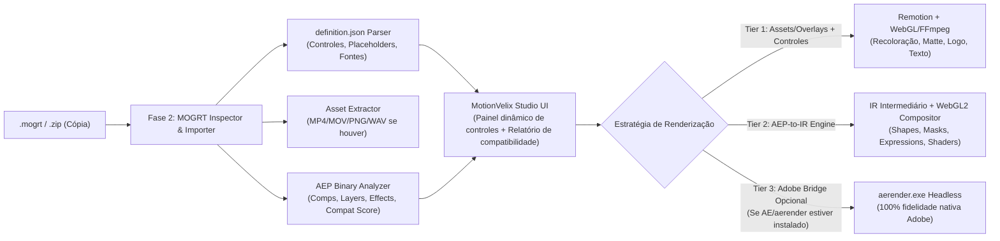

# Relatório de Viabilidade Técnica — MotionVelix MOGRT Engine (Fase 1)

> [!IMPORTANT]
> **Veredito direto:** **Extrair metadados, thumbnails, placeholders e TODOS os controles editáveis de qualquer `.mogrt` é 100% viável e rápido (dias).**
> **Renderizar fielmente um `.mogrt` criado no After Effects (`authorApp: "aefx"`) SEM Adobe em tempo de execução** é um problema de **reimplementar um subconjunto do motor do After Effects** — **viável em níveis progressivos** dependendo do tipo de `.mogrt`, mas **NÃO existe compatibilidade universal 100% fiel** para efeitos proprietários fechados da Adobe sem reimplementá-los em WebGL/GLSL (e mesmo assim com divergências de seed/ruído).

---

## 1. Auditoria Forense do Pack Real

Arquivo inspecionado (cópia isolada; arquivo original preservado intacto):
- **Pacote:** `PREMIERE_PRO_dynamic-anime-burst-logo-pack-311486_supported_software.zip`
- **Conteúdo:**
  - `Dynamic Anime Burst Logo 01.mogrt` (1,05 MB)
  - `Dynamic Anime Burst Logo 02.mogrt` (1,67 MB)
  - `Font/Font.txt` → `Montserrat` (FontSquirrel — SIL Open Font License 1.1)
  - `Help/MOGRT Help.mp4` (10,07 MB)

### Estrutura interna descoberta nos `.mogrt`

Um `.mogrt` é um container **ZIP** contendo:
1. `definition.json` — **JSON aberto e estruturado** com nome, resolução (`4096×2304`, `30 fps`, `7,27s`), espaço de cor (`BT.709 RGB Full`), lista de efeitos (`usedEffects`), fontes (`Montserrat-Bold`) e **todos os controles editáveis (`clientControls` / `capsuleparams`)**.
2. `thumb.png` — miniatura oficial do template.
3. `project.aegraphic` — **outro container ZIP** contendo:
   - `Dynamic Anime Burst Logo Pack.aep` (**2,49 MB** — arquivo binário proprietário do After Effects no formato `RIFX/Egg!`, **sem especificação pública oficial da Adobe**).
   - `Dynamic Anime Burst Logo PackReport.txt` — relatório de coleta gerado pelo AE.
   - `Thumbnails/*.png` — miniaturas dos placeholders de logo e fundo.

### Descoberta crítica sobre este pack específico

| Métrica forense | Logo 01 | Logo 02 |
| --- | ---: | ---: |
| **Vídeos/PNGs pré-renderizados embutidos** | **0 arquivos (0 KB)** | **0 arquivos (0 KB)** |
| **Composições aninhadas (precomps)** | 16 | 19 |
| **Camadas (`Layr`)** | 43 | 54 |
| **Streams de keyframes (`ldat`)** | 1.070 | 3.747 |
| **Máscaras Bezier animadas (`ADBE Mask Shape`)** | 106 | 384 |
| **Vetores Shape Layer (`ADBE Vector Shape`)** | 16 | 11 |
| **Expressões JavaScript do AE** | 120 | 112 |
| **Controles editáveis em `definition.json`** | 27 | 30 |
| **Efeitos nativos do AE usados** | 21 | 21 |
| **Plugins de terceiros (Trapcode, Saber, etc.)** | **0** | **0** |

> [!WARNING]
> **O que isso significa na prática:** Este pack **não contém vídeos/overlays de fogo ou fumaça prontos**. Toda a animação anime 2D é gerada em tempo real dentro do After Effects combinando **centenas de máscaras Bezier animadas (106–384)** + **efeitos proprietários encadeados** (`Turbulent Displace`, `Fractal Noise`, `Vegas`, `Scribble`, `Simple Choker`, `Displacement Map`, `CC Radial Blur`) + **112–120 expressões JS**.

---

## 2. Matriz de Compatibilidade com Evidências Técnicas

### A. Metadados, Controles e Assets (`definition.json`)

| Recurso | Evidência no Pack | Viabilidade sem Adobe | Complexidade |
| --- | --- | --- | --- |
| Leitura do ZIP `.mogrt` e `.aegraphic` | Testado via parser ZIP | **100% compatível** | Baixa |
| Metadados (nome, duração, FPS, 4K, fonte) | `sourceInfoLocalized` | **100% compatível** | Baixa |
| Controles de Cor (`type: 4`, RGBA float) | 10–12 cores por template | **100% compatível** | Baixa |
| Controles de Texto (`type: 6`, fonte, tamanho, caps) | `Text` (`Montserrat-Bold`) | **100% compatível** | Baixa |
| Controles Numéricos / Checkbox / Ponto / Escala | `type: 1, 2, 3, 5, 9` | **100% compatível** | Baixa |
| Media Placeholders (`type: 14`) | `Logo Placeholder` (500×500), `BG Placeholder` (4096×2304) | **100% compatível** | Baixa |
| Assets pré-renderizados (quando presentes em outros packs) | `0` neste pack; comum em packs de overlay | **100% compatível** (extração + recoloração via FFmpeg/WebGL) | Baixa |

### B. Leitura do Projeto Binário `.aep` (`RIFX/Egg!`)

| Recurso | Evidência no Pack | Viabilidade sem Adobe | Observação Técnica |
| --- | --- | --- | --- |
| Hierarquia de comps, camadas, in/out, blend modes | 16–19 comps, 43–54 layers | **Viável via engenharia reversa** | Formato `RIFX` não documentado (bibliotecas OSS parciais como `aep-parser` em Python existem, mas variam por versão do AE) |
| Keyframes de Transform (posição, escala, rotação, opacidade) | 1.070–3.747 `ldat` | **Viável (parcial → alta)** | Curvas temporais/espaciais Bezier do AE exigem decodificação binária exata |
| Máscaras Bezier animadas (`ADBE Mask Shape`) | **106 (L01) / 384 (L02)** | **Viável, mas trabalhoso** | Exige decodificador de vértices/tangentes `shph`/`ldat` + interpolação de caminhos + feather/expansion |
| Expressões JS do AE (`comp()`, `effect()`, `wiggle()`, `valueAtTime()`) | **112–120 expressões** | **Parcial (sandbox JS)** | Expressões de vínculo de controle (`comp().layer("Controls").effect(...)`) são simples; `wiggle()` tem RNG proprietário da Adobe |

### C. Efeitos Nativos do After Effects encontrados no Pack (25 únicos no total)

| Categoria | Efeitos encontrados no pack | Equivalente WebGL / Remotion / FFmpeg | Fidelidade esperada sem Adobe |
| --- | --- | --- | --- |
| **Controles (4)** | `Checkbox Control`, `Color Control`, `Point Control`, `Slider Control` | Variáveis de estado no IR | **100% exato** |
| **Cor & Composição (7)** | `Fill`, `Tint`, `Transform`, `Drop Shadow`, `Shift Channels`, `Set Matte`, `Gradient Ramp` | Shaders WebGL2 / Canvas / SVG | **95–100% fiel** |
| **Processamento de Imagem (7)** | `Fast Box Blur`, `Glow`, `Curves`, `Exposure`, `Noise`, `Mosaic`, `Posterize Time` | Shaders WebGL2 multi-pass + quantização de tempo | **85–95% fiel** |
| **Distorção & Choke (3)** | `Displacement Map`, `Simple Choker`, `CC Radial Blur` | Shaders WebGL2 (mapa UV, morfologia/distância de alpha, blur radial) | **80–90% fiel** |
| **Geradores Proprietários Complexos (4)** | **`Turbulent Displace`** (106/85 refs), **`Fractal Noise`** (99 refs), **`Scribble`** (95 refs), **`Vegas`** (`APC Vegas`, 115 refs) | **Sem equivalente idêntico pronto** — algoritmos fechados da Adobe | **Baixa a Média (40–70%)** sem reimplementação dedicada em WebGL/Canvas; seeds e padrões de ruído/traço divergem do AE |

---

## 3. Arquitetura Proposta — MotionVelix MOGRT Engine

### Os 3 Níveis (Tiers) de Execução

1. **Tier 1 — MOGRT Importer + Asset-Backed Engine (Altíssimo ROI, zero Adobe):**
   - Importa qualquer `.mogrt`/`.zip`, lê `definition.json`, exibe automaticamente todos os controles reais na UI do Aethera e mostra um **Relatório de Compatibilidade honesto** (quais efeitos são suportados, quais são parciais e quais exigem motor Adobe).
   - Para packs que contêm **overlays/vídeos pré-renderizados** (muito comuns em Envato/MotionArray, como fogo/fumaça/partículas em MOV/MP4 com alpha/luma matte), extrai os assets e renderiza **100% fiel** no Remotion + FFmpeg com logo da Biblioteca, textos e recoloração.
   - **Nota sobre este pack (`Dynamic Anime Burst Logo Pack`):** como ele tem `0` assets pré-renderizados e depende fortemente de `Turbulent Displace` + `Vegas` + `Scribble` + `384 máscaras`, o Tier 1 **classificaria corretamente como incompatível para renderização nativa sem motor AEP**, sem jamais substituir silenciosamente por uma animação genérica.

2. **Tier 2 — Motor Nativo AEP → IR → WebGL2 + Remotion (Sem Adobe, esforço alto):**
   - Parser binário `RIFX/Egg!` do `.aep` convertendo para um **IR (Intermediate Representation)** determinístico (comps, camadas, keyframes Bezier, máscaras, texto, expressões).
   - Motor de composição multi-pass em **WebGL2** (reutilizável tanto no Preview `@remotion/player` quanto no render headless para garantir paridade Preview = MP4).
   - Implementação gradual de shaders equivalentes para os efeitos nativos mais comuns (`Fill`, `Tint`, `Glow`, `Fast Box Blur`, `Curves`, `Set Matte`, `Displacement Map`, `Simple Choker`, `CC Radial Blur`, `Fractal Noise`, `Turbulent Displace`).
   - **Limite honesto:** efeitos gerativos muito específicos como `Scribble` e `Vegas`, além de `wiggle()` e ruídos com seed interno do AE, terão **equivalentes aproximados**, nunca idênticos bit-a-bit ao After Effects.

3. **Tier 3 — Bridge Opcional Local (`aerender.exe`) ou Conversão Assistida (Bônus estratégico):**
   - Se o usuário tiver After Effects instalado na máquina (ou num Remote Host), o Aethera pode **opcionalmente** oferecer um modo "Renderizar via Adobe Engine local" ou "Assar (bake) camadas de efeito em overlay transparente (WebM/ProRes Alpha)" uma única vez — transformando qualquer `.mogrt` complexo em um template **Tier 1 ultrarrápido e 100% idêntico** no Aethera, sem precisar mais do AE depois do bake!

---

## 4. Riscos Técnicos e Licenciamento

### Riscos Técnicos
1. **Formato `.aep` proprietário e não documentado:** pequenas mudanças entre versões do After Effects (CC 2019 → 2026) alteram offsets internos dos chunks `RIFX` (`tdgp`, `ldat`, `shph`, `btdk`), podendo quebrar a leitura de projetos específicos.
2. **Paridade visual em efeitos gerativos:** `Turbulent Displace`, `Fractal Noise`, `Scribble` e `Vegas` não têm fórmulas públicas; diferenças de frequência/seed mudam a silhueta das chamas/energia.
3. **Expressões arbitrárias:** projetos `.mogrt` de terceiros podem conter expressões JS complexas com APIs internas do AE (`sourceRectAtTime`, `toComp`, `sampleImage`). Executar expressões exige sandbox seguro (sem acesso a Node/FS/rede).
4. **Custo de manutenção:** manter um mini-After Effects em WebGL2 é um projeto contínuo (similar ao esforço de projetos como Lottie/Rive, que deliberadamente restringem o subconjunto do AE suportado).

### Licenciamento e Uso Legal
- **Pack analisado:** não inclui arquivo `LICENSE.txt` dentro do ZIP (apenas `Font/Font.txt` apontando para `Montserrat`, que é **SIL OFL 1.1**, livre para uso comercial). Templates comprados em marketplaces (Envato Elements, VideoHive, MotionArray) geralmente permitem **uso em vídeos finais renderizados**, mas **proíbem redistribuir os arquivos `.mogrt`/assets originais dentro de um software comercial**. Portanto, o Aethera deve tratar packs `.mogrt` como **arquivos importados localmente pelo próprio usuário**, nunca embutidos no instalador do Aethera.
- **Formato `.mogrt` / `.aep`:** ler arquivos fornecidos pelo usuário para interoperabilidade não exige SDK da Adobe, mas não se deve redistribuir binários, fontes licenciadas ou plugins proprietários da Adobe.

---

## 5. Estimativa de Esforço Realista

| Escopo | O que entrega | Esforço estimado | Fidelidade no pack de teste |
| --- | --- | --- | --- |
| **Fase 2 — Importador & Inspetor `.mogrt` (Tier 1)** | Upload `.mogrt`/`.zip`, extração de controles, thumbnails, fontes, assets pré-renderizados, UI dinâmica no MotionVelix + matriz de compatibilidade por arquivo | **3 a 5 dias** | Extração 100% fiel; renderização nativa apenas para packs com overlays pré-renderizados |
| **Fase 3A — Parser `.aep` + IR + Compositor Básico (Tier 2 Core)** | Leitura de comps, layers, transform/opacity keyframes, textos, máscaras estáticas/animadas, expressões de controle e 12 efeitos básicos em WebGL2/Remotion | **3 a 5 semanas** | **45–60%** (estrutura, timing, logo e texto OK; efeitos gerativos ausentes/parciais) |
| **Fase 3B — Shaders Avançados (`Fractal Noise`, `Turbulent Displace`, `Choker`, `Vegas`, `Scribble`)** | Equivalentes WebGL2 para os 21 efeitos do pack + paridade Preview/MP4 + validação frame-a-frame | **4 a 8 semanas adicionais** | **70–85%** (visual próximo, mas não idêntico pixel-a-pixel nos geradores fechados) |
| **Alternativa Híbrida — Bake único de overlays Alpha (Tier 1 + Asset Engine)** | Aceita packs de overlays transparentes (WebM/MOV/PNG sequence) ou "bake" de camadas de efeito do `.mogrt` + edição total de logo, cores, texto e timing no Aethera | **4 a 7 dias** | **98–100%** (idêntico à referência visual, render rápido em segundos e sem Adobe em produção) |

---

## 6. Recomendação Estratégica

1. **Sim, vale muito a pena construir a Fase 2 (Importador + Inspetor `.mogrt`)** — dá ao Aethera suporte real para ler `.mogrt`, inspecionar compatibilidade honestamente e aproveitar packs com assets/overlays embutidos.
2. **Para atingir qualidade 100% idêntica à referência em chamas/anime VFX sem gastar 3 meses reescrevendo o After Effects inteiro**, o caminho com melhor custo-benefício é:
   - **Curto prazo (1 semana):** Implementar o **Importador `.mogrt` (Fase 2)** + **Motor de Templates Baseados em Overlays Alpha Recoloríveis** (suportando packs de chamas/energia em WebM/MOV/PNG sequence + o motor procedural atual como fallback).
   - **Médio prazo (se decidir investir no Tier 2):** Evoluir o IR + compositor WebGL2 incrementalmente, começando por templates `.mogrt` vetoriais/Lottie-like (lower thirds, títulos, reveals com shape layers e efeitos básicos) onde a fidelidade sem Adobe chega a 90–98%.
